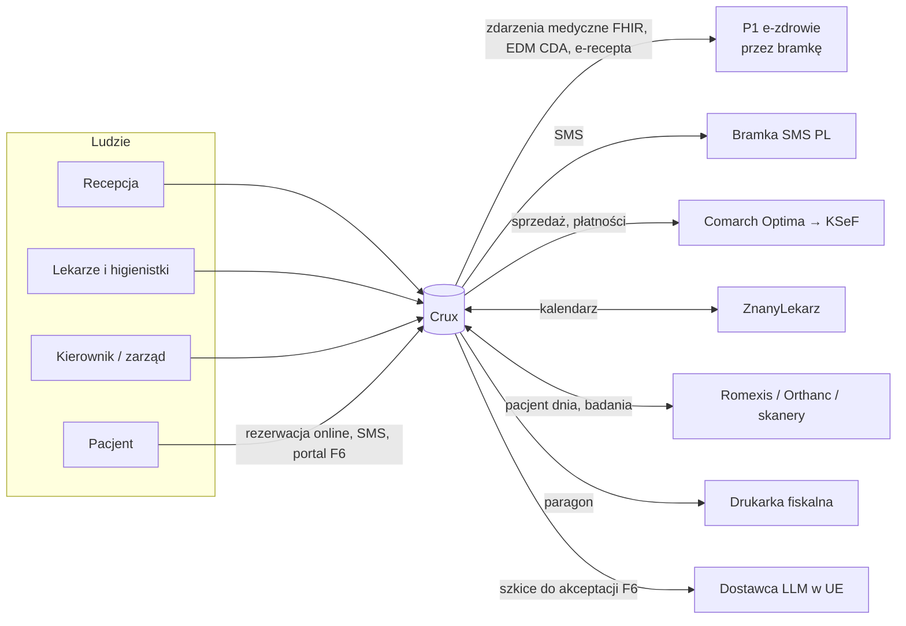
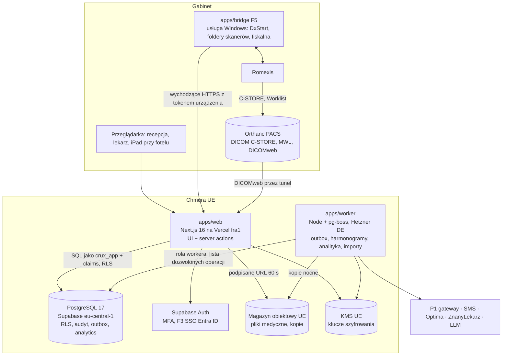
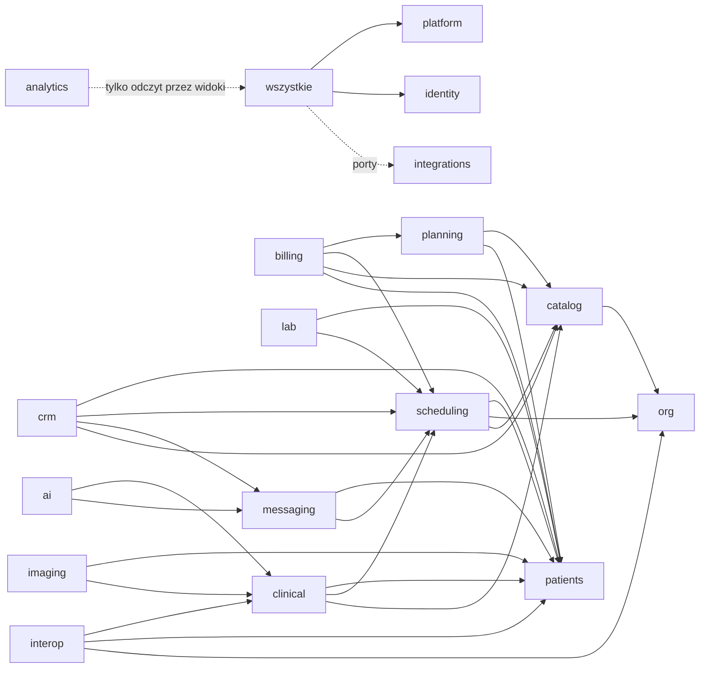
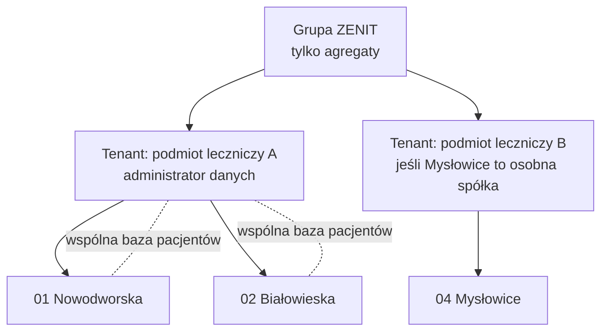

# 01 · Architektura

Wersja 2.1 · 6 listopada 2026. Decyzje i uzasadnienia: `02-decyzje-architektoniczne.md`. Model danych: `03-model-domeny.md` i `03a-schemat-bazy.md`. Co z tego wchodzi w wydanie 1.0 (bez danych pacjentów): kolumna „Faza” w sekcji 4 i `07`, sekcja 2.

## 1. Styl w jednym akapicie

Crux to **modularny monolit** w TypeScript. Jedna aplikacja webowa (Next.js 16), jeden proces roboczy (worker w Node) i od F5 lokalny agent w gabinetach korzystają z tych samych modułów domenowych w monorepo. Każdy moduł odpowiada jednemu obszarowi domeny (bounded context) i ma wewnątrz architekturę heksagonalną: czysta domena, przypadki użycia, adaptery. Danych pilnuje PostgreSQL: więzy, polityki RLS, triggery audytu, tabele tylko do dopisywania. Integracje zewnętrzne idą przez porty i outbox, więc awaria P1, SMS czy Romexis nigdy nie blokuje recepcji. Model wewnętrzny jest relacyjny, ale każda encja kliniczna ma mapowanie na HL7 FHIR R4 (ADR-021), więc P1 i EHDS to tylko adaptery.

**Dlaczego nie mikroserwisy:** zespół to jedna osoba plus AI. Mikroserwisy mnożą miejsca, w których AI może rozjechać kontrakt. Monolit z twardymi granicami daje te same korzyści (izolacja, wymienność) i kosztuje dziesięć razy mniej. Granice są narysowane tak, że obrazowanie lub analitykę da się kiedyś wyciąć bez przepisywania reszty.

## 2. Kontekst systemu (C4, poziom 1)



## 3. Kontenery (C4, poziom 2)



## 4. Moduły (bounded contexts)

| Moduł | Pakiet | Odpowiada za | Główne agregaty | Faza |
|---|---|---|---|---|
| Platforma | `@crux/platform` | audyt, log dostępu, outbox, zdarzenia domenowe, flagi funkcji, ustawienia, integralność łańcuchów | AuditEvent, AccessLog, OutboxMessage, FeatureFlag | F0 |
| Tożsamość i dostęp | `@crux/identity` | personel, role, uprawnienia, członkostwa w gabinetach, sesje, break-glass | StaffMember, Membership, Role, Permission | F0 |
| Organizacja | `@crux/org` | podmioty lecznicze, gabinety, fotele, godziny pracy, zasoby (sprzęt), cenniki bazowe | Tenant, Location, Chair, OpeningHours, PriceList | F0 |
| Pacjenci | `@crux/patients` | dane osobowe, kontakty, opiekunowie, upoważnienia, duplikaty, numer karty | Patient, Guardian, Authorization, MergeRecord | F1 |
| Terminarz | `@crux/scheduling` | obłożenie foteli (1.0: wpisy godzinowe bez pacjenta, blokady foteli, zamknięcie dnia), grafiki, dostępność, wizyty, lista oczekujących, rezerwacje online | ChairOccupancy, DayClosure, TimeBlock (1.0); Appointment, ProviderSchedule, WaitlistEntry (1.1) | F0 (obłożenie, moduł wzorcowy), F1 (wizyty) |
| Komunikacja | `@crux/messaging` | przypomnienia, potwierdzenia, szablony, zgody kanałowe, skrzynka odpowiedzi | Message, Template, ChannelConsent | F1 |
| Katalog i cennik | `@crux/catalog` | usługi, kategorie Z1–Z+, czasy, cenniki wersjonowane, wyjątki per gabinet | Service, ServiceCategory, PriceListVersion | F1 (minimalny: usługi i kategorie dla terminarza), F2 (cennik) |
| Plany leczenia | `@crux/planning` | plany, warianty, etapy, kosztorysy, akceptacja | TreatmentPlan, Variant, Estimate, Acceptance | F2 |
| Finanse | `@crux/billing` | należności, płatności, alokacje, storna, paragony, faktury, rozliczenia wykonawców | Charge, Payment, Allocation, Receipt, ProviderSettlement | F2 |
| Laboratorium | `@crux/lab` | pracownie, zlecenia, terminy, koszty | DentalLab, LabOrder | F0-001, realizacja w 1.1 (wymaga pacjentów) |
| CRM | `@crux/crm` | recall, kampanie, źródła pacjentów, zadania kontaktowe | RecallRule, RecallTask, Campaign | F3 |
| Analityka | `@crux/analytics` | schemat gwiazdy, metryki jako kod, zasilanie, eksporty | fakty i wymiary (bez agregatów domenowych) | F0 (1.0: obłożenie i przychód z wpisów), F3 (pełny) |
| Dokumentacja kliniczna | `@crux/clinical` | wizyty kliniczne, wpisy, wersje, podpisy, rozpoznania, procedury, odontogram, zgody, załączniki, udostępnienia | Encounter, ClinicalEntry, EntryVersion, Diagnosis, Procedure, Consent, DisclosureRecord | F4 |
| Interoperacyjność | `@crux/interop` | mapowanie domena ↔ FHIR R4 / HL7 CDA, generatory dokumentów EDM, eksport EEHRxF | DocumentBundle (wartość) | F4 |
| Obrazowanie | `@crux/imaging` | indeks badań DICOM, skany 3D, powiązania z zębami, podgląd | ImagingStudy, ScanFile | F5 |
| Integracje | `@crux/integrations` | porty i adaptery: P1, SMS, Optima, ZnanyLekarz, fiskalna, Orthanc, agent | IntegrationLog, DeviceToken | F0+ |
| AI | `@crux/ai` | `LlmPort`, szkice do akceptacji, transkrypcja, ocena jakości | AiDraft | F6 |

**Kierunki zależności** (strzałka = „może zależeć od”; reszta zabroniona i egzekwowana lintem oraz `dependency-cruiser`):



Reakcja modułu „niżej” na coś z modułu „wyżej” wyłącznie przez **zdarzenie domenowe** zapisane w outboxie (np. `scheduling` publikuje `appointment.completed`, `crm` tworzy z niego zadanie recall, `billing` otwiera rozliczenie wizyty).

## 5. Budowa modułu

```
packages/modules/scheduling/
  src/
    domain/              # typy, encje, reguły. Zero I/O, zero frameworków, czas z ctx.clock
      appointment.ts
      appointment.rules.ts
      appointment.rules.test.ts
      slot-search.ts     # usługa domenowa: szukanie wolnych terminów w sieci
    application/         # przypadki użycia: komendy i zapytania
      book-appointment.ts
      book-appointment.test.ts     # integracyjny, z bazą testową i RLS
      move-appointment.ts
      find-free-slots.ts
      list-day-schedule.ts
    infrastructure/      # repozytoria (Drizzle), adaptery, mapowanie wierszy na domenę
      appointment.repository.ts
      schedule.read-model.ts
    events.ts            # zdarzenia publikowane przez moduł (typy + schematy Zod)
    permissions.ts       # uprawnienia definiowane przez moduł
    index.ts             # JEDYNY publiczny interfejs modułu
  package.json           # name: @crux/scheduling
  README.md              # 10 linii: co moduł robi, czego nie robi, od czego zależy
```

Ekrany żyją w `apps/web/app/(app)/…`, komponenty specyficzne dla funkcji w `apps/web/features/<moduł>/`, komponenty ogólne w `packages/ui`. Generator (`pnpm gen module`) tworzy ten szkielet razem z testem RLS i wpisem w `dependency-cruiser` (ADR-029).

## 6. Przepływ żądania (komenda)

```mermaid
sequenceDiagram
  participant UI as Komponent React
  participant SA as Server action
  participant UC as Przypadek użycia
  participant D as Domena
  participant DB as PostgreSQL (RLS)
  participant OB as Outbox
  UI->>SA: dane formularza
  SA->>SA: Zod, requireActor()
  SA->>UC: bookAppointment(ctx, actor, input)
  UC->>UC: authorize(actor, 'appointment.create', { locationId })
  UC->>D: reguły: godziny pracy, grafik, czas usług, kompetencje wykonawcy, sprzęt fotela
  UC->>DB: BEGIN; set local role; set local claims; INSERT
  DB-->>DB: EXCLUDE (fotel, czas), EXCLUDE (wykonawca, czas), trigger audytu
  UC->>OB: INSERT outbox('appointment.booked', { appointmentId })
  UC->>DB: COMMIT
  UC-->>SA: Result.ok(appointment)
  SA-->>UI: updateTag('schedule:<location>:<day>') + wynik
```

Zasady:
- Przypadek użycia zwraca `Result<T, DomainError>`; wyjątki tylko dla awarii technicznych.
- Jedna komenda = jedna transakcja; zdarzenia zapisują się do outboxa w tej samej transakcji, więc nie istnieje stan „wizyta zapisana, SMS zgubiony”.
- Zapytania (odczyt) mogą pomijać domenę i czytać z modeli odczytu (CQRS w wersji lekkiej). Dashboardy czytają wyłącznie ze schematu `analytics`.
- Idempotencja: komendy przyjmują `commandId` (UUID z klienta); powtórka z tym samym `commandId` zwraca pierwotny wynik (tabela `platform.command_log`). Chroni przed podwójnym kliknięciem i ponowieniem po utracie łączności.

## 7. Wielogabinetowość i wielopodmiotowość



- **Tenant** = podmiot leczniczy z RPWDL = administrator danych. Pacjent, dokumentacja, płatności należą do tenanta.
- **Location** = gabinet z numerem `01`, `02`… i kodem resortowym. Numer nie przechodzi na inny gabinet.
- W tenancie pacjent jest widoczny we wszystkich gabinetach; wizytę można umówić w każdym; lekarz może pracować w kilku.
- Między tenantami **nie ma** wymiany danych osobowych bez formalnego udostępnienia. Grupa widzi tylko agregaty z `analytics` bez kolumn identyfikujących.
- Otwarta kwestia (prawnik, `04`, pytanie 8): czy 03 i 04 będą w tym samym podmiocie. Model obsługuje oba warianty bez migracji.

## 8. Sieć jako jeden organizm: co znaczy „pełna integracja między gabinetami”

To jest lista mechanizmów, które sprawiają, że cztery gabinety działają jak jeden. Każdy ma właściciela w module i fazę.

| Mechanizm | Jak działa | Moduł | Faza |
|---|---|---|---|
| Jedna kartoteka pacjenta | pacjent raz w tenancie; numer karty `ZS-000123` wspólny; gabinet „macierzysty” tylko do raportów | patients | F1 |
| Terminarz sieci | kolumny foteli z dowolnej liczby gabinetów na jednym ekranie; filtr „mój gabinet / wszystkie”; przeciągnięcie wizyty między gabinetami z potwierdzeniem i SMS | scheduling | F1 |
| Najbliższy wolny termin w sieci | `findFreeSlots(service, {locations: all})` zwraca sloty posortowane po czasie z odległością gabinetu; recepcja proponuje pacjentowi inny gabinet, gdy własny jest pełny | scheduling | F1 |
| Wspólna lista oczekujących | pacjent zapisany na wcześniejszy termin w dowolnym gabinecie lub w wybranych | scheduling | F1 |
| Lekarz w kilku gabinetach | jeden `staff_member`, wiele `memberships` z grafikami per gabinet; więz wykluczający nie pozwala być w dwóch miejscach naraz | identity, scheduling | F1 |
| Jeden standard usług i cen | katalog usług i kolornik Z1–Z+ wspólne; cennik bazowy tenanta z wyjątkami per gabinet, wersjonowany z datą obowiązywania | catalog | F2 |
| Plan leczenia realizowany w dowolnym gabinecie | pozycja planu nie jest przypisana do gabinetu; procedura wykonana w 02 realizuje pozycję z planu przedstawionego w 01 | planning, clinical | F2/F4 |
| Saldo pacjenta w sieci | należności i płatności na poziomie tenanta; raport „kto gdzie zapłacił” per gabinet | billing | F2 |
| Obłożenie i przychód na godzinę fotela na jednej definicji | wpisy godzinowe per fotel (1.0), potem wizyty (1.1); `fact_chair_occupancy` niezależnie od źródła; porównanie 01 vs 02 od pierwszego tygodnia | scheduling, analytics | F0 |
| Zlecenia laboratoryjne widoczne tam, gdzie wraca praca | zlecenie ma gabinet wysyłki i gabinet wizyty oddania (mogą się różnić) | lab | F1/F2 |
| Recall niezależny od gabinetu | zadanie recall proponuje najbliższy termin w sieci, preferując gabinet macierzysty | crm | F3 |
| Pulpit sieci | porównanie gabinetów w stałych kolorach, jedna definicja metryk | analytics | F0 (1.0: 7 metryk), F3 (pełny) |
| Jedna dokumentacja | wpisy z każdego gabinetu w jednej karcie; nagłówek wpisu zawiera gabinet i kod resortowy (wymóg § 10 rozporządzenia) | clinical | F4 |
| Badania obrazowe z każdego gabinetu w jednej karcie | indeks badań z czterech Orthanców pod jednym pacjentem | imaging | F5 |
| Szablony i ustawienia centralne | szablony wpisów, zgód, SMS, cenniki: edycja raz, obowiązują wszędzie, z możliwością wyjątku per gabinet | platform | F0+ |
| Jedno logowanie, wiele gabinetów | przełącznik gabinetu w pasku bocznym; uprawnienia per gabinet | identity | F0 |

## 9. Dostęp do danych i RLS (obrona w głąb)

1. **Aplikacja:** `authorize(actor, permission, scope)` w każdym przypadku użycia sprawdza rolę i członkostwo w gabinecie. Uprawnienia są danymi (`identity.permissions`) sprawdzanymi w jednym miejscu.
2. **Baza:** RLS na każdej tabeli. Serwer łączy się jako `crux_app`, w każdej transakcji `set local role authenticated` i `set local request.jwt.claims` (identyfikator personelu, tenant, lista gabinetów, rola). Polityki porównują `tenant_id` i `location_id` z claimami przez funkcje `auth.tenant_id()`, `auth.location_ids()`, `auth.has_permission(text)`. Nawet jeśli AI zapomni o `where tenant_id = …`, baza nie odda cudzych danych.
3. **Brak bocznych drzwi:** Data API Supabase wyłączone (ADR-020). Klucz workera ma rolę `crux_worker` z listą dozwolonych operacji w `apps/worker/src/privileged.ts` i własnym audytem.
4. **Test:** każda tabela ma test pgTAP „użytkownik tenanta A nie widzi i nie zmieni wiersza tenanta B” oraz, dla tabel z `location_id`, „użytkownik gabinetu 01 bez członkostwa w 02 nie widzi wiersza z 02”, z wyjątkiem danych pacjenta współdzielonych w tenancie (lista w `03a`).

## 10. Dane kliniczne i finansowe: tylko dopisywanie

- `clinical_entries` + `clinical_entry_versions`: wersja podpisana jest niezmienna; korekta to nowa wersja z `correction_reason`; `content_hash = sha256(prev_hash || canonical_json)` w łańcuchu per pacjent; worker weryfikuje łańcuchy co noc (`audit.integrity_checks`).
- Odontogram jest **projekcją** z rozpoznań i procedur (`odontogramAt(patientId, date)`): stan zęba na dowolny dzień da się odtworzyć.
- Płatności, paragony, faktury, rozliczenia: korekta to storno (nowy rekord z ujemną kwotą i odwołaniem), nigdy `UPDATE amount`.
- Plany leczenia po akceptacji mają zamrożone ceny; akceptacja przechowuje przedstawiony kosztorys (PDF + skrót w łańcuchu).

## 11. Zdarzenia, outbox i zadania w tle

- `platform.outbox` (`id`, `tenant_id`, `topic`, `payload jsonb` z identyfikatorami, `status`, `attempts`, `next_attempt_at`, `dedupe_key`). Adapter dociąga dane w chwili wysyłki.
- Worker (pg-boss) obsługuje: wysyłkę outboxa, przypomnienia SMS (48 h z prośbą o potwierdzenie, 2 h krótkie), recall, zasilanie `analytics` (co 5 min przyrost, nocą pełne), weryfikację łańcuchów, kopie nocne, eksport do Optimy, raport „Koniec dnia”, importy.
- Ponowienia z wykładniczym odstępem; po 8 próbach status `dead` i zadanie dla człowieka w ekranie „Integracje” (lista z powodem i przyciskiem „ponów”).
- Zdarzenia mają schemat Zod i wersję (`appointment.completed.v1`); zmiana kształtu = nowa wersja, stare konsumenty działają.

## 12. Analityka i dashboardy

- Dashboardy nie liczą metryk z tabel operacyjnych. Czytają ze schematu `analytics` (ADR-027), odświeżanego przez worker. Na ekranie widać czas ostatniego odświeżenia.
- Każda metryka ma: definicję słowną i SQL w `@crux/analytics/metrics`, test na zestawie wzorcowym, wpis w rejestrze (`11-dashboardy-i-raporty.md`), drążenie do listy rekordów.
- Filtry globalne w URL (`?okres=30d&gabinet=01&wykonawca=…&kategoria=Z5`), więc widok da się wysłać linkiem; uprawnienia filtrują, co widać (lekarz: tylko swoje wyniki; kierownik: gabinet; zarząd: sieć).

## 13. Środowiska, wdrożenie, koszty

| Środowisko | Baza | Dane | Kto |
|---|---|---|---|
| lokalne | Supabase CLI (Docker) + Orthanc w Dockerze (F5) | fabryki | programista, Cursor |
| podgląd (PR) | gałąź Supabase | fabryki | automatycznie z PR |
| staging | projekt `crux-staging`, Frankfurt | syntetyczne, wolumen jak produkcja | testy akceptacyjne z recepcją |
| produkcja | projekt `crux-prod`, Frankfurt, PITR | prawdziwe | gabinety |

Domeny (ADR-033): produkcja `https://crux.zenitstomatologia.pl`, staging `https://crux-staging.zenitstomatologia.pl` (hasło Vercel), podglądy PR `*.vercel.app` z ochroną dostępu. Domena główna `zenitstomatologia.pl` to strona dla pacjentów (osobny deploy, marka zenit.stomatologia); `zenitstomatologia.com` przekierowuje na `.pl`. Rezerwacja online (1.1) dla pacjenta pod `zenitstomatologia.pl/rezerwacja` przez rewrite do `(public)/rezerwacja`. Webhooki: `crux.zenitstomatologia.pl/api/webhooks/<dostawca>`. Worker bez publicznej domeny.

- Migracje: `drizzle-kit generate` → przegląd → `pnpm db:test` → staging → produkcja przez CI; zawsze expand → migrate → contract; wdrożenia produkcyjne po 20:00 do czasu potwierdzenia migracji bez przestojów.
- Szacunek kosztów miesięcznych infrastruktury (USD/PLN, listopad 2026, bez pracy ludzi): Supabase Pro 25 + PITR 100 + compute 15–60 = 140–185 USD (Team od F4: +574 USD); Vercel Pro ~20 USD; serwer workera Hetzner 10–30 €; magazyn obiektowy 5–20 €; SMS ok. 0,07–0,10 zł/szt. (ok. 3 000 SMS/mies. dla 4 gabinetów = 200–300 zł); Sentry 0–26 USD; bramka P1 (F4): na zapytanie; KMS: kilka USD. **Razem do F3: ok. 1 000–1 500 zł/mies.; od F4: ok. 3 500–4 500 zł/mies. plus bramka P1.**

## 14. Wymagania niefunkcjonalne

| Obszar | Cel |
|---|---|
| Dostępność | 99,5% w godzinach pracy gabinetów (pn–sb 7:00–21:00) |
| Odtworzenie | RPO ≤ 5 min (PITR), RTO ≤ 4 h; test odtworzenia raz na kwartał na czystym Postgresie |
| Wydajność | ekran dnia < 1 s, wyszukiwanie pacjenta < 300 ms, dashboard < 1,5 s (p95); budżet JS ekranów roboczych < 300 kB |
| Bezpieczeństwo | MFA dla wszystkich; sesja 12 h; blokada ekranu po 5 min; break-glass z powodem |
| Awaria internetu | PWA tylko do odczytu (lista dnia), łącze LTE zapasowe, procedura papierowa (ADR-023) |
| Przechowywanie | dokumentacja 20 lat od ostatniego wpisu; eksport całości w każdej chwili (§ 1 ust. 6 pkt 8) |
| Dostępność cyfrowa | WCAG 2.2 AA, pola dotyku min. 44 px, pełna klawiatura |
| Przeglądarki | Chrome, Edge, Safari (iPad) w dwóch ostatnich wersjach |
| Skala docelowa | 4 gabinety, 16 foteli, 25 użytkowników, ok. 60 tys. wizyt rocznie, ok. 2 TB obrazów rocznie w Orthanc (CBCT) |

## 15. Jak system rośnie bez psucia (punkty rozszerzeń)

- **Nowy gabinet:** rekord `locations` + fotele + godziny + członkostwa + wyjątki cennika. Zero kodu. Szablon „nowy gabinet” w F6 to tylko kreator.
- **Nowy podmiot (tenant):** rekord `tenants` + DEK w KMS + bucket w magazynie. Zero kodu.
- **Nowa integracja:** port w `@crux/integrations/ports` + adapter + atrapa do testów + temat outboxa. Moduły domenowe nie zmieniają się.
- **Nowa metryka:** plik w `@crux/analytics/metrics` + test + wpis w rejestrze. Dashboard dostaje kafel przez konfigurację.
- **Nowy rodzaj dokumentu EDM:** szablon w `@crux/interop` (CDA) + typ wpisu klinicznego. Model `clinical_entries` się nie zmienia.
- **Nowa funkcja AI:** przypadek użycia w `@crux/ai` korzystający z `LlmPort`, z wynikiem typu `AiDraft` do akceptacji.
- **Zmiana zasady:** ADR + aktualizacja `AGENTS.md`/reguł Cursora w tym samym PR, inaczej `pnpm doctor` zawodzi na niespójności (rejestr reguł ma sumę kontrolną).
