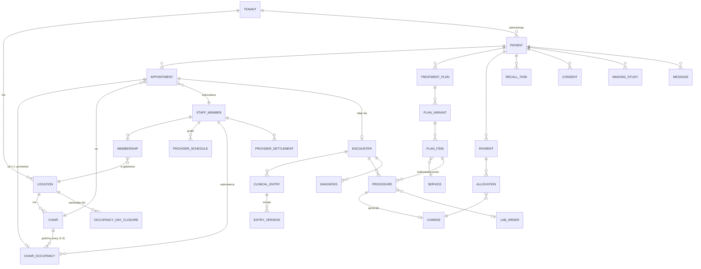
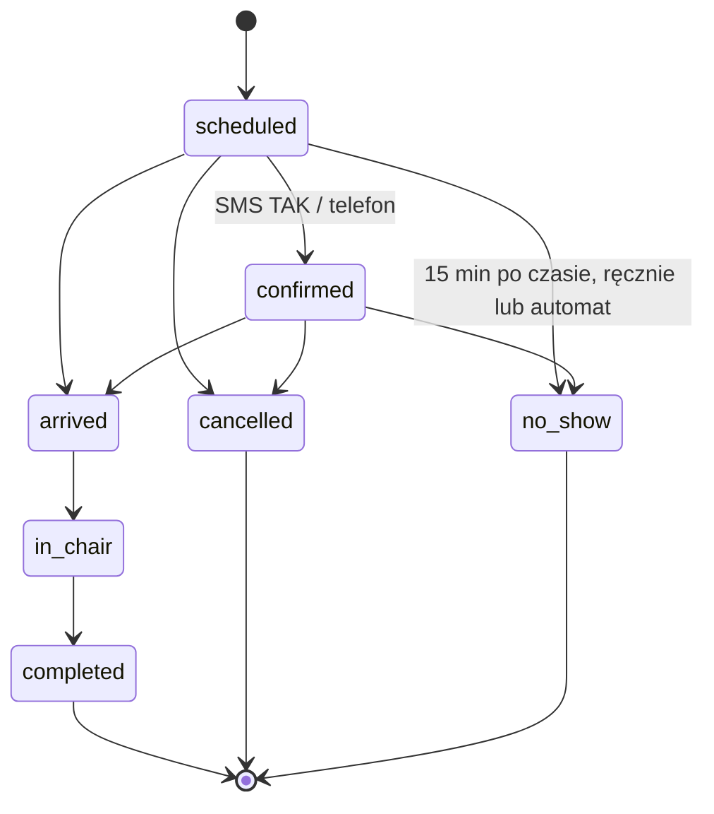

# 03 · Model domeny

Wersja 2.1 · 6 listopada 2026. Wiążący słownik i model pojęciowy. Schemat tabel na poziomie DDL: `03a-schemat-bazy.md`. Zanim dodasz tabelę lub pole, sprawdź, czy pojęcie już tu jest. Jeśli nie ma, dopisz je w tym samym PR.

## 1. Słownik PL ↔ EN

| Pojęcie (PL) | W kodzie (EN) | Definicja |
|---|---|---|
| podmiot leczniczy | `tenant` | podmiot wpisany do RPWDL, administrator danych pacjentów |
| gabinet | `location` | miejsce udzielania świadczeń z numerem `01`, `02`… i kodem resortowym; w UI „01 Nowodworska” (numer i ulica, bez „nr”, „#”, „Gabinet 1”; numeracja i kolory: `14`, sekcja 4) |
| sieć / grupa | `group` | poziom właścicielski, widzi tylko agregaty |
| fotel, stanowisko | `chair` | zasób, na którym odbywa się wizyta; ma wyposażenie (`equipment`: RVG, CBCT, mikroskop, skaner) |
| personel | `staff_member` | osoba z kontem w systemie |
| członkostwo | `membership` | przypisanie personelu do gabinetu z rolą i okresem |
| lekarz dentysta | `dentist` (rola), `provider` (wykonawca świadczenia) | ma NPWZ |
| higienistka stomatologiczna | `hygienist` | wykonawca świadczeń higienizacyjnych |
| asystentka | `assistant` | pomoc przy fotelu, zlecenia, zgody |
| recepcja | `receptionist` | rejestracja, płatności |
| kierownik gabinetu | `location_manager` | grafiki, rozliczenia, pulpit gabinetu |
| zarząd | `network_admin` | konfiguracja sieci, pulpit sieci |
| pacjent | `patient` | osoba, której dotyczy dokumentacja |
| numer karty | `patient_number` | krótki, stały identyfikator w tenancie, np. `ZS-000123`; używany w Romexis i na dokumentach |
| opiekun prawny | `guardian` | przedstawiciel ustawowy |
| upoważnienie | `patient_authorization` | osoba upoważniona do informacji lub dokumentacji |
| scalanie | `merge` | połączenie duplikatów; rekord scalany dostaje `merged_into_id` |
| grafik wykonawcy | `provider_schedule` | okresy pracy wykonawcy w gabinecie (reguła cykliczna + wyjątki) |
| blokada czasu | `time_block` | czas niedostępny na fotelu lub u wykonawcy (urlop, przerwa, serwis); od 1.0 dla foteli, od 1.1 także dla wykonawców |
| wpis obłożenia | `chair_occupancy` (encja `OccupancyEntry`) | godzina (w 1.0 pełna) pracy fotela: wykonawca, kategoria Z, opcjonalna kwota; bez pacjenta; w 1.0 wpisywany ręcznie, od 1.1 także pochodna wizyty (`source = appointment`) |
| zamknięcie dnia | `occupancy_day_closure` | potwierdzenie przez recepcję lub kierownika, że wpisy obłożenia dnia w gabinecie są kompletne; po zamknięciu zmiana wymaga uprawnienia i powodu |
| tryb obłożenia | `occupancy_mode` | ustawienie per gabinet: `manual` (wpisy ręczne, 1.0) albo `appointments` (obłożenie liczone z wizyt, po przejściu gabinetu na terminarz Crux) |
| wydanie | `release` | numerowana wersja Crux wdrożona w gabinetach (1.0 „Krasnodrzew”, 1.1 „Ratania”…); `07`, sekcja 2 |
| wizyta (w terminarzu) | `appointment` | zarezerwowany czas na fotelu u wykonawcy |
| wolny termin | `slot` | wynik wyszukiwania: fotel, wykonawca, początek, koniec, gabinet; **nie** nazwa encji (godzina obłożenia to `chair_occupancy`) |
| lista oczekujących | `waitlist_entry` | pacjent chcący wcześniejszy termin, z preferencjami gabinetów i dni |
| wiadomość | `message` | SMS/e-mail do pacjenta z szablonu, ze statusem doręczenia |
| zgoda kanałowa | `channel_consent` | zgoda na SMS/e-mail marketingowy; przypomnienia nie wymagają zgody |
| usługa (katalog) | `service` | pozycja katalogu z kategorią Z1–Z+, czasem trwania i wymaganiami (sprzęt, rola) |
| kategoria usługi | `service_category` | kolornik marki: Z1, Z2, Z3, Z4, Z5, Z+ |
| cennik | `price_list` | wersjonowane ceny usług tenanta z datą obowiązywania i wyjątkami per gabinet |
| wizyta kliniczna | `encounter` | zdarzenie kliniczne, w którym powstają wpisy; zwykle z `appointment` |
| wpis w dokumentacji | `clinical_entry` | jednostka dokumentacji; ma wersje |
| wersja wpisu | `entry_version` | niezmienna treść z podpisem wewnętrznym i skrótem |
| rozpoznanie | `diagnosis` | kod ICD-10 + opis, opcjonalnie ząb i powierzchnie |
| procedura / świadczenie | `procedure` | wykonana czynność: usługa + ząb + powierzchnie + kod ICD-9 PL |
| ząb | `tooth` | notacja FDI (11–48 stałe, 51–85 mleczne) |
| powierzchnia | `surface` | M, O, D, B (V), L (P), I |
| odontogram | `odontogram` | projekcja stanu zębów na dzień z rozpoznań i procedur |
| plan leczenia | `treatment_plan` | warianty → etapy → pozycje |
| kosztorys | `estimate` | wycena wariantu przedstawiona pacjentowi (PDF + skrót) |
| akceptacja planu | `plan_acceptance` | zgoda pacjenta na wariant i cenę |
| zgoda na zabieg | `consent` | podpisany formularz (wersja szablonu + podpis + PDF + skrót) |
| udostępnienie dokumentacji | `disclosure` | komu, co, kiedy, w jakiej formie, na jakiej podstawie |
| należność | `charge` | kwota do zapłaty za procedurę lub usługę |
| płatność | `payment` | wpłata (gotówka, karta, przelew, raty) |
| alokacja | `allocation` | przypisanie płatności do należności |
| storno | `reversal` | rekord odwracający płatność lub należność |
| paragon | `receipt` | dokument fiskalny z kasy |
| faktura | `invoice` | wystawiana w Optimie (KSeF) na podstawie danych z Crux |
| rozliczenie wykonawcy | `provider_settlement` | miesięczne wynagrodzenie wykonawcy (stawka, potrącenia) |
| pracownia protetyczna | `dental_lab` | zewnętrzna pracownia |
| zlecenie do pracowni | `lab_order` | praca protetyczna z terminem i kosztem |
| reguła recall | `recall_rule` | usługa → odstęp (np. Z1 co 6 mies.) |
| zadanie recall | `recall_task` | zaproszenie pacjenta na wizytę cykliczną |
| nieobecność | `no_show` | status wizyty: pacjent nie przyszedł bez odwołania |
| źródło pacjenta | `acquisition_source` | skąd przyszedł (ZnanyLekarz, Google, polecenie, strona) |
| zdarzenie medyczne | `medical_event_report` | komunikat FHIR do P1 o udzielonym świadczeniu |
| dokument EDM | `edm_document` | dokument CDA z katalogu EDM, podpisany i zaindeksowany w P1 |
| badanie obrazowe | `imaging_study` | badanie DICOM (StudyInstanceUID) w Orthanc, indeksowane w Crux |
| skan 3D | `scan_file` | plik STL/PLY/OBJ ze skanera przypięty do pacjenta |
| urządzenie (agent) | `device` | stanowisko z lokalnym agentem i tokenem |
| szkic AI | `ai_draft` | wynik modelu do akceptacji przez człowieka |

Zakazane synonimy (lint, `crux-doctor`): `visit` (użyj `appointment` albo `encounter`), `clinic`/`branch` (`location`), `customer`/`client` (`patient`), `doctor` jako rola (`dentist`), `treatment` jako pozycja planu (`plan_item`), `bill` (`charge`/`invoice`).

## 2. Mapa encji

## 3. Agregaty i niezmienniki

### Patient (`@crux/patients`)
- Pola: `patient_number`, imiona, nazwisko, data urodzenia, płeć, PESEL (zaszyfrowany + HMAC) lub typ i numer innego dokumentu (zaszyfrowany), adres, telefon (E.164), e-mail, preferowany kanał i język kontaktu, opiekunowie, upoważnienia, źródło pozyskania, gabinet macierzysty (tylko do raportów), `imaging_id` (= `patient_number`), flagi: `deceased_at`, `merged_into_id`.
- Niezmienniki: PESEL unikalny w tenancie (po HMAC); data urodzenia i płeć zgodne z PESEL; małoletni (< 18) musi mieć opiekuna do podpisu zgód (od 16 lat zgoda łączna); telefon w E.164.
- Duplikaty: przy zakładaniu wyszukiwanie „podobnych” (trigram na nazwisko + data urodzenia lub telefon); scalanie to osobna komenda z audytem; nic nie jest kasowane; wszystkie referencje wskazują na rekord docelowy przez widok `patients_resolved`.

### ChairOccupancy (`@crux/scheduling`, od 1.0)
- Pola: gabinet, fotel, wykonawca (opcjonalny), `period tstzrange` (w 1.0 UI wpisuje pełne godziny lokalne; baza dopuszcza dowolny zakres, żeby w 1.1 wpisy pochodne z wizyt miały rzeczywisty czas), kategoria Z1–Z+, kwota w groszach (opcjonalna: przychód zrealizowany przypisany do wpisu), `source` (`manual`, `appointment`, `import`), `appointment_id` (od 1.1), notatka organizacyjna ≤ 80 znaków, `voided_at` + `void_reason`.
- Niezmienniki: brak nakładania wpisów nieunieważnionych na fotelu (`EXCLUDE USING gist`); wpis w godzinach otwarcia gabinetu z wyjątkami (nadpisanie przez kierownika z powodem); wpis nie wchodzi w blokadę fotela; kwota ≥ 0; notatka nie zawiera danych pacjenta (`containsPii`, test); wpis w dniu zamkniętym zmienia tylko `occupancy.write_closed` z powodem; wpisy zostają na zawsze, a korekta to unieważnienie z powodem.
- Zamknięcie dnia (`DayClosure`): jedno na gabinet i dzień; zapisuje podsumowanie (godziny, kwota, fotele bez wpisów) i blokuje zwykłą edycję; „otwórz ponownie” z powodem.
- Przejście do 1.1: gabinet w trybie `appointments` nie przyjmuje wpisów ręcznych dla dni po dacie przełączenia; obłożenie liczy się z wizyt (statusy inne niż `cancelled`/`no_show`), a `chair_occupancy` dostaje wiersze pochodne `source = appointment` dla ciągłości historii. Definicja metryki `chair_utilization` nie zmienia się (`11`, sekcja 4.2).

### Appointment (`@crux/scheduling`)
- Pola: pacjent (opcjonalny dla blokad), gabinet, fotel, wykonawca, opcjonalnie asystentka, `period tstzrange`, usługi planowane (`service_ids[]`), kategoria główna (kolor), status, źródło rezerwacji, notatka recepcji (bez danych medycznych), `late_cancellation`, `confirmed_via`.
- Statusy i przejścia:

- Niezmienniki: brak nakładania na fotelu i u wykonawcy (`EXCLUDE USING gist`); wizyta w godzinach pracy gabinetu i w grafiku wykonawcy (reguła domenowa z nadpisaniem przez kierownika z powodem); wykonawca ma kompetencje do kategorii usługi (`provider_capabilities`); fotel ma wymagany sprzęt; anulowanie < 24 h przed wizytą ustawia `late_cancellation`.
- Usługa domenowa `findFreeSlots(criteria)`: wejście: usługi (czas = suma czasów + bufor), zakres dat, gabinety (domyślnie wszystkie w tenancie), wykonawca (opcjonalnie), preferencje pacjenta; wyjście: sloty posortowane po czasie, z gabinetem i odległością od gabinetu macierzystego. Liczy się z grafików, blokad i wizyt w jednym zapytaniu (`generate_series` + `tstzrange` minus zajęte).

### Encounter i ClinicalEntry (`@crux/clinical`)
- Encounter otwiera się przy `in_chair` lub ręcznie; zamknięcie wymaga ≥ 1 wpisu podpisanego i wykonawcy z NPWZ; zamknięcie publikuje `encounter.closed` → zdarzenie medyczne do P1.
- ClinicalEntry: typ (`history`, `examination`, `diagnosis`, `procedure_note`, `recommendation`, `imaging_report`, `attachment_note`, `referral`, `prescription`), autor, `occurred_at`, `recorded_at`; wersje w `entry_versions` (treść strukturalna JSON + tekst, `signed_by`, `signed_at`, `content_hash`, `prev_hash`, `correction_reason`). Typ `imaging_report` to dokument EDM (opis badania diagnostycznego): generuje CDA i indeks w P1.
- Procedure: `service_id`, `tooth` (FDI), `surfaces[]`, kod ICD-9 PL, wykonawca, materiał, `plan_item_id`, `encounter_id`.
- Diagnosis: ICD-10, ząb, powierzchnie, opis, status (`active`, `resolved`), `encounter_id`.

### Odontogram (projekcja)
- `odontogramAt(patientId, date)` składa stan z rozpoznań i procedur. Stany: `sound`, `caries`, `filling`, `root_canal`, `crown`, `bridge_abutment`, `pontic`, `implant`, `missing`, `extraction_planned`, `unerupted`, `sealant`, `veneer`, `fracture`, `mobility`.
- Odontogram nie ma „zapisz”. Każda zmiana to rozpoznanie albo procedura we wpisie klinicznym. Stan historyczny (import z poprzedniego programu) to wpis typu `examination` z datą importu i adnotacją źródła.

### TreatmentPlan (`@crux/planning`)
- Plan → warianty → etapy → pozycje (`service_id`, ząb, powierzchnie, cena z cennika, rabat, cena końcowa, `status`: `planned`, `scheduled`, `done`, `dropped`).
- Statusy planu: `draft` → `presented` → `accepted` (jeden wariant) / `declined` / `expired` → `in_progress` → `completed`.
- Niezmienniki: po akceptacji ceny zamrożone; akceptacja zapisuje przedstawiony kosztorys (PDF + skrót); pozycja `done` tylko przez procedurę; kosztorys ważny domyślnie 90 dni.

### Charge, Payment, ProviderSettlement (`@crux/billing`)
- Charge: z procedury (F4 automatycznie, wcześniej przy „rozliczeniu wizyty” w recepcji). Cena z planu, jeśli procedura realizuje zaakceptowaną pozycję, inaczej z cennika obowiązującego w dniu świadczenia.
- Payment: kwota, metoda, data, gabinet, przyjmujący, `receipt_number`, alokacje; nadpłata to saldo (zaliczka). Storno = nowy rekord z ujemną kwotą i `reverses_id`.
- ProviderSettlement: za okres: przychód z procedur wykonawcy (wg wykonanych lub zapłaconych, zależnie od umowy w `provider_contracts`) × stawka − udział w kosztach laboratorium i materiałów. Zatwierdzone jest niezmienne; korekta to rozliczenie korygujące.

### LabOrder (`@crux/lab`)
- Pracownia, typ pracy, zęby, kolor (VITA), daty: wysłania, oczekiwanego zwrotu, przymiarki, odbioru; koszt; status (`sent`, `received`, `fitted`, `completed`, `cancelled`); `appointment_id` wizyty oddania (może być w innym gabinecie). Alert dzień przed wizytą, jeśli praca nie wróciła.

### RecallTask (`@crux/crm`)
- Reguły per usługa (Z1 co 6 mies., Z2 co 6 mies., kontrola po Z4 po 6–12 mies.). Po `appointment.completed` z usługą objętą regułą powstaje zadanie z terminem. Zamyka je: umówiona wizyta, rezygnacja, 3 nieudane kontakty. Zadanie proponuje najbliższy termin w sieci (preferencja: gabinet macierzysty).

### ImagingStudy (`@crux/imaging`)
- `study_instance_uid`, `orthanc_id`, gabinet (który Orthanc), modalność (`IO`, `PX`, `CT`), data, liczba serii/instancji, zęby (z opisu lub ręcznie), miniatura w magazynie, `report_entry_id` (wpis `imaging_report`, jeśli opisane). Piksele zostają w Orthanc.

## 4. Katalog usług i kolornik

| Kod | Kategoria | Kolor tła | Przykładowe usługi |
|---|---|---|---|
| Z1 | Przegląd i plan leczenia | `#F6F1E1` | przegląd, konsultacja, plan leczenia, RTG punktowe |
| Z2 | Higienizacja | `#EFE4C6` | skaling, piaskowanie, fluoryzacja, instruktaż |
| Z3 | Wypełnienia | `#E6D6AE` | wypełnienie 1–3 powierzchnie, odbudowa |
| Z4 | Leczenie kanałowe | `#D9C595` | leczenie jedno- i wielokanałowe, ponowne |
| Z5 | Korony i licówki | `#C9B37F` | korona, licówka, onlay, most, wkład |
| Z+ | Ortodoncja nakładkowa | `#E4ECE5` | konsultacja, nakładki, retencja |

Usługi spoza kolornika (chirurgia, implanty, protetyka ruchoma, periodontologia) dostają kategorię najbliższą lub nową, zatwierdzoną przez właściciela marki. Nie dodajemy kolorów ad hoc. Usługa ma: czas trwania domyślny, wymagane kompetencje wykonawcy, wymagany sprzęt fotela, domyślny kod ICD-9 PL, regułę recall, flagę „dostępna w rezerwacji online dla nowych pacjentów”.

## 5. Konwencje schematu bazy

- Schematy: `public` (operacyjne), `ref` (słowniki: ICD-10, ICD-9 PL, skala VITA, kody resortowe; tylko odczyt, bez `tenant_id`), `analytics`, `audit`, `platform` (outbox, flagi, command_log), `pgboss`, `auth` (Supabase).
- Tabele w liczbie mnogiej, `snake_case`. Każda tabela operacyjna: `id uuid pk default uuid_generate_v7()`, `tenant_id uuid not null`, `created_at timestamptz not null default now()`, `created_by uuid`; modyfikowalne także `updated_at`, `updated_by`; tabele tylko do dopisywania nie mają `updated_*`.
- Statusy jako `enum` w Postgresie, odzwierciedlone w TS przez Drizzle.
- Klucze obce z indeksem; `on delete restrict` dla danych pacjenta i finansów.
- Pola szyfrowane: `*_enc text` w formacie `enc:v1:…` + `*_hmac bytea` do wyszukiwania.
- Kolumny czasu: `*_at timestamptz`; daty kalendarzowe `*_on date`.

## 6. Mapowanie na HL7 FHIR R4 (ADR-021)

| Encja Crux | Zasób FHIR R4 | Uwagi do mapowania |
|---|---|---|
| `tenant` | `Organization` | identyfikator: numer księgi RPWDL, NIP, REGON |
| `location` | `Location` (+ `Organization` część) | kod resortowy cz. VII/VIII w `identifier` |
| `chair` | `Location` (physicalType `ro`) | `partOf` gabinet |
| `staff_member` + `membership` | `Practitioner` + `PractitionerRole` | NPWZ w `identifier`; rola → `code` |
| `patient` | `Patient` | PESEL w `identifier` (system PESEL), opiekun → `RelatedPerson`/`contact` |
| `patient_authorization` | `Consent` (scope `patient-privacy`) | lub `RelatedPerson` |
| `appointment` | `Appointment` + `Slot` | status mapowany 1:1 poza `in_chair` → `arrived`/`fulfilled` |
| `encounter` | `Encounter` | `class` AMB; `serviceProvider` gabinet |
| `diagnosis` | `Condition` | ICD-10 w `code`; ząb w `bodySite` (FDI, system ISO 3950) |
| `procedure` | `Procedure` | ICD-9 PL w `code`; `bodySite` ząb + powierzchnie jako rozszerzenie |
| `clinical_entry` (typ) | `Composition` / `DocumentReference` | dokument EDM = CDA zaindeksowany jako `DocumentReference` |
| `consent` | `Consent` (scope `treatment`) | PDF jako `sourceAttachment` |
| `treatment_plan` | `CarePlan` + `RequestGroup`/`ServiceRequest` | pozycje jako `activity` |
| `charge` / `invoice` | `ChargeItem` / `Invoice` | lokalne; eksport opcjonalny |
| `imaging_study` | `ImagingStudy` | `identifier` StudyInstanceUID, endpoint DICOMweb |
| `medical_event_report` | Bundle wg profilu CeZ | generowany w `@crux/interop` |

Pola bez odpowiednika w FHIR (np. `late_cancellation`, `acquisition_source`) są oznaczone w schemacie komentarzem `-- local` i nie trafiają do eksportów interoperacyjnych.

## 7. Słowniki referencyjne (`ref`)

| Tabela | Źródło | Aktualizacja |
|---|---|---|
| `ref.icd10` | CeZ / NFZ (słownik ICD-10 PL) | skrypt importu w workerze, wersjonowany |
| `ref.icd9_pl` | NFZ (ICD-9 PL, procedury stomatologiczne rozdz. 23–24 i 96–99) | jak wyżej |
| `ref.tooth_fdi` | ISO 3950 (11–48, 51–85) | statyczny |
| `ref.surfaces` | M, O, D, B, L, I | statyczny |
| `ref.vita_shades` | skala VITA Classical i 3D-Master | statyczny |
| `ref.resort_codes` | kody resortowe gabinetów tenanta (z RPWDL) | ręcznie przy zakładaniu gabinetu |
| `ref.service_templates` | startowy katalog usług wg kolornika | seed w F2 |

## 8. Role i uprawnienia (macierz startowa)

Uprawnienia są danymi (`identity.permissions`, `identity.role_permissions`); tabela jest źródłem seedu w K06 i rośnie z każdym wydaniem. Zakres: `sieć` = wszystkie gabinety tenanta, `gabinet` = gabinety z członkostwem, `własne` = tylko rekordy, w których `provider_id`/`staff_id` to użytkownik.

| Uprawnienie | network_admin | location_manager | receptionist | dentist / hygienist | assistant | accountant | auditor | Od |
|---|---|---|---|---|---|---|---|---|
| `org.manage` (gabinety, fotele, godziny) | sieć | — | — | — | — | — | — | 1.0 |
| `staff.manage` (konta, role, członkostwa) | sieć | — | — | — | — | — | — | 1.0 |
| `settings.manage` (flagi, ustawienia, cele) | sieć | — | — | — | — | — | — | 1.0 |
| `audit.read` | sieć | gabinet | — | — | — | — | sieć | 1.0 |
| `occupancy.read` | sieć | gabinet | gabinet | gabinet | gabinet | sieć | sieć | 1.0 |
| `occupancy.write` | sieć | gabinet | gabinet | — | — | — | — | 1.0 |
| `occupancy.write_own` | — | — | — | własne | — | — | — | 1.0 |
| `occupancy.void` | sieć | gabinet | gabinet (dzień otwarty) | własne | — | — | — | 1.0 |
| `occupancy.close_day` | sieć | gabinet | gabinet | — | — | — | — | 1.0 |
| `occupancy.write_closed` (edycja po zamknięciu, z powodem) | sieć | gabinet | — | — | — | — | — | 1.0 |
| `occupancy.override_hours` (poza godzinami, z powodem) | sieć | gabinet | — | — | — | — | — | 1.0 |
| `analytics.view_self` | — | — | — | własne | — | — | — | 1.0 |
| `analytics.view_location` | — | gabinet | — | — | — | — | — | 1.0 |
| `analytics.view_network` | sieć | — | — | — | — | sieć | — | 1.0 |
| `analytics.export` (CSV) | sieć | gabinet | — | — | — | sieć | — | 1.0 |
| `network.view` (przełącznik „cała sieć”) | sieć | — | — | — | — | sieć | sieć | 1.0 |
| `integrations.manage` | sieć | — | — | — | — | — | — | 1.0 |
| `patient.read` / `patient.write` / `patient.merge` | sieć | gabinet | gabinet | gabinet | gabinet (read) | — | — | 1.1 |
| `appointment.read` / `create` / `move` / `cancel` | sieć | gabinet | gabinet | gabinet (read, własne statusy) | gabinet (read) | — | — | 1.1 |
| `appointment.override_hours` | sieć | gabinet | — | — | — | — | — | 1.1 |
| `lab_order.read` / `write` / `cost` | sieć | gabinet | gabinet (read) | gabinet (read, write) | gabinet (read, write) | — | — | 1.1 |

Zasady: rola `network_admin` nie dostaje uprawnień „własne” (zarząd nie jest wykonawcą; jeśli wspólnik leczy, ma drugie członkostwo jako `dentist`). Konto `accountant` i `auditor` powstaje dopiero, gdy jest potrzebne. Każde nowe uprawnienie: wiersz tutaj + `permissions.ts` + migracja danych w tym samym PR.
