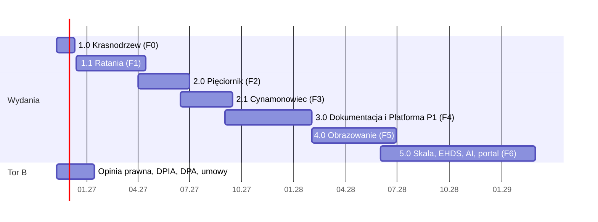

# 07 · Roadmapa produktowa

Wersja 2.1 · 6 listopada 2026. Założenia: jedna osoba prowadząca (product owner + architekt, Miłosz) z Cursorem i czatami w projekcie Claude; jeden programista od wydania 1.1 (przegląd kodu, integracje, wsparcie wdrożeń); prawnik na godziny; dystrybutor Planmeca i biuro rachunkowe jako partnerzy. **Jednostką dostarczania jest wydanie** (ADR-032): numerowana wersja z nazwą rośliny z zielnika marki, wdrażana w gabinetach po spełnieniu bramki. Fazy F0–F6 opisują zakres funkcjonalny i porządkują specyfikacje (`13`) oraz prompty (`prompts/`); wydania mówią, co i kiedy trafia do gabinetów. Każde wydanie kończy się **bramką**: bez jej spełnienia nie wdrażamy kolejnego (prace programistyczne mogą iść równolegle).

## 1. Trzy tory równoległe

| Tor | Co | Kto | Dlaczego osobno |
|---|---|---|---|
| **A · Produkt i kod** | moduły, ekrany, testy, wdrożenia | Miłosz + Cursor + programista | rytm tygodniowy, bramki wydań |
| **B · Prawo i organizacja** | opinia prawna, DPIA, DPA, umowy, rejestr czynności, procedury, szkolenia | Miłosz + prawnik + Bartek | długie czasy odpowiedzi; nie blokuje wydania 1.0 (bez danych pacjentów), blokuje 1.1 |
| **C · Integracje i sprzęt** | bramka Platformy P1, ZnanyLekarz API, SMS, Optima, Planmeca, Orthanc, agent | Miłosz + programista + dostawcy | zależność od osób trzecich; wnioski składamy od razu, bo procesy trwają tygodniami |

## 2. Wydania

| Wydanie | Nazwa | Co trafia do gabinetów | Fazy / specyfikacje | Bramka (skrót) | Termin |
|---|---|---|---|---|---|
| **1.0** | **Krasnodrzew** | szkielet aplikacji ze strażnikami; logowanie z MFA; role i dostępy; gabinety 01 i 02 z fotelami i godzinami; **obłożenie godzinowe foteli** (bez pacjentów); schemat `analytics`, rejestr metryk, pulpity sieci/gabinetu/moje; ekrany administracji; worker, kopie, obserwowalność | F0: K01–K17; F0-010, F0-011 | 10 dni roboczych wpisów w obu gabinetach z `days_closed_rate ≥ 90%`; pulpit zgodny z drążeniem; `doctor` zielony; test odtworzenia kopii; zero `dead` | **11.12.2026** |
| **1.1** | **Ratania** | kartoteka pacjenta, terminarz sieci, lista oczekujących, ekran Dziś, SMS, import ze starego programu, rezerwacja online, zlecenia laboratoryjne, PWA, Integracje | F1: K01–K12; F1-001…F1-011, F0-001 | 4 tygodnie obu gabinetów tylko na terminarzu Crux; zero podwójnych rezerwacji; p95 wyszukiwania < 300 ms; recepcja ocenia szybkość ≥ stary program; potwierdzenia SMS > 60%; gabinety w trybie `appointments` z ciągłą historią obłożenia | 15.04.2027 |
| **2.0** | **Pięciornik** | katalog i cennik, plany leczenia z kosztorysem i akceptacją na tablecie, rozliczenie wizyt, płatności, saldo, rozliczenia wykonawców, eksport do Optimy, magazyn plików UE | F2: K01–K08 | rozliczenie wykonawców za pełny miesiąc zgodne z ręcznym co do grosza; uzgodnienie kasy bez różnic przez 2 tygodnie; 100% planów z Crux | 01.07.2027 |
| **2.1** | **Cynamonowiec** | pełne pulpity (plany, pacjenci, nieobecności), recall, kampanie, odprawa i Koniec dnia, cele i alerty, SSO | F3: K01–K09 | zarząd miesiąc bez równoległego Excela; recall > 40%; Koniec dnia codziennie bez błędów | 15.09.2027 |
| **3.0** | **Dąb** | dokumentacja medyczna z podpisem wewnętrznym, rozpoznania, procedury, odontogram, zgody, FHIR/CDA, Platforma P1, import archiwum | F4: K00–K10 | 2 tygodnie pracy klinicznej w 01 tylko w Crux z Platformą P1 bez odrzuceń > 2%, potem 02; round-trip eksportu | 01.02.2028 |
| **4.0** | **Gutaperkowiec** | obrazowanie: agent, Romexis, Orthanc, DICOMweb, worklist, skany, opisy jako EDM | F5: K01–K07 | kryteria z `12`, sekcja 8 | 30.06.2028 |
| **5.0** | **Brzoza** | gabinety 03 i 04, EHDS, AI organizacyjne, portal pacjenta, pulpit grupy | F6 | gotowość EHDS; nowy gabinet w ≤ 2 tygodnie | 2029 |

Nazwy pochodzą z zielnika marki (`Materialy marki/ryciny-kohler/ZIELNIK.md`, 42 tablice): rośliny kolornika usług (szałwia, mięta, goździkowiec, eukaliptus, mirra, rumianek) zostają poza cyklem wydań. Krasnodrzew pospolity (*Erythroxylum coca*) otwiera cykl, bo z niego wzięło się pierwsze znieczulenie miejscowe w stomatologii; dąb (garbniki, które utrwalają) dostał dokumentację medyczną, gutaperkowiec (gutaperkę widać na każdym zdjęciu RTG) obrazowanie, brzoza (gatunek pionierski) kolejne gabinety. Nazwy 3.0–5.0 nadane 13.11.2026 po rozszerzeniu zielnika; zmiana nazwy przed startem wydania to jedna linia w tej tabeli i w `ZIELNIK.md`. Rycina wydania pojawia się na stronie „O Crux”, w podręczniku i w changelogu; nigdzie indziej (`06`, 3.3).

**„P1” w rozmowach.** Gdy mówimy „P1” o pierwszej wersji Crux, w dokumentach jest to **wydanie 1.0 „Krasnodrzew”**. W dokumentach „P1” oznacza wyłącznie Platformę P1 (e-zdrowie, CeZ). Prompty mają numery `K01`, `K02`… w obrębie fazy.

### Bramka 1.0 w całości

1. Oba gabinety wpisują obłożenie przez 10 kolejnych dni roboczych; `days_closed_rate ≥ 90%` w każdym.
2. Pulpit sieci pokazuje wartości zgodne z sumą wpisów (drążenie, `[F0-011/AC4]`); `refreshed_at` nie starsze niż 10 minut w godzinach pracy.
3. Wszystkie konta imienne z MFA; żadnego konta współdzielonego; kierownicy i recepcja przeszkoleni (lista obecności).
4. `pnpm doctor`, testy, e2e zielone na tagu `v1.0.0`; `spec.traceability` pełne dla F0-010 i F0-011.
5. Kopie nocne działają, jedno odtworzenie wykonane i opisane; procedury `docs/ops/` mają właścicieli.
6. Zero zdarzeń `dead` w outboxie przez 10 dni; Sentry bez danych osobowych (zrzut w `docs/ops/`).
7. Retrospektywa z recepcją po 2 tygodniach: czas wpisania dnia ≤ 3 minuty; lista bólów do 1.1.

## 3. Przegląd

Kamienie milowe: **M0** (11.12.2026) wydanie 1.0 na produkcji w obu gabinetach; **M1** (15.04.2027) oba gabinety na terminarzu Crux (1.1); **M2** (01.07.2027) rozliczenie lekarzy z Crux (2.0); **M3** (15.09.2027) zarząd pracuje na pulpicie (2.1); **M4** (01.02.2028) stary program wyłączony (3.0); **M5** (30.06.2028) obrazowanie w karcie (4.0); **M6** (01.03.2029) gotowość EHDS, gabinety 03/04 (5.0, lub wcześniej, patrz F6).

## 4. Fazy, epiki, bramki

### F0 · Fundament = wydanie 1.0 (09.11 – 11.12.2026)

**Cel:** repo, w którym Cursor dokłada funkcje bezpiecznie, oraz pierwsza mierzalna wartość dla sieci: obłożenie i przychód na godzinę fotela w obu gabinetach, bez danych pacjentów.

Epiki (tor A):
- **E0.1 Monorepo i narzędzia:** pnpm + Turborepo, TypeScript strict, ESLint flat + boundaries, dependency-cruiser, Vitest, Playwright, Storybook, CI (GitHub Actions), `pnpm doctor`, generator (`pnpm gen`), rejestr promptów (K01, K10).
- **E0.2 Baza i dostęp:** Supabase lokalnie i staging (osobna organizacja), schematy, rozszerzenia, UUIDv7, role `crux_app`/`crux_worker`, `withActor`, funkcje `auth.*`, wzorce RLS, pgTAP, migracje expand/contract (K02–K04).
- **E0.3 Platforma:** audyt, log dostępu, outbox, `command_log`, flagi, ustawienia, zdarzenia domenowe z wersjami (K05).
- **E0.4 Tożsamość i organizacja:** Supabase Auth + MFA, sesje, blokada ekranu, personel, role, uprawnienia, członkostwa, tenanci, gabinety, fotele, godziny pracy (K06, K07).
- **E0.5 Design system:** pakiet marki w repo, znak Crux w powłoce, tokeny, komponenty, model kuleczkowy, Storybook z testami wizualnymi (K08).
- **E0.6 Worker:** pg-boss, dispatcher outboxa, harmonogramy, kopie nocne, `privileged.ts` (K09).
- **E0.7 Moduł wzorcowy: obłożenie godzinowe foteli (F0-010):** od specyfikacji do e2e; dokument „jak skopiować moduł” (K11, K12).
- **E0.8 Analityka i pulpity 1.0 (F0-011):** schemat `analytics`, zasilanie, rejestr metryk, pulpity sieci/gabinetu/moje, lista drążenia (K13, K14).
- **E0.9 Administracja:** organizacja, personel, ustawienia systemu, Integracje (K15).
- **E0.10 Obserwowalność i procedury:** pino, Sentry UE z filtrem, OpenTelemetry, `docs/ops/` (K16).
- **E0.11 Wydanie:** produkcja, dane startowe, konta, instrukcje, szkolenie, changelog (K17).

Tor B: zapytania do prawnika (`04`, sekcja 8), DPIA i TIA, DPA Supabase/Vercel/Hetzner/SMS/Sentry, rejestr czynności, procedury (`docs/ops/`), umowa między spółkami o systemie. Wydanie 1.0 przetwarza wyłącznie dane personelu (konta, godziny pracy), więc nie czeka na te dokumenty; wydanie 1.1 czeka.
Tor C: audyt procesów w 01 i 02 (dzień obserwacji recepcji, lista bólów), spis sprzętu i foteli (wejście do K17), próbny eksport z obecnego programu, zapytania: Medfile (Platforma P1), Docplanner (API), SMSAPI (DPA), Planmeca (DICOM, PmBridge), biuro rachunkowe (format Optimy), pomiar bazowy metryk sukcesu.

**Bramka:** bramka 1.0 z sekcji 2.

### F1 · Pacjenci i terminarz = wydanie 1.1 (kod od 14.12.2026, wdrożenie do 15.04.2027)

**Cel:** recepcja obu gabinetów pracuje na jednym terminarzu Crux; obłożenie liczy się z wizyt.

Epiki: **E1.1 Kartoteka pacjenta** (F1-001), **E1.2 Terminarz sieci** (F1-002: grafiki, blokady, siatka dnia/tygodnia, przeciąganie, statusy, przeniesienie między gabinetami, `findFreeSlots`, przełączenie `occupancy_mode`), **E1.3 Lista oczekujących** (F1-004), **E1.4 Ekran Dziś** (F1-005), **E1.5 SMS** (F1-003: przypomnienia, potwierdzenia, odpowiedzi), **E1.6 Import** (F1-006), **E1.7 Rezerwacja online** (F1-007), **E1.8 ZnanyLekarz** (F1-008, jeśli dostęp do API przyznany; inaczej 2.0), **E1.9 PWA tylko do odczytu** (F1-009), **E1.10 Ekran Integracje** (F1-010), **E1.11 Zlecenia laboratoryjne** (F0-001, po kartotece i terminarzu).

Wdrożenie: gabinet 01 dwa tygodnie równolegle ze starym terminarzem (recepcja wpisuje w obu, Crux jest „prawdą”), przełączenie i zmiana `occupancy_mode` na `appointments`, potem 02. Instrukcja „gdzie co wpisujemy” (dokumentacja nadal w starym programie). Warunek startu wdrożenia: tor B zamknięty (opinia prawna, DPIA, umowy powierzenia).

**Bramka 1.1:** 4 tygodnie pracy obu gabinetów tylko na terminarzu Crux; zero podwójnych rezerwacji; p95 wyszukiwania pacjenta < 300 ms na produkcji; recepcja ocenia szybkość co najmniej tak samo jak w starym programie (ankieta); odsetek wizyt potwierdzonych SMS-em > 60%; historia obłożenia ciągła między trybami.

### F2 · Katalog, plany leczenia i finanse = wydanie 2.0 (01.04 – 01.07.2027)

**Cel:** każda złotówka i każdy plan leczenia jest w Crux.

Epiki: **E2.1 Katalog usług i cennik** (F2-001), **E2.2 Plan leczenia z wariantami i kosztorysem PDF** (F2-002), **E2.3 Akceptacja na tablecie** (F2-003), **E2.4 Rozliczenie wizyty, płatności, saldo, storna, paragon** (F2-004), **E2.5 Rozliczenia wykonawców** (F2-005), **E2.6 Eksport do Optimy i faktury** (F2-006), **E2.7 Laboratorium połączone z planami i wizytami** (F2-007), **E2.8 Magazyn plików UE** (F2-008, `FileStoragePort`). Od 2.0 `revenue_realized` liczy się z należności, a wpisy obłożenia przestają nieść kwoty.

**Bramka 2.0:** rozliczenie wykonawców za jeden pełny miesiąc z Crux zgadza się z rozliczeniem ręcznym co do grosza; uzgodnienie kasy z płatnościami w Crux bez różnic przez 2 tygodnie; 100% planów leczenia przedstawianych z Crux.

### F3 · CRM i dashboardy = wydanie 2.1 (15.06 – 15.09.2027)

**Cel:** właściciel widzi całą sieć, a recall działa sam.

Epiki: **E3.1 Schemat `analytics`: nowe fakty** (F3-002), **E3.2 Rejestr metryk: pełny** (F3-003), **E3.3 Pulpit sieci: pełny** (F3-001), **E3.4 Pulpit gabinetu i lekarza: pełne** (F3-004), **E3.5 Przegląd 60 sekund i Koniec dnia** (F3-005), **E3.6 Recall: reguły, zadania, lista do dzwonienia** (F3-006), **E3.7 Zgody marketingowe i kampanie** (F3-007), **E3.8 Cele i alerty** (F3-008), **E3.9 SSO Entra ID** (F3-009), **E3.10 Drukarka fiskalna przez pierwszą wersję agenta** (F3-010, jeśli kasy pozwalają), **E3.11 Ocena local-first** (ADR-023).

**Bramka 2.1:** zarząd przez miesiąc podejmuje decyzje (grafiki, marketing, cele) na podstawie pulpitu bez dodatkowego Excela; skuteczność recall mierzona i > 40% w pierwszym miesiącu; raport „Koniec dnia” wysyłany codziennie bez błędów.

### F4 · Dokumentacja medyczna i Platforma P1 = wydanie 3.0 (01.09.2027 – 01.02.2028)

**Cel:** Crux zastępuje obecny program w całości.

Epiki: **E4.1 Wizyta kliniczna i wpisy z wersjami i podpisem wewnętrznym** (F4-001), **E4.2 Rozpoznania i procedury ze słownikami** (F4-002), **E4.3 Odontogram jako projekcja** (F4-003), **E4.4 Szablony wpisów i zgód, podpis na tablecie** (F4-004), **E4.5 Załączniki, eksport dokumentacji, rejestr udostępnień** (F4-005), **E4.6 `@crux/interop`: FHIR/CDA** (F4-006), **E4.7 Platforma P1 przez bramkę: zdarzenia, EDM, e-recepta, e-skierowanie** (F4-007), **E4.8 Należności z procedur automatycznie** (F4-008), **E4.9 Import archiwum ze starego programu** (F4-009), **E4.10 Weryfikacja łańcuchów, retencja, procedury** (F4-010).

Tor B: aktualizacja DPIA, test penetracyjny, instrukcja użytkowania (wymóg EHDS w przyszłości), szkolenia lekarzy, przejście na Supabase Team.

**Bramka 3.0:** dwa tygodnie pracy klinicznej w 01 tylko w Crux z Platformą P1 bez odrzuceń powyżej 2%; potem 02; eksport całości dokumentacji (round-trip) przetestowany; stary program wyłączony dopiero po potwierdzeniu, że jego dane są zarchiwizowane i dostępne przez 20 lat.

### F5 · Obrazowanie i skanery = wydanie 4.0 (01.02 – 30.06.2028)

Epiki: **E5.1 Agent `apps/bridge` i urządzenia** (F5-001), **E5.2 Otwórz w Romexis** (F5-002), **E5.3 Orthanc + DICOMweb + podgląd** (F5-003), **E5.4 Modality Worklist** (F5-004), **E5.5 Skany STL i podgląd 3D** (F5-005), **E5.6 Opis badania jako EDM** (F5-006), **E5.7 Kopie i retencja obrazów** (F5-007).

**Bramka 4.0:** kryteria z `12`, sekcja 8.

### F6 · Skala, EHDS, AI, portal = wydanie 5.0 (od 06.2028)

- **Nowe gabinety 03 Kłodzko i 04 Mysłowice:** kreator „nowy gabinet” (konfiguracja, fotele, cennik, personel, import) w ≤ 2 tygodnie. **Może się odbyć wcześniej, w dowolnym momencie po bramce 1.1**, jeśli biznes tego potrzebuje; model danych jest gotowy od 1.0 (obłożenie nowego gabinetu działa od razu).
- **EHDS:** eksport EEHRxF, dokumentacja techniczna, samoocena zgodnie z opinią prawną, przed 26.03.2029 (pierwsza grupa kategorii).
- **AI organizacyjne (ADR-024):** transkrypcja i szkic wpisu do akceptacji, streszczenie historii przed wizytą, asystent SMS dla recepcji.
- **Portal pacjenta:** plany leczenia, płatności, umawianie, dokumenty do pobrania.
- **Pulpit grupy** dla wielu podmiotów.

## 5. Wydanie 1.0 tydzień po tygodniu

Rytm: jeden prompt dziennie w dni robocze (Plan → Agent → przegląd diffu → ledger → commit), prompty z `prompts/F0-fundament.md`. Tygodnie 6–10 to bufor i przygotowanie 1.1; jeśli 1.0 wejdzie zgodnie z planem, tydzień 6 jest wolny.

| Tydz. | Tor A (kod) | Tor B | Tor C |
|---|---|---|---|
| 1 (9–13.11) | K01 monorepo, K02 Supabase, K03 `shared`, K04 `db` | pytania do prawnika wysłane; wniosek o DPA Supabase, Vercel, Sentry; organizacja Supabase „Zenit Stomatologia” | spis foteli i godzin otwarcia 01 i 02 (wejście do K17); zapytania: Medfile, Docplanner, SMSAPI, Planmeca, biuro rachunkowe |
| 2 (16–20.11) | K05 `platform`, K06 `identity` + `org`, K07 logowanie i powłoka, K08 `ui` (start) | rejestr czynności, szkic DPIA | dzień obserwacji w 01; lista osób i ról do kont |
| 3 (23–27.11) | K08 `ui` (dokończenie), K09 worker, K10 doctor i generatory, K11 obłożenie (części 1–2) | procedury ops (szkice do K16) | dzień obserwacji w 02; spis sprzętu |
| 4 (30.11–4.12) | K11 obłożenie (części 3–4), K12 fabryki i zestaw wzorcowy, K13 analityka | umowa między spółkami (szkic); token `--dane-kulka-pusta` do `Materialy marki/` | próbny eksport z obecnego programu, analiza pól |
| 5 (7–11.12) | K14 pulpity, K15 administracja, K16 obserwowalność, K17 wydanie: **produkcja 11.12** | DPIA v1 | szkolenie recepcji (15 min per gabinet), pierwszy dzień wpisów |
| 6 (14–18.12) | bufor; przegląd adwersarialny całości; poprawki po pierwszych dniach | odpowiedzi prawnika → ADR | pomiar bazowy metryk (nieobecności, recall, czas rozliczeń) ze starego programu |
| 7–8 (21.12–1.01) | specyfikacje 1.1 (F1-004…F1-011) w czatach projektu; spike terminarza (ADR-019) | — | — |
| 9–10 (4–15.01) | F1 K01–K02 na gałęzi (kod bez wdrożenia) | DPIA podpisana, umowy powierzenia | plan importu; bramka 1.0 po 10 dniach wpisów → retrospektywa |

## 6. Ryzyka i odpowiedzi

| Ryzyko | Skutek | Odpowiedź |
|---|---|---|
| Recepcja nie wpisuje obłożenia (podwójna praca obok starego programu w 1.0) | puste pulpity, bramka 1.0 niespełniona | wpis dnia ≤ 3 minuty z klawiatury, „dzień jak wczoraj”, zamknięcie dnia jako rytuał; `days_closed_rate` na pulpicie; kwoty opcjonalne; retrospektywa po 2 tygodniach |
| Kwoty z wpisów niekompletne lub niezgodne z kasą | zarząd nie ufa `revenue_realized` w 1.0 | kafel pokazuje odsetek godzin z kwotą; od 2.0 źródłem są należności; kwoty 1.0 opisane jako pomiar (księga zostaje w Optimie) |
| Opinia prawna negatywna dla Supabase/Vercel | opóźnienie 1.1 o 2–4 tyg. | plan wyjścia gotowy od 1.0 (Docker, `pg_dump`, Postgres w UE); decyzja przed 1.1; 1.0 nie zawiera danych pacjentów |
| Brak dostępu do API Docplanner | brak synchronizacji ZnanyLekarz | ręczne przepisywanie z powiadomień e-mail + własna rezerwacja online; ponowny wniosek |
| Bramka Platformy P1 droga lub bez SLA | 3.0 zagrożone | plan B natywny (interop już istnieje), plan C gabinet.gov.pl; decyzja do końca 2.0 |
| Romexis bez automatycznego eksportu DICOM | poziom 2 obrazowania trudniejszy | obserwowany folder eksportu, rozmowa z Planmeca o licencjach |
| Jedna osoba techniczna | ciągłość | dokumentacja jako sworzeń, programista od 1.1, rejestr promptów, podręcznik, kwartalny przegląd „bus factor” |
| Recepcja odrzuca nowy terminarz | bramka 1.1 niespełniona | spike z recepcją, dwa tygodnie równoległej pracy, klawiatura i szybkość jako priorytet; nawyk Crux zbudowany już w 1.0 |
| Rozjazd kodu i dokumentacji | psucie systemu | `pnpm doctor`, ADR w tym samym PR, przegląd adwersarialny |
| Zmiany prawa (KSeF, AI Act, UKSC) | dodatkowe wymagania | przegląd prawny raz na kwartał; `04` ma datę i właściciela |

## 7. Czego świadomie nie robimy (do odwołania)

- NFZ i sprawozdawczość do NFZ.
- Natywna aplikacja mobilna (iPad w przeglądarce).
- Magazyn materiałów (zamówienia, stany) do potwierdzenia potrzeby po 2.1.
- Sprzedaż Crux innym gabinetom (model danych tego nie wyklucza, ale nie budujemy onboardingu, cennika ani marketingu produktu).
- Własny stos Platformy P1 przed sprawdzeniem bramki.
- AI kliniczne (diagnostyka, obrazy).
- Ekrany „wkrótce”: funkcja, której nie ma w wydaniu, nie jest widoczna w nawigacji.

## 8. Jak czytać postęp

- Każda specyfikacja ma status (`szkic`, `gotowa do planu`, `w realizacji`, `wdrożona`) i pole „Wydanie” w nagłówku; `13-backlog-specyfikacji.md` jest listą i zarazem tablicą postępu.
- `prompts/ledger.md` mówi, które prompty zastosowano i z jakim wynikiem; `CHANGELOG.md` w repo mówi, co weszło do którego wydania.
- Bramki wydań są binarne. Jeśli bramka nie jest spełniona, nie wdrażamy w gabinecie, nawet jeśli kod jest „prawie gotowy”.
