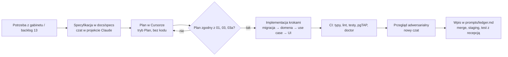

# 10 · Praca z AI: jak dokładać funkcje promptami i nie rozwalić systemu

Wersja 2.1 · 6 listopada 2026.

## 1. Dlaczego systemy pisane promptami się psują

```
prompt opisuje CO, ale nie GDZIE i NA JAKICH ZASADACH
  → model wybiera najkrótszą drogę (import na skróty, logika w komponencie, nowa tabela obok starej)
  → każdy prompt dokłada własną konwencję
  → po 50 promptach 50 stylów, dublujące się pojęcia, brak testów
  → zmiana w jednym miejscu psuje trzy inne, a nikt nie wie dlaczego
```

Przerywamy ten łańcuch na pięciu poziomach:

| Poziom | Mechanizm | Gdzie |
|---|---|---|
| Kontekst | model zawsze dostaje zasady, słownik i architekturę | `AGENTS.md`, `.cursor/rules/`, `docs/` |
| Zamiar | każda funkcja ma specyfikację z kryteriami akceptacji, zanim powstanie kod | `docs/specs/`, `13-backlog-specyfikacji.md` |
| Szkielet | generator tworzy strukturę, AI wypełnia | `pnpm gen` (ADR-029) |
| Egzekucja | granice modułów, typy, RLS, `crux-doctor`, śledzenie specyfikacji w testach łamią się głośno | lint, `tsc`, pgTAP, `pnpm doctor`, CI |
| Przegląd i pamięć | człowiek przegląda plan i diff; drugi model robi przegląd adwersarialny; rejestr promptów mówi, co już zrobiono | sekcje 3.5 i 6, `prompts/ledger.md` |

## 2. Cykl jednej funkcji (spec-driven development)



1. **Specyfikacja** (czat w projekcie „Zenit Stomatologia”): z szablonu `_szablon.md`, ID z backlogu. Czat ma w kontekście `docs/`, więc pisze w słowniku i wie, które tabele istnieją.
2. **Plan** (Cursor, tryb Plan): prompt 3.1. Model wypisuje pliki, migracje, testy. Sprawdzasz granice i słownik. Jeśli plan proponuje nową tabelę, której nie ma w `03a`, najpierw PR do `03a`.
3. **Implementacja** krokami, każdy krok to osobny prompt (3.2) i commit: (a) migracja + RLS + pgTAP, (b) domena + testy jednostkowe, (c) przypadek użycia + test integracyjny, (d) UI + e2e. Przed krokiem (a) uruchom `pnpm gen`, żeby szkielet już był.
4. **CI** musi być zielone. Nie prosisz modelu „napraw testy”, tylko „wyjaśnij, dlaczego test nie przechodzi, i zaproponuj poprawkę kodu; test zostaje bez zmian”.
5. **Przegląd adwersarialny** w nowym czacie bez historii implementacji (3.5), obowiązkowy dla `security`, `money`, `clinical`.
6. **Rejestr promptów:** wpis (data, ID specyfikacji, prompt lub odnośnik do `prompts/`, commit, wynik, co poszło nie tak). Nowy czat zaczyna od przeczytania ostatnich wpisów.

## 3. Szablony promptów

### 3.1 Plan funkcji (Cursor, tryb Plan)

```
Przeczytaj AGENTS.md, docs/01-architektura.md (sekcje 4–6), docs/03-model-domeny.md,
docs/03a-schemat-bazy.md (sekcje dla modułów, których dotyczy zadanie)
i specyfikację docs/specs/<ID>.md. Zajrzyj do prompts/ledger.md (ostatnie 10 wpisów).

Nie pisz jeszcze kodu. Przygotuj plan implementacji:
1. Których modułów dotyczy zmiana i czy to zgodne z kierunkami zależności (01, sekcja 4).
2. Zmiany w bazie: tabele, kolumny, enumy, więzy, polityki RLS (wzorzec z 03a, sekcja 0), testy pgTAP.
   Jeśli tabela lub kolumna nie istnieje w 03a, wypisz ją jako „wymaga aktualizacji 03a”.
3. Zmiany w domenie: typy, reguły, zdarzenia (z wersją).
4. Przypadki użycia: wejście (Zod, z commandId), uprawnienie, wynik, błędy domenowe.
5. UI: ekrany, komponenty z packages/ui, stany (ładowanie, pusto, błąd, brak uprawnień), skróty.
6. Testy dla każdego kryterium akceptacji ze znacznikiem [<ID>/ACn].
7. Ryzyka i pytania. Jeśli coś jest sprzeczne z dokumentacją, wypisz to na początku i zatrzymaj się.
Podziel pracę na kroki po maksymalnie ok. 400 linii zmian. Pierwszy krok to zawsze `pnpm gen`.
```

### 3.2 Krok implementacji (Cursor, tryb Agent)

```
Realizujemy krok <N> z planu dla docs/specs/<ID>.md: <opis kroku>.
Zakres: tylko pliki z planu dla tego kroku. Nie zmieniaj innych modułów ani istniejących migracji.
Trzymaj się AGENTS.md (sekcje „Zawsze” i „Nigdy”) i słownika z docs/03.
Nazwy testów kryteriów akceptacji: [<ID>/ACn].
Na koniec uruchom: pnpm typecheck && pnpm lint && pnpm test --filter <moduł> && pnpm doctor
i pokaż wynik. Jeśli coś nie przechodzi, opisz przyczynę, zanim cokolwiek zmienisz.
Nie zmieniaj testów, które przechodziły.
```

### 3.3 Migracja bazy

```
Dodaj migrację dla <zmiana> zgodnie z docs/03a-schemat-bazy.md (sekcja <n>) i docs/09, sekcja 4.
Wymagania: tenant_id, komentarz tabeli (rls, append_only, retention), polityki wg wzorca
<tenant_all|tenant_location|append_only|self_or_manager>, brak polityk update/delete i revoke
dla tabel tylko do dopisywania, indeksy na kluczach obcych, trigger audit.track(),
test pgTAP izolacji tenantów i gabinetów w supabase/tests/<tabela>.sql.
Nie edytuj istniejących migracji. Pokaż wygenerowany SQL przed zapisaniem.
```

### 3.4 Ekran UI

```
Zbuduj ekran <nazwa> dla docs/specs/<ID>.md (sekcja UI).
Użyj wyłącznie komponentów z packages/ui i tokenów z packages/ui/brand/tokens.css (docs/06, sekcja 2).
Przeczytaj docs/14-guideline-aplikacji.md (marka) i docs/06 (Crux); logo tylko z plików w packages/ui/brand/logo; gabinety „01 Nowodworska”, „02 Białowieska”.
Referencja wizualna: design/crux-dashboard-prototyp.html; dla dashboardów docs/11 (forma metryki z sekcji 4.6: łuk obłożenia, siatka kuleczek, wykres kropkowy).
Teksty w packages/i18n/pl, ton z docs/06, sekcja 7 (bez wykrzykników, bezosobowo dla personelu).
Stany: ładowanie bez migania, pusto (krótki tekst + jedno działanie), błąd (co zrobić), brak uprawnień.
Pola dotyku min. 44 px, pełna nawigacja klawiaturą, fokus bursztynowy, liczby tabular-nums.
Dodaj stronę Storybooka dla każdego nowego komponentu w packages/ui.
Przejdź listę kontrolną z docs/14, sekcja 11, i dołącz zrzut ekranu do PR.
```

### 3.5 Przegląd adwersarialny (nowy czat, bez historii)

```
Jesteś recenzentem kodu systemu medycznego. Dostajesz diff i specyfikację docs/specs/<ID>.md.
Szukaj tylko realnych problemów, z konkretnym scenariuszem awarii:
- wyciek danych między tenantami lub gabinetami, brak authorize(), brak RLS, polityka using (true)
- dane pacjenta w logach, URL-ach, błędach, payloadach outboxa, nazwach plików
- UPDATE/DELETE na danych tylko do dopisywania; brak powodu przy korekcie
- błędy pieniędzy (float, zaokrąglenia, storno bez odwołania), stref czasowych, kolizji wizyt, idempotencji
- import z wnętrza innego modułu; logika w komponencie lub server action; nowy synonim pojęcia
- kryteria akceptacji bez testu; test osłabiony razem z kodem
- zależność npm bez wpisu w docs/zaleznosci.md
Dla każdego problemu: plik, linia, scenariusz, poprawka. Bez uwag stylistycznych.
Na końcu: lista kryteriów akceptacji z oceną „pokryte / niepokryte / pokryte słabo”.
```

### 3.6 Błąd

```
Błąd: <opis, kroki, oczekiwane vs faktyczne, identyfikatory bez danych osobowych>.
Najpierw napisz test, który go odtwarza i nie przechodzi. Potem znajdź przyczynę (nie objaw)
i popraw kod. Nie zmieniaj testów, które przechodziły. Wyjaśnij przyczynę w 2–3 zdaniach
w opisie commita. Jeśli przyczyną jest brak zasady, zaproponuj wpis do AGENTS.md lub reguły Cursora.
```

### 3.7 Nowa metryka (F3+)

```
Dodaj metrykę <id> do docs/11-dashboardy-i-raporty.md (rejestr, sekcja 4) i do
packages/modules/analytics/src/metrics/<id>.ts: definicja słowna, SQL na schemacie analytics,
typ wyniku, kierunek, uprawnienie, cel drążenia. Dodaj test na zestawie wzorcowym
(packages/testing/golden) z wartością policzoną ręcznie i opisem, jak ją policzono.
Nie dodawaj kafla na ekran, dopóki pnpm doctor nie potwierdzi wpisu w rejestrze.
```

### 3.8 Aktualizacja decyzji

```
Chcę zmienić zasadę: <opis>. Przeczytaj docs/02-decyzje-architektoniczne.md.
Napisz nowy ADR według szablonu (status: proponowana), wskaż, które ADR-y uzupełnia lub zastępuje,
i wypisz wszystkie miejsca w AGENTS.md, .cursor/rules/ i docs/, które trzeba zmienić w tym samym PR.
Nie zmieniaj kodu, dopóki ADR nie zostanie przyjęty.
```

## 4. Czaty w projekcie Claude jako generatory

Projekt „Zenit Stomatologia” ma te pliki w dokumentach projektu. Czaty w projekcie służą do:
- pisania specyfikacji z szablonu (wynik: plik do `docs/specs/`);
- generowania promptów dla Cursora wg sekcji 3 lub z `prompts/` (wynik: prompt do wklejenia);
- przeglądów adwersarialnych;
- aktualizacji ADR i backlogu;
- analizy błędów z logów (bez danych osobowych).

Zasada: czat-generator nie pisze kodu produkcyjnego. Kod powstaje w Cursorze, który widzi repo i uruchamia testy. Jeśli czat w projekcie i Cursor się nie zgadzają co do architektury, wygrywa `docs/`, a rozbieżność trafia do ADR.

## 5. Cursor: konfiguracja i nawyki

- **Reguły** w `.cursor/rules/*.mdc` (zawsze: `00-core`, `10-architecture-boundaries`, `40-security-privacy`; z globami: `20-database`, `30-ui`, `50-clinical`, `60-integrations`, `70-analytics`, `80-testing`) plus reguły zagnieżdżone per moduł generowane przez `pnpm gen module`. Każda reguła < 150 linii, z przykładami i odnośnikami do plików. `AGENTS.md` w katalogu głównym jest czytany automatycznie.
- **MCP:** Supabase MCP (tylko do projektu lokalnego/stagingu, nigdy produkcji) i Next.js DevTools MCP (logi, trasy) w Cursorze, żeby model widział prawdziwy schemat i prawdziwe błędy.
- **Tryb Plan przed Agentem** dla każdej funkcji. Agent tylko z promptem kroku (3.2).
- **Jeden krok = jeden commit = jeden wpis w rejestrze.** Nie łączymy kroków.
- **Kontekst:** w prompcie podawaj ścieżki plików (`@docs/specs/F1-002…`); streszczenia dryfują.
- **Model:** do planów i przeglądów model najmocniejszy; do kroków implementacji model szybki, ale po planie.
- **Nigdy** nie akceptuj zmiany, której nie rozumiesz w 2 minuty. Jeśli diff jest za duży, krok był za duży.

## 6. Sygnały, że AI zaczyna rozwalać system

- Nowa nazwa na istniejące pojęcie (`visit` obok `appointment`, `clinic` obok `location`). → Odrzuć, wskaż słownik; `doctor` to łapie.
- Server action ma więcej niż ok. 25 linii logiki. → Przenieś do przypadku użycia.
- Nowa tabela bez wpisu w `03a` i bez testu pgTAP. → CI zawodzi; jeśli nie, dopisz regułę.
- Model proponuje `service_role`, `security definer`, wyłączenie RLS albo `using (true)` „żeby zadziałało”. → Stop.
- Test zmieniony razem z kodem bez wyjaśnienia. → Odrzuć zmianę testu.
- Zależność npm dodana „przy okazji”. → Usuń lub uzasadnij w `docs/zaleznosci.md`.
- Komponent z kolorem HEX albo wartością arbitralną Tailwinda. → Token.
- Metryka na ekranie bez wpisu w rejestrze. → Rejestr najpierw.
- Model „poprawia” dokumentację, żeby pasowała do kodu, bez ADR. → Cofnij; ADR najpierw.

Każdy taki przypadek kończy się dopisaniem zasady do `AGENTS.md`, reguły Cursora albo reguły `doctor`. Dokumentacja uczy się na błędach, żeby model nie powtarzał ich w kolejnych czatach.

## 7. Rejestr promptów (`prompts/ledger.md`)

Format wpisu:

```
## 2026-11-26 · F0-010 · część 2 (domena)
Prompt: prompts/F0-fundament.md#K11 część 2
Commit: a1b2c3d · Gałąź: feat/F0-010-oblozenie
Wynik: zielone CI; doctor: 1 ostrzeżenie (brak README modułu) → poprawione w a1b2c3e
Uwagi: model chciał dodać pole `patient_initials` do chair_occupancy; odrzucone (ADR-032, nie ma w 03a).
```

Nowy czat (Claude lub Cursor) czyta 10 ostatnich wpisów, zanim zaproponuje plan. To jest pamięć projektu między sesjami.
