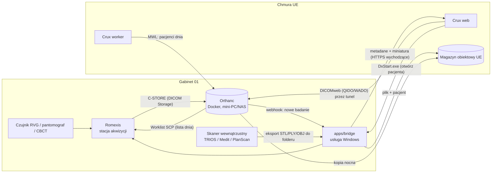

# 12 · Obrazowanie: Romexis, DICOM, skanery

Wersja 1.0 · 5 listopada 2026. Projekt modułu `@crux/imaging`, lokalnego agenta `apps/bridge` i infrastruktury DICOM dla F5. Decyzje: ADR-012, ADR-028, ADR-026. Granice prawne: ADR-017 (MDR). Źródła sprawdzone 5.11.2026: [specyfikacja Romexis](https://inte.planmeca.com/jaSoftware/specifications), [most Romexis w Open Dental](https://www.opendental.com/manual/bridgeplanmeca.html), [deklaracja zgodności DICOM Romexis 6.1](https://inte.planmeca.com/globalassets/planmeca-modernization/software/downloads/dicom_conformance_statement_romexis_6_1.pdf), [integracje 3Shape Unite](https://learn.3shape.com/en/support/all-products/3shape-unite/connections--integrations-in-unite).

## 1. Cel i granica

**Cel:** lekarz w karcie pacjenta w Crux widzi wszystkie badania obrazowe pacjenta z każdego gabinetu (RTG punktowe, pantomogram, CBCT, skany wewnątrzustne), otwiera badanie w Romexis jednym kliknięciem, a nowe zdjęcie pojawia się w karcie w ciągu minuty od wykonania. Recepcja nie przepisuje danych pacjenta do aparatu.

**Granica:** Crux **nie jest** przeglądarką diagnostyczną. Diagnoza, pomiary, okienkowanie i filtry: Romexis (wyrób medyczny z CE). Crux pokazuje podgląd z etykietą „podgląd, nie do diagnostyki”, bez narzędzi pomiarowych, bez filtrów wyostrzających, bez AI na obrazach. Opis badania (dokument EDM) lekarz pisze w Crux jako wpis `imaging_report` po obejrzeniu badania w Romexis.

## 2. Architektura docelowa

Komponenty:

| Komponent | Gdzie | Rola | Technologia |
|---|---|---|---|
| Orthanc | każdy gabinet (mini-PC z Linuksem lub NAS z Dockerem) | serwer PACS: przyjmuje badania, worklist, DICOMweb, webhooki | Orthanc + wtyczki: DICOMweb, Worklists, Python/Lua do webhooków, PostgreSQL jako indeks (lokalny) |
| `apps/bridge` | stanowiska z Romexis i komputer skanera | otwieranie pacjenta w Romexis, obserwacja folderów, drukarka fiskalna, przekazywanie zdarzeń z Orthanca | Node 22 jako usługa Windows (node-windows), pakiet `pkg`/SEA; komponent .NET tylko dla TWAIN/VDDS, jeśli będzie potrzebny |
| `@crux/imaging` | chmura | indeks badań, powiązania z pacjentem i zębami, miniatury, podgląd, uprawnienia | moduł jak każdy inny |
| Przeglądarka podglądu | przeglądarka użytkownika | wyświetlenie serii 2D i miniatur CBCT | OHIF Viewer w trybie podstawowym lub Stone Web Viewer Orthanca; konfiguracja bez narzędzi pomiarowych |
| Magazyn obiektowy UE | chmura | kopie badań, miniatury, pliki STL | S3 (Hetzner/Scaleway), object lock |
| Tunel | gabinet ↔ chmura | dostęp Crux do DICOMweb Orthanca bez otwierania portów | Cloudflare Tunnel, Tailscale lub WireGuard na serwerze workera (decyzja F5 po pomiarze łączy) |

## 3. Poziomy integracji z Romexis

### Poziom 1: otwórz pacjenta w Romexis (start F5)
- Romexis instalowany z opcją PmBridge udostępnia `DxStart.exe`: `DxStart.exe "PatientID" "FamilyName" "FirstName" "BirthDate" "Doctor"`; jeśli pacjent istnieje, dane są aktualizowane; tak działa most w Open Dental. Wersja z linii poleceń obsługuje znaki łacińskie bez diakrytyków; polskie znaki mogą wymagać interfejsu DLL PmBridge **[do sprawdzenia na wersji Romexis w gabinetach]**. Rozwiązanie przejściowe: transliteracja nazwiska w wywołaniu, `PatientID` = `patient_number` (np. `ZS-000123`), który jest stały i bez diakrytyków.
- Przepływ: przycisk „Otwórz w Romexis” w karcie → `apps/web` zapisuje komendę dla urządzenia (`bridge_commands`: device_id, patient_number, dane) → agent odbiera przez długie połączenie (WebSocket wychodzący) → wywołuje `DxStart.exe` → raportuje wynik. Czas: < 3 s.
- Bezpieczeństwo: agent ma token urządzenia (haszowany w `devices`), połączenie tylko wychodzące, komendy podpisane, logowane w `audit.access_log` jako `imaging_open`.

### Poziom 2: badania w Crux przez DICOM
- Romexis wysyła kopie badań **DICOM C-STORE** do Orthanca (wymagany pakiet „DICOM Storage” lub „DICOM Full” w Romexis; cena z dystrybutorem Planmeca). Konfiguracja: w Romexis cel DICOM = Orthanc (AET `CRUX01`, port 4242), automatyczny eksport po akwizycji **[sprawdzić, czy Romexis wysyła automatycznie, czy wymaga ręcznego eksportu; jeśli ręcznego, poziom 2 realizujemy przez obserwowany folder eksportu DICOM]**.
- Orthanc po przyjęciu badania (`OnStableStudy`) woła webhook agenta → agent pobiera metadane (QIDO) i miniaturę (WADO rendered) → wysyła do Crux `imaging.study.received` → worker tworzy `imaging_studies` i dopasowuje pacjenta po `PatientID` = `patient_number` (jeśli brak dopasowania: kolejka „badania bez pacjenta” dla asystentki).
- Podgląd w Crux: karta pacjenta → zakładka „Obrazowanie” → miniatury chronologicznie z modalnością i gabinetem → kliknięcie otwiera przeglądarkę podglądu pobierającą serie przez DICOMweb z Orthanca (przez tunel, z krótkotrwałym tokenem) → przycisk „Otwórz w Romexis” zawsze obok.
- **Modality Worklist (MWL):** Crux worker wystawia listę pacjentów dnia do Orthanca (wtyczka Worklists: pliki `.wl` generowane z `appointments` co 5 min); Romexis z pakietem „DICOM Full” pobiera dane pacjenta z worklisty (Worklist SCU), więc technik nie przepisuje nazwiska i daty urodzenia. Zmniejsza liczbę literówek i badań bez dopasowania.
- CBCT: setki MB na badanie; zostaje w Orthanc w gabinecie; w Crux metadane, miniatura (MPR 3 przekroje) i przycisk „Otwórz w Romexis”. Kopia nocna do magazynu obiektowego (deduplikacja po SOPInstanceUID).

### Poziom 3: skanery wewnątrzustne
- Najprostsze i uniwersalne: skaner eksportuje STL/PLY/OBJ do folderu (`C:\CruxScans\<patient_number>\…`); agent obserwuje folder, przypina plik do pacjenta po numerze w nazwie lub pyta w Crux („plik bez pacjenta”), wysyła do magazynu obiektowego (`scan_files`).
- 3Shape Unite: dostępne drogi integracji z PMS: aplikacje w Unite Store (Command Line Interface, VDDS interface, Web Service interface) i gotowe integracje z Dentally, Open Dental, CareStack. Dla Crux: CLI do otwarcia pacjenta w Unite i Web Service interface do odbioru przypadków **[do sprawdzenia dostępności w regionie i warunków programu partnerskiego 3Shape]**.
- Medit Link: API chmurowe Medit (wiedza ogólna) **[sprawdzić po spisie sprzętu]**.
- Podgląd 3D w Crux: three.js (`STLLoader`, `PLYLoader`, `OBJLoader`), obrót, zoom, bez pomiarów.

## 4. Model danych (zarys w `03a`, sekcja 14)

- `devices`: stanowisko z agentem (gabinet, rodzaj, token, możliwości: `romexis`, `scanner_folder`, `fiscal_printer`, `orthanc_relay`).
- `imaging_studies`: `study_instance_uid`, `orthanc_id`, gabinet (który Orthanc), pacjent, modalność (`IO` RTG punktowe, `PX` pantomogram, `CT` CBCT, `OT` inne), data badania, opis, liczba serii i instancji, zęby (z opisu lekarza lub ręcznie), miniatura, `report_entry_id` (wpis EDM „opis badania”), status kopii.
- `imaging_series`/`imaging_instances` tylko jeśli potrzebne do podglądu (DICOMweb i tak zwraca); na start wystarczy `imaging_studies`.
- `scan_files`: plik STL/PLY/OBJ z metadanymi (skaner, łuk, data), `file_id` w `files`.
- `bridge_commands`: kolejka komend dla urządzeń (`open_in_romexis`, `print_receipt`, `rescan_folder`) ze statusem i wynikiem.

## 5. Opis badania jako dokument EDM (F4 + F5)

- Lekarz ogląda badanie w Romexis, w Crux pisze wpis `imaging_report` (szablon: rodzaj badania, zęby/okolica, opis, wnioski, zalecenia) powiązany z `imaging_study_id`.
- Podpis wewnętrzny Crux wersjonuje wpis; `@crux/interop` generuje CDA „opis badania diagnostycznego” → podpis przez bramkę P1 (certyfikat ZUS lekarza) → indeks w P1 → status w karcie (`04`, sekcje 2 i 4).
- Badanie bez opisu po 7 dniach trafia na listę lekarza „badania do opisania” (metryka `documentation_lag_hours`).

## 6. Bezpieczeństwo i prawo

- Orthanc: dostęp tylko z sieci gabinetu i przez tunel; uwierzytelnianie HTTP + TLS; brak publicznego portu; AET lista dozwolonych modalności; kopie szyfrowane.
- Dane w DICOM zawierają nazwisko, datę urodzenia, `PatientID`: traktowane jak dokumentacja; dostęp logowany (`audit.access_log`, zasób `imaging_study`).
- Retencja: obrazy traktujemy jak część dokumentacji (20 lat), bo opis badania jest EDM i odwołuje się do obrazu; polityka usuwania jak w `03a`, sekcja 15.
- MDR: lista „nie robimy” w podglądzie: brak pomiarów długości/kąta, brak filtrów diagnostycznych, brak automatycznej detekcji, brak porównań „przed/po” sugerujących ocenę. Każda zmiana przeglądarki podglądu wymaga przeglądu z etykietą `clinical`.
- Agent: usługa z własnym kontem bez praw administratora; aktualizacje podpisane; token odwoływalny; logi bez danych pacjenta (identyfikatory).

## 7. Prace przed F5 (do wykonania w F0 i F4)

1. **Spis sprzętu w każdym gabinecie** (F0): aparaty RTG, czujniki RVG, pantomograf, CBCT, skanery (producent, model), wersja Romexis, licencje DICOM, czy jest serwer centralny Romexis, system operacyjny stanowisk, łącze internetowe (upload/download), switch/VLAN.
2. **Rozmowa z dystrybutorem Planmeca** (F0/F1): pakiety DICOM (Storage, Full), PmBridge DLL, automatyczny eksport DICOM, polskie znaki w `DxStart`, koszt.
3. **Pilot Orthanc na stagingu** (F4): Orthanc w Dockerze + próbki DICOM (publiczne zbiory testowe) + OHIF; test MWL z symulatorem.
4. **Decyzja: Orthanc per gabinet czy centralny** (start F5) na podstawie pomiaru łączy i wolumenu CBCT.

## 8. Kryteria akceptacji F5 (bramka z `07`)

- Lekarz otwiera badanie pacjenta z Crux w Romexis w mniej niż 3 s (e2e z atrapą agenta + test ręczny w gabinecie).
- Nowe zdjęcie RVG pojawia się w karcie pacjenta w Crux w ciągu 60 s od akwizycji (pomiar w gabinecie 01 przez tydzień, 95% badań).
- Zero badań „bez pacjenta” po wdrożeniu MWL w gabinecie z pakietem DICOM Full (pomiar miesięczny; cel < 2%).
- Plik STL ze skanera przypięty do pacjenta bez ręcznego przepisywania w 90% przypadków.
- Podgląd nie zawiera żadnej funkcji z listy „nie robimy” (przegląd kodu z etykietą `clinical`).
