# Podręcznik Crux · wydanie 1.0 „Krasnodrzew”

Wersja 1.0 · 6 listopada 2026 · dla Miłosza (product owner i architekt), programisty od 1.1 i każdego, kto chce zrozumieć system bez zgadywania.

Ten podręcznik jest **generowany** z folderu `crux` (`podrecznik/build.py`): rozdziały 1–10 i 12–14 są napisane ręcznie w `podrecznik/rozdzialy/`, rozdział 11 zawiera pełny tekst promptów wklejony automatycznie z `prompts/F0-fundament.md`, rysunki pochodzą z `podrecznik/rysunki/*.mmd`, a makiety z `manifest/makiety/`. Gdy zmieniasz prompt albo rysunek, uruchamiasz `python3 podrecznik/build.py` i podręcznik jest znowu aktualny. Dzięki temu nie ma dwóch wersji prawdy.

## Spis treści

- **1 · Po co Crux i dlaczego zaczynamy od obłożenia foteli**
    - Problem w jednym łańcuchu · Dlaczego nie kupujemy gotowego programu · Dlaczego pierwsze wydanie mierzy fotele · Trzy zasady marki, które stają się zasadami systemu · Czym Crux nie jest
- **2 · Co dostajemy w wydaniu 1.0 „Krasnodrzew”**
    - Zakres w jednym zdaniu · Co kto dostaje · Czego celowo nie ma · Jak wygląda dzień recepcji z Cruxem 1.0 · Jak wygląda tydzień zarządu · Krasnodrzew: dlaczego ta nazwa · Bramka 1.0 (kiedy uznajemy wydanie za udane)
- **3 · Architektura w obrazkach**
    - 3.1 Styl: modularny monolit · 3.2 Kontekst systemu w wydaniu 1.0 · 3.3 Kontenery i środowiska · 3.4 Moduły w 1.0 i kierunki zależności · 3.5 Budowa jednego modułu (szablon, który generuje `pnpm gen module`) · 3.6 Przepływ jednej komendy (co się dzieje po „Zapisz”) · 3.7 Obrona w głąb: dlaczego baza sama pilnuje dostępu · 3.8 Zdarzenia, outbox i worker · 3.9 Analityka jako osobny schemat · 3.10 Strażnicy: jak system rośnie przez prompty i się nie psuje · 3.11 Decyzje, które chronią 1.0 (z ADR)
- **4 · Dane: jak wygląda baza wydania 1.0**
    - 4.1 Mapa encji 1.0 · 4.2 Tabele 1.0 w jednym miejscu · 4.3 Wpis obłożenia: tabela, która przeżyje wszystkie wydania · 4.4 Pojemność, blokady, zamknięcie dnia · 4.5 Ustawienia jako dane: tryb obłożenia · 4.6 Identyfikatory, czas, pieniądze (konwencje, które obowiązują wszędzie) · 4.7 Audyt: co zapisuje się samo · 4.8 Retencja
- **5 · Dostępy: kto co widzi i skąd system to wie**
    - 5.1 Trzy pojęcia · 5.2 Macierz 1.0 · 5.3 Przykłady na osobach z danych testowych · 5.4 Jak system to wie: od logowania do polityki w bazie · 5.5 Sesja, blokada, konta · 5.6 Co się dzieje, gdy ktoś spróbuje obejść
- **6 · Obłożenie foteli: moduł wzorcowy**
    - 6.1 Model w jednym zdaniu · 6.2 Ekran `/oblozenie` · 6.3 Klawiatura (recepcja pracuje z rękami na klawiaturze) · 6.4 Reguły domeny (gdzie mieszka „mądrość”) · 6.5 Przypadki użycia · 6.6 Co z tego liczy analityka · 6.7 Przejście do 1.1 (żeby nic nie było „wdową”) · 6.8 Dlaczego to jest wzorzec do kopiowania
- **7 · Analityka i pulpity 1.0**
    - 7.1 Droga liczby: od komórki w siatce do kafla · 7.2 Siedem metryk 1.0 · 7.3 Filtry: jeden wiersz rządzi wszystkim · 7.4 Trzy pulpity · 7.5 Drążenie: każda liczba na ekranie ma dowód · 7.6 Cele i porównania · 7.7 Odświeżanie i wydajność · 7.8 Jak dodać metrykę (procedura)
- **8 · Jak to wygląda: marka w aplikacji**
    - 8.1 Dziesięć zasad, które łamie się najczęściej · 8.2 Ekrany 1.0 · 8.3 Komponenty 1.0 (`packages/ui`) · 8.4 Pakiet marki w repo · 8.5 Lista kontrolna przed każdym PR z interfejsem (`docs/14`, sekcja 11)
- **9 · Stan prac na 6 listopada 2026**
    - 9.1 Co jest · 9.2 Czego nie ma (i kiedy będzie) · 9.3 Decyzje otwarte (każda ma właściciela i termin) · 9.4 Czego potrzebuję od zespołu w pierwszych dwóch tygodniach · 9.5 Co się zmieniło 6 listopada (żeby nikt nie pracował na starej wersji)
- **10 · Plan wydania 1.0 krok po kroku**
    - 10.1 Siedemnaście kroków · 10.2 Harmonogram · 10.3 Jak wykonać jeden krok (rytuał, zawsze ten sam) · 10.4 Wpis w ledgerze · 10.5 Definicja ukończenia (każda część i PR) · 10.6 Sygnały, że AI zaczyna rozwalać system (zatrzymaj się)
- **11 · Prompty K01–K17 (pełny tekst)**
- **12 · Wdrożenie 1.0 i co po nim**
    - 12.1 Środowiska i co w nich żyje · 12.2 Dane startowe produkcji (K17, skrypt `tools/bootstrap-prod.ts`) · 12.3 Szkolenie i instrukcje · 12.4 Lista kontrolna wdrożenia produkcyjnego (`docs/ops/wdrozenie-produkcyjne.md`) · 12.5 Bramka 1.0 i co ją może zatrzymać · 12.6 Co po 1.0: warunki startu 1.1 „Ratania”
- **13 · Procedury: jak dokładać, zmieniać i wracać**
    - 13.1 Jak dodać funkcję (od bólu w gabinecie do wydania) · 13.2 Jak dodać tabelę lub kolumnę · 13.3 Jak dodać ekran · 13.4 Jak dodać metrykę · 13.5 Jak dodać gabinet, fotel, osobę (bez kodu) · 13.6 Jak zmienić zasadę (ADR) · 13.7 Jak wrócić (gdy coś poszło nie tak) · 13.8 Procedury operacyjne (`docs/ops/`, powstają w K16) · 13.9 Rytm, który utrzymuje system w zdrowiu
- **14 · Słownik, skróty i mapa plików**
    - 14.1 Pojęcia 1.0 (PL ↔ EN) · 14.2 Skróty · 14.3 Mapa plików folderu `crux` · 14.4 Jak zbudować ten podręcznik ponownie

## Jak czytać

| Jeśli masz | Czytaj |
|---|---|
| 10 minut | rozdział 1 (po co), rozdział 2 (co dostajemy w 1.0), rozdział 9 (stan prac) |
| godzinę przed pierwszym promptem | rozdziały 3–7 (architektura, dane, dostępy, obłożenie, analityka), potem 10 (plan) |
| Cursor otwarty i chcesz pracować | rozdział 10 (jak wykonać krok), rozdział 11 (prompty K01–K17), rozdział 13 (procedury), ledger |
| pytanie „gdzie to jest w dokumentacji” | rozdział 14 (mapa plików i słownik) |

Zasada tego podręcznika: **nic nie trzeba się domyślać**. Każda nazwa pliku, tabeli, uprawnienia i kroku jest dokładnie tą, która trafi do repo. Gdy podręcznik i plik w `docs/` mówią co innego, wygrywa `docs/` (podręcznik jest widokiem na `docs/`), a różnicę naprawiamy w tym samym dniu.

## Konwencje zapisu

- `K07` to prompt (jeden czat w Cursorze) z `prompts/F0-fundament.md`; „Część 2/4” to commit w obrębie promptu.
- `F0-010` to specyfikacja z `docs/specs/`; `AC5` to jej piąte kryterium akceptacji; w testach pojawia się jako `[F0-010/AC5]`.
- `01 Nowodworska` i `02 Białowieska` to gabinety; numer jest stały, kolor danych też (zieleń, niebieski).
- „Platforma P1” to system e-zdrowia (CeZ). Gdy w rozmowie mówimy „P1” o Cruxie, chodzi o wydanie 1.0.
- Ścieżki są względem katalogu repo (`apps/web`, `packages/modules/scheduling`) albo folderu `crux` z dokumentacją (`docs/03a`, `prompts/`).
- Daty w planie są z `docs/07`; jeśli coś się przesunie, zmieniamy `07` i generujemy podręcznik ponownie.


# 1 · Po co Crux i dlaczego zaczynamy od obłożenia foteli

## Problem w jednym łańcuchu

Gabinet na typowym programie gabinetowym ma dane w trzech miejscach: program (pacjenci, terminarz, dokumentacja), Excel (rozliczenia lekarzy, laboratorium, plany sprzedażowe) i głowa kierownika (kto nie wrócił na przegląd, który plan utknął). Przy jednym gabinecie to działa. Przy dwóch zaczyna się łańcuch:

```
brak jednej bazy pacjentów sieci
  → pacjent z 01 nie może łatwo umówić się w 02
  → recepcja nie widzi wolnych foteli w innym gabinecie
  → puste fotele i utracone wizyty
  → plany leczenia bez terminu nikną z pola widzenia
  → właściciel widzi to dopiero w KPiR, miesiąc później
```

Crux ma ten łańcuch przerwać. Pełna wizja: `docs/00-wizja-i-zasady.md`.

## Dlaczego nie kupujemy gotowego programu

Sprawdziliśmy polskie (IQ Dental, Prodentis, Estomed, FELG, Medfile) i światowe (Dentrix/Jarvis, CareStack, Curve, Open Dental) rozwiązania (`docs/08`). Żadne nie jest zbudowane wokół **sieci** gabinetów z jednym właścicielem: brak jednej definicji metryk dla wielu lokalizacji, rozliczenia lekarzy poza systemem, dashboardy jako dodatek. Dla jednego gabinetu gotowiec jest tańszy; dla sieci, która ma być liderem IT w regionie, własny system z własną analityką jest jedyną drogą, żeby dane były nasze i porównywalne.

## Dlaczego pierwsze wydanie mierzy fotele

Pełny terminarz Crux z pacjentami wymaga najpierw trzech rzeczy, na które czeka się tygodniami: opinii prawnej o dokumentacji medycznej i Supabase, oceny skutków dla ochrony danych (DPIA) i umów powierzenia z dostawcami (`docs/04`). Gdybyśmy czekali, pierwsza wartość pojawiłaby się w kwietniu 2027.

Dlatego wydanie 1.0 **nie przetwarza danych pacjentów** (ADR-032). Przetwarza tylko dane personelu: kto, kiedy, na którym fotelu pracował i jaką kategorię usługi wykonał. To dane zwykłe w rozumieniu RODO, więc wystarczy standardowa umowa powierzenia z Supabase i Vercel, wpis w rejestrze czynności i informacja dla personelu. Skutek:

- Crux wchodzi do gabinetów **11 grudnia 2026**, cztery miesiące wcześniej niż w planie 2.0;
- zarząd po raz pierwszy widzi 01 i 02 obok siebie na jednej definicji liczb: obłożenie foteli, godziny, przychód na godzinę fotela;
- recepcja buduje nawyk pracy w Cruxie na małym, bezpiecznym zadaniu (2–3 minuty dziennie), zanim w 1.1 dostanie cały terminarz;
- cała infrastruktura, bezpieczeństwo i strażnicy kodu (rozdziały 3–5) powstają teraz i są gotowe, gdy w 1.1 pojawią się dane pacjentów.

Cena: recepcja przez kilka miesięcy wpisuje obłożenie obok starego programu. Dlatego wpis dnia musi zajmować najwyżej 3 minuty z klawiatury, jest funkcja „dzień jak wczoraj”, a kwoty są opcjonalne. Jeśli mimo to wpisy nie będą utrzymywane (bramka 1.0 niespełniona po 4 tygodniach), pomiar startuje z wizyt w 1.1, a 1.0 zostaje jako szkielet i administracja (ADR-032, „Wracamy, gdy”).

## Trzy zasady marki, które stają się zasadami systemu

| Marka | System |
|---|---|
| **Spokój** | pulpit pokazuje stan i to, co wymaga działania dziś; bez czerwonych liczników „dla zasady”; stan zawsze z ikoną i słowem |
| **Precyzja** | każda liczba ma wpis w rejestrze metryk, SQL w kodzie, test na zestawie wzorcowym i drążenie do rekordów; metryka bez wpisu nie trafia na ekran (strażnik `crux-doctor`) |
| **Ciągłość** | jeden standard w każdym gabinecie; gabinet różni się tylko numerem i adresem; nowy gabinet to sama konfiguracja |

## Czym Crux nie jest

- nie jest produktem SaaS: nie budujemy onboardingu klientów, cennika ani marketingu produktu (model danych tego nie wyklucza);
- nie diagnozuje i nie podpowiada leczenia; nie analizuje zdjęć (granica wyrobu medycznego, ADR-017, ADR-028);
- nie zastępuje księgowości: księga i KSeF zostają w Comarch Optima;
- nie obsługuje NFZ, dopóki gabinety nie mają kontraktu;
- nie wchodzi „na raz”: stary program gaśnie wydanie po wydaniu (`docs/07`, sekcja 2).


# 2 · Co dostajemy w wydaniu 1.0 „Krasnodrzew”

## Zakres w jednym zdaniu

Szkielet aplikacji ze wszystkimi strażnikami, logowanie z MFA, role i dostępy, gabinety 01 i 02 z fotelami i godzinami otwarcia, **obłożenie godzinowe foteli** wpisywane ręcznie (bez pacjentów), schemat `analytics` z rejestrem metryk i trzy pulpity (sieć, gabinet, moje), ekrany administracji, worker z kopiami nocnymi, obserwowalność bez danych osobowych, wdrożenie produkcyjne w obu gabinetach.

## Co kto dostaje

| Rola | Co robi w Cruxie 1.0 | Czego jeszcze nie ma (i w którym wydaniu będzie) |
|---|---|---|
| Recepcja | wpisuje obłożenie dnia (fotel × godzina: wykonawca, kategoria Z, opcjonalnie kwota), blokady foteli, „dzień jak wczoraj”, „zamknij dzień” | pacjenci, terminarz, SMS (1.1) |
| Lekarz, higienistka | pulpit „moje”: moje godziny, moja kwota na godzinę, mediana gabinetu bez nazwisk; może wpisać własne godziny | grafik, lista dnia, wpisy kliniczne (1.1, 3.0) |
| Kierownik gabinetu | pulpit gabinetu, tabela wykonawców, zamykanie i ponowne otwieranie dni, poprawki z powodem, nadpisanie godzin otwarcia | grafiki, import ze starego programu (1.1), należności (2.0) |
| Zarząd | pulpit sieci (01 i 02 obok siebie), drążenie do wpisów, link z filtrami, administracja: gabinety, fotele, godziny, personel, role, flagi, cele | plany, konwersja, nieobecności, rankingi (2.0, 2.1) |
| Pacjent | nic się nie zmienia | SMS i rezerwacja online (1.1) |

## Czego celowo nie ma

Pacjentów, wizyt, terminarza, SMS-ów, planów leczenia, płatności, dokumentacji, integracji zewnętrznych (Platforma P1, ZnanyLekarz, Optima). Funkcja, której nie ma w wydaniu, **nie jest widoczna w nawigacji** jako „wkrótce” (zasada z `docs/07`, sekcja 7); nawigacja 1.0 to: Obłożenie, Pulpit, Ustawienia, Integracje (szkielet).

## Jak wygląda dzień recepcji z Cruxem 1.0

1. Rano, po zalogowaniu (hasło + kod z telefonu), recepcja widzi siatkę dnia: kolumny to fotele, wiersze to godziny otwarcia gabinetu.
2. Klika „Dzień jak wczoraj”: wykonawcy i kategorie z wczoraj są skopiowane, kwoty nie. Poprawia różnice strzałkami i klawiszami 1–6.
3. W ciągu dnia dopisuje kwoty, jeśli są znane (z paragonu lub starego programu), albo robi to po południu.
4. Jeśli fotel 3 ma serwis 12:00–14:00, dodaje blokadę; te godziny nie liczą się do pojemności.
5. Przed wyjściem klika „Zamknij dzień”: widzi podsumowanie (godziny, kwoty, fotele bez wpisów) i potwierdza. Od tej chwili zmiana wymaga kierownika i powodu.
6. Pięć minut później pulpit sieci ma nowe dane (worker odświeża analitykę co 5 minut).

Cały proces przy dobrym dniu zajmuje 2–3 minuty. To jest miara bramki 1.0.

## Jak wygląda tydzień zarządu

- poniedziałek: pulpit sieci z filtrem „7 dni”: obłożenie 01 vs 02 jako łuki, przychód na godzinę fotela jako wykres kropkowy, dni niezamknięte na liście;
- klik w kafel „godziny pracy foteli” otwiera listę wpisów, których suma daje tę liczbę (drążenie); CSV do pobrania;
- link z filtrami wysłany wspólnikowi otwiera dokładnie ten widok;
- w Ustawieniach: nowy fotel w 02, konto dla nowej higienistki, cel obłożenia 75% dla 01.

## Krasnodrzew: dlaczego ta nazwa

Każde wydanie dostaje roślinę z zielnika marki (42 tablice z atlasu Köhlera, każda związana z leczeniem jamy ustnej; `Materialy marki/ryciny-kohler/ZIELNIK.md`). Krasnodrzew pospolity, *Erythroxylum coca*, to roślina, z której wzięło się pierwsze znieczulenie miejscowe w stomatologii (1884). Pierwsze wydanie ma znieczulić pierwszy ból sieci: nie wiemy, jak naprawdę pracują fotele. Kolejne: 1.1 Ratania, 2.0 Pięciornik, 2.1 Cynamonowiec, 3.0 Dąb, 4.0 Gutaperkowiec, 5.0 Brzoza. Rycina wydania pojawia się wyłącznie na stronie „O Crux”, w tym podręczniku i w changelogu; interfejs roboczy zostaje czysty (`docs/06`, 3.3).

## Bramka 1.0 (kiedy uznajemy wydanie za udane)

1. Oba gabinety wpisują obłożenie przez 10 kolejnych dni roboczych; `days_closed_rate ≥ 90%` w każdym.
2. Pulpit sieci pokazuje wartości zgodne z sumą wpisów (drążenie); `refreshed_at` nie starsze niż 10 minut w godzinach pracy.
3. Wszystkie konta imienne z MFA; żadnego konta współdzielonego; kierownicy i recepcja przeszkoleni (lista obecności).
4. `pnpm doctor`, testy, e2e zielone na tagu `v1.0.0`; `spec.traceability` pełne dla F0-010 i F0-011.
5. Kopie nocne działają, jedno odtworzenie wykonane i opisane; procedury `docs/ops/` mają właścicieli.
6. Zero zdarzeń `dead` w outboxie przez 10 dni; Sentry bez danych osobowych (zrzut w `docs/ops/`).
7. Retrospektywa z recepcją po 2 tygodniach: czas wpisania dnia ≤ 3 minuty; lista bólów do 1.1.

Źródło i pełna mapa wydań: `docs/07-roadmapa.md`, sekcja 2.


# 3 · Architektura w obrazkach

Pełny opis: `docs/01-architektura.md`; uzasadnienia: `docs/02-decyzje-architektoniczne.md` (ADR-001…033). Ten rozdział pokazuje to samo rysunkami i tłumaczy, co każda decyzja chroni.

## 3.1 Styl: modularny monolit

Jedna aplikacja webowa (Next.js 16), jeden proces roboczy (worker w Node) i jedna baza (PostgreSQL w Supabase) korzystają z tych samych modułów domenowych w jednym repozytorium. Moduł to osobny pakiet (`packages/modules/<nazwa>`) z trzema warstwami: `domain` (czyste reguły, zero I/O), `application` (przypadki użycia: komendy i zapytania), `infrastructure` (repozytoria Drizzle, adaptery). Moduły rozmawiają ze sobą tylko przez publiczny `index.ts` i zdarzenia domenowe.

**Dlaczego nie mikroserwisy:** zespół to jedna osoba plus AI. Mikroserwisy mnożą miejsca, w których model może rozjechać kontrakt. Monolit z twardymi granicami (lint, `dependency-cruiser`, `crux-doctor`) daje tę samą izolację i kosztuje dziesięć razy mniej. Granice są narysowane tak, że analitykę albo obrazowanie da się kiedyś wyciąć bez przepisywania reszty.

## 3.2 Kontekst systemu w wydaniu 1.0

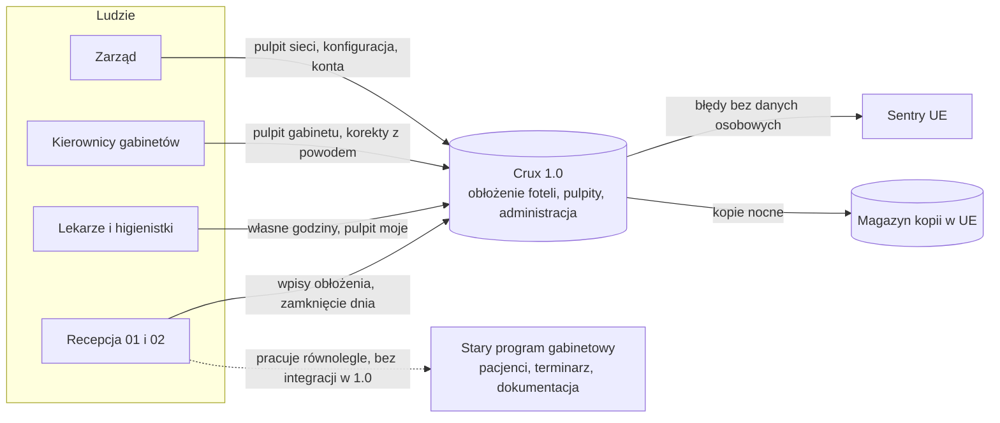

*Rysunek: Kontekst systemu w wydaniu 1.0: kto i co rozmawia z Crux (`podrecznik/rysunki/kontekst.mmd`, SVG obok).*

W 1.0 nie ma pacjenta, Platformy P1, SMS-ów ani ZnanyLekarz. Stary program gabinetowy zostaje nietknięty; Crux stoi obok i mierzy. Integracje zewnętrzne mają już porty i atrapy, żeby 1.1 tylko podpinało adaptery.

## 3.3 Kontenery i środowiska

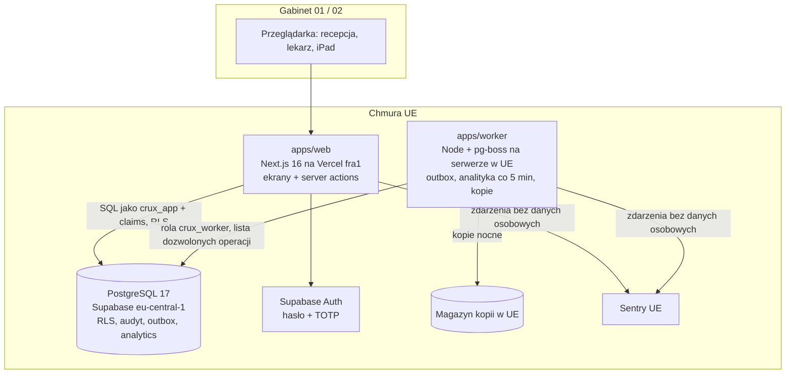

*Rysunek: Kontenery i środowiska: aplikacja, worker, baza, usługi (`podrecznik/rysunki/kontenery.mmd`, SVG obok).*

| Środowisko | Baza | Dane | Kto |
|---|---|---|---|
| lokalne | Supabase CLI (Docker na laptopie) | fabryki, `pnpm seed:demo` | Miłosz, Cursor |
| podgląd (PR) | gałąź Supabase | fabryki | automatycznie z PR |
| staging | projekt `crux-staging`, Frankfurt | syntetyczne, wolumen jak produkcja | testy akceptacyjne z recepcją |
| produkcja | projekt `crux-prod`, Frankfurt, PITR | prawdziwe (personel, wpisy obłożenia) | gabinety |

Koszt infrastruktury 1.0: ok. 1 000–1 500 zł miesięcznie (Supabase Pro + PITR, Vercel Pro, serwer workera w UE, Sentry). Szczegóły: `docs/01`, sekcja 13.

## 3.4 Moduły w 1.0 i kierunki zależności

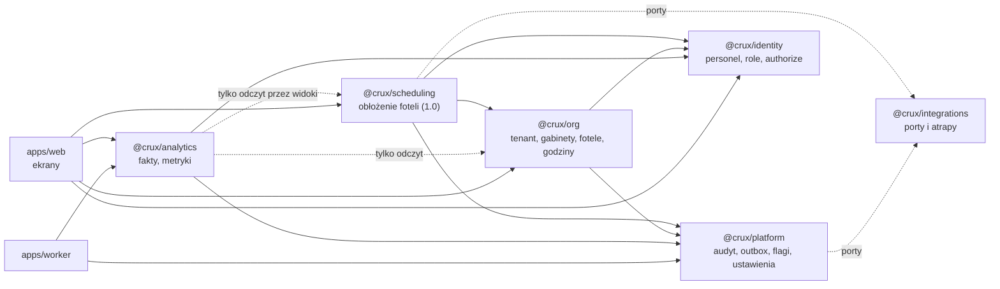

*Rysunek: Moduły 1.0 i dozwolone kierunki zależności (`podrecznik/rysunki/moduly.mmd`, SVG obok).*

| Moduł | Pakiet | W 1.0 odpowiada za | Prompt |
|---|---|---|---|
| Platforma | `@crux/platform` | audyt, log dostępu, outbox, `command_log`, flagi, ustawienia (w tym `scheduling.occupancy_mode`) | K05 |
| Tożsamość | `@crux/identity` | personel, role, uprawnienia jako dane, członkostwa, `authorize()`, claims, konta | K06 |
| Organizacja | `@crux/org` | tenant (podmiot leczniczy), gabinety, fotele, godziny otwarcia, wyjątki | K06 |
| Terminarz (część 1.0) | `@crux/scheduling` | obłożenie foteli: wpisy, blokady foteli, zamknięcie dnia; **moduł wzorcowy** | K11 |
| Analityka (część 1.0) | `@crux/analytics` | schemat `analytics`, zasilanie, rejestr metryk, `runMetric` | K13 |
| Integracje | `@crux/integrations` | porty i atrapy (SMS, pliki, KMS); adaptery od 1.1 | K09, K12 |
| Współdzielone | `@crux/shared`, `@crux/db`, `@crux/ui`, `@crux/i18n`, `@crux/testing` | typy wartości, dostęp do bazy, design system, teksty, fabryki | K03, K04, K08, K12 |

Strzałka „A → B” znaczy „A może importować z B”. Reszta jest zabroniona i egzekwowana lintem i `dependency-cruiser`. Reakcja modułu „niżej” na coś z modułu „wyżej” idzie wyłącznie przez zdarzenie domenowe w outboxie (np. `occupancy.day_closed.v1` → worker → odświeżenie analityki).

## 3.5 Budowa jednego modułu (szablon, który generuje `pnpm gen module`)

```
packages/modules/scheduling/
  src/
    domain/                     # typy, encje, reguły; zero I/O; czas z ctx.clock
      chair-occupancy.ts
      chair-occupancy.rules.test.ts
      day-closure.ts
    application/                # przypadki użycia: komendy i zapytania
      record-occupancy.ts
      record-occupancy.test.ts  # integracyjny, z bazą testową i RLS
      close-day.ts
      get-day-grid.ts
    infrastructure/             # repozytoria (Drizzle), mapowanie wierszy na domenę
      occupancy.repository.ts
      day-grid.read-model.ts
    events.ts                   # zdarzenia publikowane przez moduł (typy + schematy Zod)
    permissions.ts              # uprawnienia definiowane przez moduł
    index.ts                    # JEDYNY publiczny interfejs modułu
  package.json                  # name: @crux/scheduling
  README.md                     # 10 linii: co moduł robi, czego nie robi, od czego zależy
```

Ekrany żyją w `apps/web/app/(app)/…`, komponenty specyficzne dla funkcji w `apps/web/features/<moduł>/`, komponenty ogólne w `packages/ui`.

## 3.6 Przepływ jednej komendy (co się dzieje po „Zapisz”)

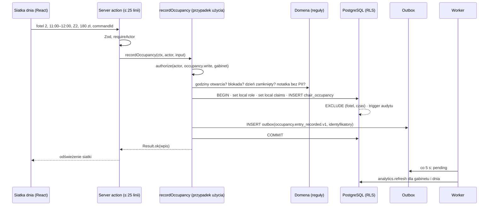

*Rysunek: Przepływ jednej komendy: od kliknięcia do zdarzenia w outboxie (`podrecznik/rysunki/przeplyw-komendy.mmd`, SVG obok).*

Zasady, które ten rysunek egzekwuje:

- przypadek użycia zwraca `Result<T, DomainError>`; wyjątki tylko dla awarii technicznych;
- jedna komenda = jedna transakcja; zdarzenie zapisuje się do outboxa w tej samej transakcji, więc nie istnieje stan „wpis zapisany, analityka o tym nie wie”;
- idempotencja: komenda ma `commandId` z klienta; powtórka (podwójne kliknięcie, utrata łączności) zwraca pierwotny wynik (`platform.command_log`);
- server action ma ≤ 25 linii: waliduje (Zod), woła przypadek użycia, zwraca wynik; logika nie żyje w Next.js.

## 3.7 Obrona w głąb: dlaczego baza sama pilnuje dostępu

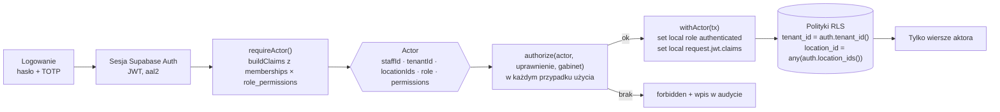

*Rysunek: Jak system wie, kto pyta: od logowania do polityki RLS (`podrecznik/rysunki/rls.mmd`, SVG obok).*

1. **Aplikacja:** `authorize(actor, permission, scope)` w każdym przypadku użycia sprawdza uprawnienie i członkostwo w gabinecie. Uprawnienia są danymi (`identity.permissions`, `role_permissions`) sprawdzanymi w jednym miejscu.
2. **Baza:** RLS (row level security) na każdej tabeli. Serwer łączy się jako `crux_app` i w każdej transakcji ustawia `set local role authenticated` oraz claims (`request.jwt.claims`: kto, który tenant, które gabinety, jakie uprawnienia). Polityki porównują `tenant_id` i `location_id` z claimami. Nawet jeśli AI zapomni o `where location_id = …`, baza nie odda cudzych wierszy.
3. **Brak bocznych drzwi:** Data API Supabase wyłączone (ADR-020); klucz workera ma osobną rolę `crux_worker` z listą dozwolonych operacji (`apps/worker/src/privileged.ts`) i własnym audytem; żadnego `service_role` w kodzie.
4. **Test:** każda tabela ma test pgTAP „użytkownik tenanta A nie widzi i nie zmieni wiersza tenanta B” oraz „użytkownik gabinetu 01 bez członkostwa w 02 nie widzi wiersza z 02”.

## 3.8 Zdarzenia, outbox i worker

- `platform.outbox`: wiersz na zdarzenie (`topic`, `payload` z samymi identyfikatorami, `status`, `attempts`, `dedupe_key`). Adapter dociąga dane w chwili wysyłki.
- Worker (pg-boss) co 5 s pobiera `pending`, wykonuje handler, ponawia z wykładniczym odstępem, po 8 próbach oznacza `dead` i tworzy zadanie dla człowieka na ekranie Integracje.
- Zadania cykliczne w 1.0: `analytics.refresh` (co 5 min i pełne 02:10), `backup.nightly` (02:00), `integrity.verify` (03:00).
- Zdarzenia mają schemat Zod i wersję (`occupancy.day_closed.v1`); zmiana kształtu = nowa wersja, stare konsumenty działają.

## 3.9 Analityka jako osobny schemat

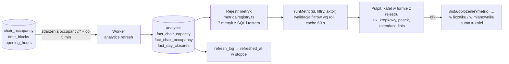

*Rysunek: Droga liczby: od komórki w siatce do kafla na pulpicie (`podrecznik/rysunki/analityka.mmd`, SVG obok).*

Pulpity nie liczą nic z tabel operacyjnych. Czytają ze schematu `analytics` (fakty i wymiary), który worker odświeża co 5 minut. Każda metryka ma: definicję słowną, SQL w `@crux/analytics/metrics/<id>.ts`, test na zestawie wzorcowym, wpis w rejestrze (`docs/11`) i drążenie do listy rekordów. Dlaczego osobno: żeby ekran dnia nie zwalniał od zapytań zarządu, żeby definicje były w jednym miejscu i żeby w 2.1 dołożyć fakty wizyt i należności bez przebudowy.

## 3.10 Strażnicy: jak system rośnie przez prompty i się nie psuje

| Strażnik | Co łapie | Gdzie |
|---|---|---|
| `pnpm gen` | tworzy szkielet modułu, przypadku użycia, ekranu, metryki, żeby AI nie wymyślało struktury | `tools/gen` |
| TypeScript strict + ESLint boundaries | import z wnętrza cudzego modułu, `any`, `new Date()` poza `shared/time` | `packages/config` |
| `dependency-cruiser` | zależność między modułami spoza grafu z `docs/01` | `packages/config/dependency-cruiser.cjs` |
| pgTAP | tabela bez RLS, wyciek między tenantami i gabinetami, aktualizacja tabeli tylko do dopisywania | `supabase/tests` |
| `crux-doctor` | tabela bez wpisu w `03a`, server action > 25 linii, `service_role`, HEX poza tokenami, metryka bez rejestru, forma wykresu niezgodna z rejestrem, spec bez testów `[ID/ACn]`, zmiana reguł bez aktualizacji locka | `tools/doctor` |
| znaczniki `[ID/ACn]` | każde kryterium akceptacji ma test | testy |
| `prompts/ledger.md` | pamięć projektu między czatami: co zrobiono, co odrzucono, jaki dług | `prompts/` |
| przegląd adwersarialny | drugi model szuka dziur po każdym prompcie `security`, `money`, `clinical` | `docs/10`, 3.5 |

## 3.11 Decyzje, które chronią 1.0 (z ADR)

| ADR | Decyzja | Przed czym chroni |
|---|---|---|
| 001, 002 | modularny monolit, TypeScript wszędzie | rozjazd kontraktów między usługami; dwa języki w jednym zespole |
| 004, 020 | Supabase we Frankfurcie, Data API wyłączone, plan wyjścia | transfer danych poza UE; dostęp do bazy z pominięciem RLS |
| 005 | Drizzle + RLS przez claims w transakcji | zapytanie bez `where tenant_id` |
| 007 | UUIDv7, grosze jako `bigint`, `timestamptz`, `tstzrange` z więzem wykluczającym | kolizje identyfikatorów, błędy zaokrągleń, nakładające się wpisy na fotelu |
| 008 | dokumentacja i finanse tylko dopisywane | „kto to zmienił i dlaczego” bez odpowiedzi |
| 009 | outbox + pg-boss | zgubione zdarzenie, blokada recepcji przez awarię integracji |
| 014, 031 | własny design system z pakietu marki, model kuleczkowy | wygląd „jak każdy SaaS”; kolory spoza tokenów |
| 027 | schemat `analytics` i metryki jako kod | liczby liczone ad hoc w ekranach, bez testu i definicji |
| 029 | generator, doctor, granice modułów | AI rozjeżdżające architekturę krok po kroku |
| 030 | Next.js 16 bez Cache Components do 2.1 | wyciek danych między użytkownikami przez cache |
| 032 | wydania; 1.0 bez danych pacjentów; obłożenie jako wzorzec | czekanie na prawników z wartością dla gabinetów |


# 4 · Dane: jak wygląda baza wydania 1.0

Źródło na poziomie DDL: `docs/03a-schemat-bazy.md` (sekcje 0–3, 5.1, 12.1, 14a). Słownik i niezmienniki: `docs/03-model-domeny.md`. Tu jest mapa i wyjaśnienie, dlaczego tak.

## 4.1 Mapa encji 1.0

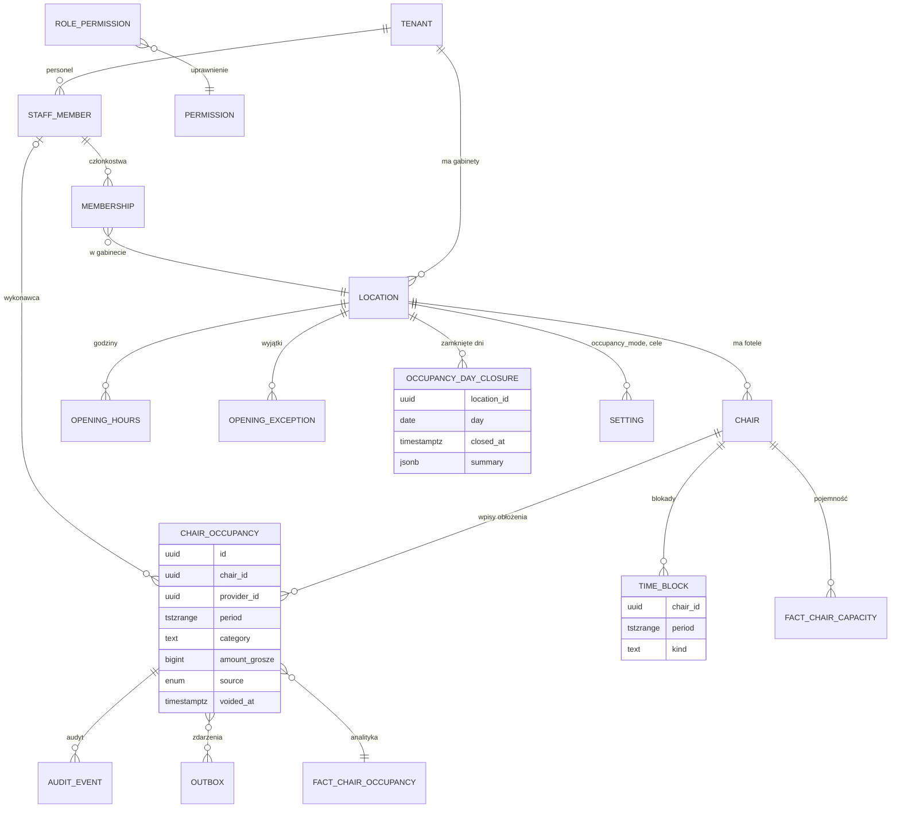

*Rysunek: Mapa encji wydania 1.0 (`podrecznik/rysunki/er-1-0.mmd`, SVG obok).*

Trzy schematy operacyjne (`public` z tabelami modułów, `platform`, `audit`), schemat `analytics` (fakty i wymiary), `ref` (słowniki, w 1.0 tylko kategorie Z1–Z+), `pgboss` (kolejka workera). Dane pacjentów nie istnieją; pierwszą tabelę `patients` tworzy dopiero wydanie 1.1 i jest to migracja z etykietą `patient-data`.

## 4.2 Tabele 1.0 w jednym miejscu

| Schemat.tabela | Co trzyma | Kto pisze | Wzorzec RLS | Tylko dopisywanie |
|---|---|---|---|---|
| `tenants` | podmiot leczniczy (administrator danych), DEK w KMS | zarząd (K17 bootstrap) | `tenant_all` (własny) | nie |
| `locations` | gabinety `01`, `02` z numerem, nazwą, kodem resortowym, `color_key` | `org.manage` | `tenant_all` | nie |
| `chairs` | fotele gabinetu: nazwa, kolejność, wyposażenie, `active` | `org.manage` | `tenant_all` | nie |
| `opening_hours`, `opening_exceptions` | tygodniowy wzorzec godzin i wyjątki (święta, dni skrócone) | `org.manage` | `tenant_all` | nie |
| `staff_members` | personel: imię, nazwisko, tytuł, NPWZ, e-mail, `auth_user_id` | `staff.manage` | `tenant_all` (własny rekord: ograniczone kolumny) | nie |
| `memberships` | przypisanie osoby do gabinetu z rolą i okresem | `staff.manage` | `tenant_all` | nie (koniec = `ends_on`) |
| `permissions`, `role_permissions` | uprawnienia jako dane i macierz ról | migracja danych (K06) | `ref_read` | tak |
| `provider_capabilities` | kategorie usług, które wykonawca może wykonywać | `staff.manage` | `tenant_all` | nie |
| `break_glass_requests` | dostęp awaryjny (używany od 1.1) | lekarz, kierownik | `tenant_all` + `audit.read` | tak |
| `chair_occupancy` | **wpis obłożenia**: fotel × godzina, wykonawca, kategoria, kwota, źródło, unieważnienie | `occupancy.write`, `occupancy.write_own` | `tenant_location` | nie, ale bez `delete` (unieważnianie) |
| `occupancy_day_closures` | zamknięcie dnia w gabinecie z podsumowaniem | `occupancy.close_day` | `tenant_location` | nie (ponowne otwarcie z powodem) |
| `time_blocks` | blokady foteli (serwis, zamknięcie, szkolenie); od 1.1 także wykonawców | `occupancy.write` | `tenant_location` | nie (`ended_at`) |
| `platform.outbox`, `command_log` | zdarzenia do wysłania; idempotencja komend | kod | tenant | tak |
| `platform.feature_flags`, `settings` | flagi per tenant/gabinet; ustawienia z rejestru kluczy (`scheduling.occupancy_mode`, `analytics.targets.*`) | `settings.manage` | tenant | nie |
| `audit.events` | kto, co, kiedy, przed/po (bez pól wrażliwych), powód | trigger `audit.track()` | `audit.read` | tak |
| `audit.access_log` | odczyty danych pacjenta (od 1.1; mechanizm testowany w 1.0) | funkcja `audit.log_access()` | `audit.read` | tak |
| `audit.integrity_checks` | wyniki weryfikacji łańcuchów (od 3.0; worker od 1.0 pisze „brak danych”) | worker | `audit.read` | tak |
| `analytics.dim_*`, `fact_chair_capacity`, `fact_chair_occupancy`, `fact_day_closures`, `refresh_log` | wymiary i fakty 1.0 (rozdział 7) | worker `analytics.refresh` | `tenant_location` + widoki per rola | przeliczane |

Wzorce RLS (`docs/03a`, sekcja 0): `tenant_all` (widoczne dla całego tenanta), `tenant_location` (tylko gabinety z członkostwem, chyba że `network.view`), `append_only` (bez `update`/`delete` dla `authenticated`), `self_or_manager` (własne wiersze lub kierownik), `ref_read` (słowniki tylko do odczytu).

## 4.3 Wpis obłożenia: tabela, która przeżyje wszystkie wydania

```sql
create table chair_occupancy (
  id uuid primary key default extensions.uuid_generate_v7(),
  tenant_id uuid not null, location_id uuid not null references locations,
  chair_id uuid not null references chairs,
  provider_id uuid references staff_members,            -- kto pracował; null = nieprzypisany
  period tstzrange not null,                             -- [start, end); 1.0: pełne godziny lokalne
  category text not null,                                -- 'Z1'…'Z+'
  amount_grosze bigint check (amount_grosze >= 0),       -- przychód przypisany do wpisu; null = nie wpisano
  source occupancy_source not null default 'manual',     -- manual | appointment | import
  appointment_id uuid,                                   -- od 1.1 (FK dodany w F1-002)
  override_reason text,                                  -- gdy poza godzinami otwarcia (kierownik)
  note text check (char_length(note) <= 80),             -- organizacyjna; containsPii w domenie
  voided_at timestamptz, voided_by uuid, void_reason text,
  created_at timestamptz not null default now(), created_by uuid, updated_at timestamptz, updated_by uuid,
  exclude using gist (chair_id with =, period with &&) where (voided_at is null),
  check (lower(period) < upper(period)),
  check ((voided_at is null) = (void_reason is null))
);
```

Dlaczego tak, element po elemencie:

- **`period tstzrange`** (pełny zakres czasu): baza umie sprawdzić nakładanie zakresów (`&&`) i w 1.1 wpisy pochodne z wizyt mają prawdziwy czas (10:15–10:45), a definicja metryki się nie zmienia. W 1.0 pełne godziny wymusza interfejs; baza dopuszcza minuty.
- **więz wykluczający** `exclude using gist (chair_id with =, period with &&) where (voided_at is null)`: dwa nieunieważnione wpisy nie mogą nachodzić na ten sam fotel. Działa niezależnie od kodu: nawet błędny prompt nie stworzy duplikatu (AC2 w F0-010).
- **`amount_grosze bigint`**: pieniądze w groszach jako liczba całkowita, typ `Money` w kodzie; nigdy `number` z przecinkiem (ADR-007). `null` znaczy „nie wpisano”, co jest inną informacją niż `0`.
- **`source`**: w 1.0 zawsze `manual`; od 1.1 wizyty tworzą wiersze `appointment`; import historii da `import`. Analityka liczy wszystkie, ale pokazuje odsetek ręcznych.
- **`voided_at` + `void_reason`**: nic nie znika, każda korekta ma powód (zasada „nic nie znika” z `docs/00`), a `check` pilnuje, że unieważnienie zawsze ma powód.
- **brak jakiejkolwiek kolumny o pacjencie** i reguła w `AGENTS.md`, że jej nie będzie: identyfikacja pacjenta należy do `appointments` (1.1).

## 4.4 Pojemność, blokady, zamknięcie dnia

- **Pojemność fotela** na dzień = godziny otwarcia gabinetu (tygodniowy wzorzec `opening_hours` z wyjątkami `opening_exceptions`) minus blokady fotela (`time_blocks` z `chair_id`). To mianownik obłożenia; liczy go worker do `fact_chair_capacity`.
- **Blokada** (`time_blocks`): serwis, zamknięcie, szkolenie, inne; w 1.1 także urlop i przerwa wykonawcy (`staff_id`). Wpis obłożenia w czasie blokady jest odrzucany przez domenę (AC8).
- **Zamknięcie dnia** (`occupancy_day_closures`): jeden wiersz na gabinet i dzień, z podsumowaniem (`summary jsonb`: godziny, kwota, fotele bez wpisów). Po zamknięciu zwykła edycja jest zablokowana; `reopened_at` z powodem otwiera ponownie. Odsetek zamkniętych dni to metryka jakości danych (`days_closed_rate`).

## 4.5 Ustawienia jako dane: tryb obłożenia

`platform.settings` z rejestrem kluczy (`settings/keys.ts`). Klucz `scheduling.occupancy_mode` per gabinet: `manual` (1.0) albo `appointments` (po przejściu gabinetu na terminarz w 1.1). Zasilanie analityki czyta wpisy ręczne dla `manual`, a wizyty dla `appointments`; domena odrzuca wpisy ręczne dla dni po przełączeniu (AC11). Dzięki temu przełączenie gabinetu to zmiana jednego ustawienia i da się je zrobić dla 01 i 02 w różnych dniach.

## 4.6 Identyfikatory, czas, pieniądze (konwencje, które obowiązują wszędzie)

- identyfikatory: UUIDv7 (`extensions.uuid_generate_v7()`), typ `Id` w kodzie; posortowane w czasie, więc indeksy są tanie;
- czas: `timestamptz` w UTC; prezentacja w `Europe/Warsaw` przez `@crux/shared/time`; nigdy `new Date()` poza `packages/shared/src/time.ts`; `hourRange(day, hour)` zwraca pełną godzinę lokalną z poprawną obsługą zmiany czasu (test dla 2027-03-28);
- pieniądze: grosze `bigint`, `Money.format()` → `1 234,50 zł`, `Money.formatShort()` → `412 tys. zł`;
- każda tabela: `id`, `tenant_id`, `created_at`, `created_by`, komentarz `rls:/append_only:/retention:`, RLS, trigger audytu, test pgTAP (`AGENTS.md`, zasada 4);
- migracje: `drizzle-kit generate` → przegląd → `pnpm db:test` → staging → produkcja; zawsze expand → migrate → contract; migracje na `main` tylko się dokłada.

## 4.7 Audyt: co zapisuje się samo

Trigger `audit.track()` na każdej tabeli modułów zapisuje `before`/`after` jako JSON (z usunięciem pól `*_enc`, których w 1.0 nie ma, ale reguła już działa), autora, `request_id` i powód z `current_setting('crux.reason')`. Zmiana kosztu, unieważnienie wpisu, edycja po zamknięciu dnia i nadpisanie godzin wymagają powodu na poziomie domeny i trafiają do audytu razem z nim. `audit.events` czyta tylko `audit.read` (zarząd, audytor, kierownik dla swojego gabinetu).

## 4.8 Retencja

Wpisy obłożenia, zamknięcia dni i blokady: 5 lat (dane operacyjne); czyszczenie workerem z protokołem. Logi audytu: 5 lat **[do potwierdzenia]**. Outbox: 13 miesięcy. Pełna tabela: `docs/03a`, sekcja 15.


# 5 · Dostępy: kto co widzi i skąd system to wie

## 5.1 Trzy pojęcia

- **Rola** (`staff_role`): `network_admin` (zarząd), `location_manager` (kierownik gabinetu), `receptionist` (recepcja), `dentist` i `hygienist` (wykonawcy), `assistant` (asystentka), `accountant` (księgowość), `auditor` (audytor). Rola jest przypisana do osoby **w gabinecie**.
- **Członkostwo** (`memberships`): osoba × gabinet × rola × okres (`starts_on`, `ends_on`). Lekarz pracujący w 01 i 02 ma dwa członkostwa. Odejście z pracy to `ends_on`; rekord zostaje.
- **Uprawnienie** (`permissions`): konkretna czynność, np. `occupancy.write`, `analytics.view_network`. Macierz rola → uprawnienia jest danymi w bazie (`role_permissions`), seedowana w K06 z tabeli w `docs/03`, sekcja 8. Kod pyta o uprawnienie („czy ma `occupancy.write_own`?”); rola jest tylko zestawem uprawnień.

## 5.2 Macierz 1.0

Zakres: `sieć` = wszystkie gabinety tenanta; `gabinet` = gabinety z członkostwem; `własne` = tylko rekordy, w których wykonawcą jest użytkownik.

| Uprawnienie | zarząd | kierownik | recepcja | lekarz / higienistka | asystentka | księgowość | audytor |
|---|---|---|---|---|---|---|---|
| `org.manage` (gabinety, fotele, godziny) | sieć | — | — | — | — | — | — |
| `staff.manage` (konta, role, członkostwa) | sieć | — | — | — | — | — | — |
| `settings.manage` (flagi, ustawienia, cele) | sieć | — | — | — | — | — | — |
| `audit.read` | sieć | gabinet | — | — | — | — | sieć |
| `occupancy.read` | sieć | gabinet | gabinet | gabinet | gabinet | sieć | sieć |
| `occupancy.write` | sieć | gabinet | gabinet | — | — | — | — |
| `occupancy.write_own` | — | — | — | własne | — | — | — |
| `occupancy.void` | sieć | gabinet | gabinet (dzień otwarty) | własne | — | — | — |
| `occupancy.close_day` | sieć | gabinet | gabinet | — | — | — | — |
| `occupancy.write_closed` (po zamknięciu, z powodem) | sieć | gabinet | — | — | — | — | — |
| `occupancy.override_hours` (poza godzinami, z powodem) | sieć | gabinet | — | — | — | — | — |
| `analytics.view_self` | — | — | — | własne | — | — | — |
| `analytics.view_location` | — | gabinet | — | — | — | — | — |
| `analytics.view_network` | sieć | — | — | — | — | sieć | — |
| `analytics.export` (CSV) | sieć | gabinet | — | — | — | sieć | — |
| `network.view` (przełącznik „cała sieć”) | sieć | — | — | — | — | sieć | sieć |
| `integrations.manage` | sieć | — | — | — | — | — | — |

Zasady: zarząd nie dostaje uprawnień „własne” (jeśli wspólnik leczy, ma drugie członkostwo jako `dentist`); konta `accountant` i `auditor` powstają, gdy są potrzebne (w 1.0 nie); każde nowe uprawnienie to wiersz w `docs/03`, sekcja 8, plus `permissions.ts`, plus migracja danych, w jednym PR.

## 5.3 Przykłady na osobach z danych testowych

- **Kasia Nowak, recepcja 01:** widzi i wpisuje obłożenie 01, zamyka dzień 01. Nie widzi 02 (RLS: brak członkostwa). Nie widzi pulpitu (brak `analytics.view_*`); jedyna „analityka”, jaką ma, to pasek sum pod siatką dnia (ekran operacyjny).
- **lek. dent. Piotr Kos, członkostwa w 01 i 02:** w przełączniku ma oba gabinety; wpisuje tylko własne godziny (`provider_id = ja`); pulpit „moje” liczy jego godziny z obu gabinetów; mediana gabinetu bez nazwisk.
- **Ewa Mróz, kierownik 02:** pulpit gabinetu dla 02, tabela wykonawców 02, poprawki po zamknięciu dnia z powodem; na `/pulpit` (sieć) dostaje przekierowanie do `/pulpit/gabinet`; parametr `gabinet=01` w URL jest ignorowany po stronie serwera (AC3 w F0-011).
- **Miłosz, zarząd:** wszystko we wszystkich gabinetach; w przełączniku „01 + 02 · cała sieć”; eksport CSV zostawia ślad w `audit.events`.

## 5.4 Jak system to wie: od logowania do polityki w bazie


*Rysunek: Jak system wie, kto pyta: od logowania do polityki RLS (`podrecznik/rysunki/rls.mmd`, SVG obok).*

1. Logowanie przez Supabase Auth: hasło + kod TOTP (MFA, `aal2`). Pierwsze logowanie wymusza zmianę hasła jednorazowego i rejestrację TOTP.
2. `requireActor()` czyta sesję z ciasteczka, weryfikuje JWT i buduje **claims** z członkostw: `{ staffId, tenantId, locationIds, activeLocationId, role, permissions[] }`; aktywny gabinet pochodzi z ciasteczka `crux.location` (przełącznik w pasku bocznym).
3. Każdy przypadek użycia woła `authorize(actor, 'occupancy.write', { locationId })`: brak uprawnienia lub członkostwa → `forbidden` + wpis w audycie.
4. `withActor(actor, tx => …)` otwiera transakcję, ustawia `set local role authenticated` i `request.jwt.claims`, więc polityki RLS w bazie widzą tego samego aktora. Zapytanie bez `where` nadal nie odda cudzych danych.
5. Worker działa jako `crux_worker` z listą dozwolonych operacji (`privileged.ts`); każda operacja ma nazwę i audyt.

## 5.5 Sesja, blokada, konta

- sesja 12 h; blokada ekranu po 5 minutach bezczynności (stanowiska wspólne), odblokowanie hasłem lub kodem bez utraty stanu strony;
- konta imienne; hasło jednorazowe pokazywane raz przy zaproszeniu i przekazywane osobiście; nigdy e-mailem ani na czacie;
- dezaktywacja: `deactivateStaffMember` kończy członkostwa (`ends_on`), wylogowuje, zostawia historię;
- reset MFA tylko przez zarząd z powodem (audyt);
- w 1.0 nie ma SSO (Entra ID dochodzi w 2.1) i nie ma logowania pacjentów (portal w 5.0).

## 5.6 Co się dzieje, gdy ktoś spróbuje obejść

| Próba | Co ją zatrzymuje |
|---|---|
| recepcja 01 wpisuje w URL `gabinet=02` | serwer ignoruje parametr spoza członkostw; RLS nie zwraca wierszy 02 |
| prompt generuje zapytanie bez `where location_id` | RLS; test pgTAP dla każdej tabeli |
| kod próbuje użyć `service_role` albo `security definer` | `crux-doctor` (`code.no-service-role`, `code.no-security-definer`) i przegląd PR |
| ktoś chce „na chwilę” wyłączyć RLS na tabeli | `db.rls-required` czerwone w CI; `AGENTS.md` zabrania |
| lekarz wpisuje godziny za kolegę | `occupancy.write_own` wymaga `provider_id = auth.staff_id()` (polityka i domena) |
| ktoś wpisuje nazwisko pacjenta w notatce | `containsPii` odrzuca telefony, PESEL i e-maile; pole ma 80 znaków; reguła w `AGENTS.md` nie pozwala dodać pola o pacjencie |


# 6 · Obłożenie foteli: moduł wzorcowy

Specyfikacja: `docs/specs/F0-010-oblozenie-godzinowe.md` (11 kryteriów akceptacji). Prompt: K11 w czterech częściach. Ten rozdział tłumaczy model i ekran; spec jest źródłem kryteriów.

## 6.1 Model w jednym zdaniu

Fotel × godzina = komórka. Komórka jest pusta (fotel stał), ma wpis (fotel pracował: kto, kategoria Z, opcjonalnie kwota) albo jest zablokowana (serwis, zamknięcie). Dzień gabinetu można zamknąć; potem zmiany wymagają kierownika i powodu.

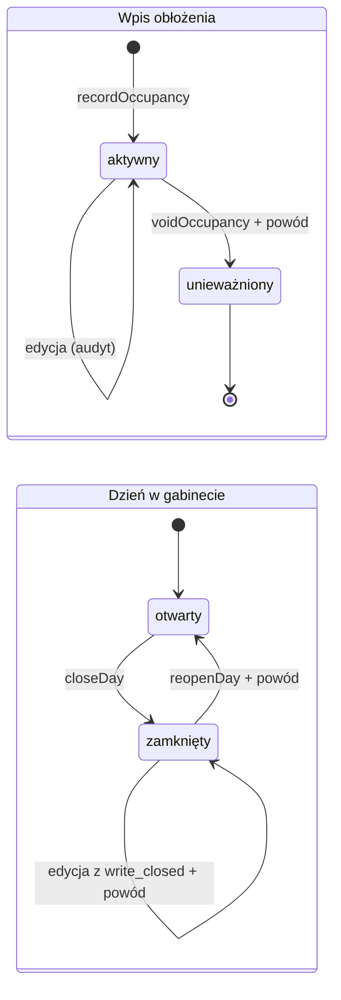

*Rysunek: Stany wpisu obłożenia i dnia w gabinecie (`podrecznik/rysunki/oblozenie-stany.mmd`, SVG obok).*

## 6.2 Ekran `/oblozenie`

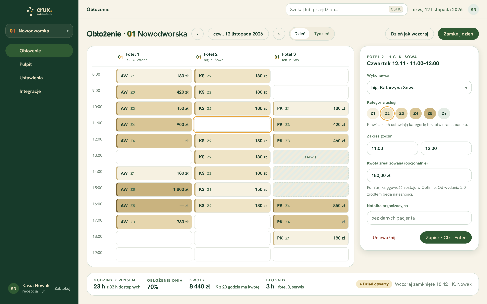

*Makieta: Ekran Obłożenie: siatka dnia gabinetu 01 (dane przykładowe) (`manifest/makiety/oblozenie.png`).*

| Element | Zachowanie |
|---|---|
| Nagłówek | przełącznik gabinetu, data, `←/→`, `T` dziś, przełącznik Dzień/Tydzień, „Dzień jak wczoraj”, „Zamknij dzień” |
| Siatka (`HourGrid`) | kolumny = fotele z chipem gabinetu i wykonawcą z wczoraj; wiersze = godziny otwarcia z wyjątkami; komórki poza godzinami wyszarzone |
| Komórka z wpisem | tło w kolorze kolornika kategorii, pasek 4 px w kolorze krawędzi, inicjały wykonawcy, kategoria, kwota `450 zł` albo `— zł` |
| Komórka zablokowana | kreskowanie mgłą + słowo (serwis, zamknięte, szkolenie) |
| Panel wpisu (`SidePanel`) | wykonawca (`Select` z personelu gabinetu), kategoria (`ChipToggle` Z1–Z+), zakres godzin, kwota w złotych z przecinkiem, notatka ≤ 80 znaków; „Zapisz” (`Ctrl+Enter`), „Unieważnij…” (z powodem) |
| Pasek dnia | godziny z wpisem / dostępne, obłożenie dnia, suma kwot z odsetkiem godzin z kwotą, blokady, stan dnia (otwarty / zamknięty przez kogo i kiedy) |
| Widok tygodnia | `DotCalendar` per fotel i dzień, tabela sum, dni niezamknięte oznaczone |

## 6.3 Klawiatura (recepcja pracuje z rękami na klawiaturze)

| Klawisz | Działanie |
|---|---|
| strzałki | fokus po komórkach (obwódka bursztynowa) |
| `Enter` | otwiera panel wpisu dla komórki (albo edycję istniejącego) |
| `1`–`6` | ustawia kategorię Z1–Z+ od razu, z wykonawcą „jak w sąsiedniej komórce” |
| `Shift` + strzałka | zaznacza zakres godzin na jednym fotelu (jedna komenda `recordOccupancyRange`) |
| `Backspace` | unieważnia wpis (`ConfirmDialog` z powodem) |
| `Ctrl+Enter` | zapis w panelu |
| `Esc` | zamyka panel bez zapisu |
| `T`, `←`, `→` | dziś, poprzedni dzień, następny dzień |

Kryterium AC9: uzupełnienie 3 godzin na dwóch fotelach, unieważnienie jednej i zamknięcie dnia bez myszy (test e2e).

## 6.4 Reguły domeny (gdzie mieszka „mądrość”)

Wszystkie w `packages/modules/scheduling/src/domain/`, testowane jednostkowo z `FixedClock`:

1. pełne godziny lokalne w 1.0 (`hourRange`), z poprawną obsługą zmiany czasu;
2. wpis w godzinach otwarcia gabinetu z wyjątkami; poza nimi tylko z `occupancy.override_hours` i powodem (AC3);
3. wpis nie wchodzi w blokadę fotela (AC8);
4. kategoria z listy Z1–Z+; kwota ≥ 0 w groszach;
5. notatka ≤ 80 znaków i `containsPii === false` (AC7): numery telefonów, PESEL, e-maile są odrzucane;
6. po zamknięciu dnia zmiana wymaga `occupancy.write_closed` i powodu (AC5);
7. unieważnienie zawsze z powodem; wpis zostaje (AC6);
8. gabinet w trybie `appointments` nie przyjmuje wpisów ręcznych dla dni po dacie przełączenia (AC11);
9. nakładanie na fotelu: więz w bazie (`23P01` → `conflict` z komunikatem, AC2).

## 6.5 Przypadki użycia

| Komenda / zapytanie | Uprawnienie | Zdarzenie |
|---|---|---|
| `recordOccupancy` (jedna komórka: tworzy lub aktualizuje) | `occupancy.write` / `occupancy.write_own` | `occupancy.entry_recorded.v1` |
| `recordOccupancyRange` (zakres godzin jednego fotela, jedna transakcja) | jw. | jw. (jedno zdarzenie per wpis) |
| `voidOccupancy` (powód) | `occupancy.void` | `occupancy.entry_voided.v1` |
| `copyDayFrom` („dzień jak wczoraj”: wykonawcy i kategorie, bez kwot) | `occupancy.write` | `occupancy.entry_recorded.v1` |
| `closeDay` | `occupancy.close_day` | `occupancy.day_closed.v1` |
| `reopenDay` (powód) | `occupancy.write_closed` | `occupancy.day_reopened.v1` |
| `createTimeBlock`, `endTimeBlock` | `occupancy.write` | — |
| `getDayGrid(locationIds, day)` (jedna kwerenda, AC10) | `occupancy.read` | — |
| `getWeekSummary`, `listOccupancy(filters)` (lista drążenia) | `occupancy.read` / `analytics.*` | — |

Każda komenda: walidacja Zod, `commandId`, `authorize`, `withActor`, outbox w tej samej transakcji.

## 6.6 Co z tego liczy analityka

Worker po każdym zdarzeniu `occupancy.*` (i co 5 minut dla ostatnich 48 h) przelicza `fact_chair_capacity` (fotel × dzień: minuty otwarcia, blokad, dostępne) i `fact_chair_occupancy` (fotel × dzień × wykonawca × kategoria: minuty, kwota, liczba wpisów). Z tego pochodzą wszystkie metryki 1.0 (rozdział 7). Wpisy unieważnione nie są liczone; dni niezamknięte są liczone, ale oznaczone.

## 6.7 Przejście do 1.1 (żeby nic nie było „wdową”)

Gdy gabinet przechodzi na terminarz Crux, zarząd ustawia `scheduling.occupancy_mode = appointments` dla tego gabinetu (ekran Ustawienia → System, z ostrzeżeniem). Od tej daty:

- obłożenie liczy się z wizyt (statusy inne niż `cancelled`/`no_show`), a każda wizyta utrzymuje wiersz pochodny w `chair_occupancy` (`source = appointment`, bez kwoty), więc historia jest jedną tabelą;
- wpisy ręczne dla dni po przełączeniu są odrzucane; dni sprzed przełączenia zostają jak były;
- kwoty znikają z wpisów w 2.0, gdy źródłem przychodu stają się należności (`revenue_realized` z polem `since` w rejestrze);
- ekran `/oblozenie` zostaje jako widok tygodnia i siatka dla gabinetów w trybie ręcznym (np. nowo otwarty 03, zanim dostanie terminarz).

## 6.8 Dlaczego to jest wzorzec do kopiowania

Moduł ma wszystko, co każdy przyszły moduł: migrację z RLS i pgTAP, domenę z regułami i testami, przypadki użycia z `commandId`/`authorize`/outbox, ekran z komponentami z `packages/ui`, e2e z klawiaturą, zdarzenia konsumowane przez worker, metryki w analityce, specyfikację z `[ID/ACn]`. I celowo nie ma: pacjenta, statusów, integracji. Po K11 powstaje `docs/wzorzec-modulu.md`: lista plików i kolejność kopiowania (w 1.1 kartoteka i terminarz są kopią tego wzorca).


# 7 · Analityka i pulpity 1.0

Specyfikacja: `docs/specs/F0-011-pulpit-1-0.md`. Rejestr metryk: `docs/11`, sekcje 4.6–4.7, układy 5.7. Prompty: K13 (schemat, zasilanie, rejestr), K14 (pulpity, lista drążenia).

## 7.1 Droga liczby: od komórki w siatce do kafla


*Rysunek: Droga liczby: od komórki w siatce do kafla na pulpicie (`podrecznik/rysunki/analityka.mmd`, SVG obok).*

1. Recepcja zapisuje wpis → wiersz w `chair_occupancy` + zdarzenie `occupancy.entry_recorded.v1` w outboxie (ta sama transakcja).
2. Worker odbiera zdarzenie i zleca `analytics.refresh` dla gabinetu i dnia (a niezależnie co 5 minut przelicza ostatnie 48 h; nocą 13 miesięcy).
3. Refresh pisze `fact_chair_capacity` (mianownik) i `fact_chair_occupancy` (licznik), `fact_day_closures`, i wpis w `refresh_log`.
4. Rejestr metryk (`metrics/registry.ts`) ma dla każdej metryki SQL na faktach; `runMetric(id, filtry, aktor)` wykonuje go z walidacją filtrów wg roli i cache 60 s.
5. Pulpit renderuje kafel w formie z rejestru (`forma`), z deltą i linkiem do `/lista/oblozenie?metric=…`, gdzie suma rekordów jest równa kaflowi (AC4).

## 7.2 Siedem metryk 1.0

| id | Nazwa | Definicja w 1.0 | Forma | Kierunek |
|---|---|---|---|---|
| `chair_utilization` | Obłożenie foteli | minuty nieunieważnionych wpisów ÷ dostępne minuty foteli (godziny otwarcia z wyjątkami minus blokady) | kafel + łuk obłożenia per gabinet | ↑ |
| `chair_hours_worked` | Godziny pracy foteli | suma minut wpisów ÷ 60 | kafel, słupki per fotel | ↑ |
| `revenue_realized` | Przychód zrealizowany | suma kwot z wpisów (`since: 1.0`; od 2.0 z należności, bez zmiany `id`) | kafel, linia tygodniowo per gabinet | ↑ |
| `revenue_per_chair_hour` | Przychód na godzinę fotela | `revenue_realized` ÷ `chair_hours_worked` (wszystkie godziny); kafel pokazuje odsetek godzin z kwotą | kafel, wykres kropkowy | ↑ |
| `revenue_by_category` | Przychód wg kategorii | podział Z1–Z+ | pasek części | neutralna |
| `provider_hours_worked` | Godziny wykonawców | minuty wpisów per wykonawca ÷ 60 | słupki; w pulpicie „moje” kafel | neutralna |
| `days_closed_rate` | Dni zamknięte | dni robocze z zamknięciem ÷ dni robocze w okresie | kafel, kalendarz kuleczek | ↑ (cel 100%) |

Czego w 1.0 celowo nie ma: nieobecności, konwersji planów, nowych pacjentów, ściągalności. Pojawiają się z wydaniami, w których powstają ich źródła. Kafel bez źródła nie jest pokazywany jako „wkrótce”.

## 7.3 Filtry: jeden wiersz rządzi wszystkim

Kontrakt URL (`docs/11`, sekcja 3): `okres` (`7d`, `30d`, `kw`, `od=…&do=…`), `porownaj` (`poprzedni`, `rok_temu`, `cel`, `brak`), `gabinet` (`all`, `01`, `02`), `wykonawca`, `kategoria` (`Z1`…`Z+`), `widok` (`wykres`/`tabela`, per karta). Zasady:

- filtry zapisują się w URL, więc link odtwarza widok (AC2); ostatnio użyte w `localStorage` per użytkownik;
- niedozwolone kombinacje są ignorowane już po stronie serwera: lekarz nie ustawi `wykonawca=inny`, kierownik nie ustawi cudzego gabinetu (AC3);
- zmiana filtra przeładowuje wszystkie karty ze stanem przyciemnienia, bez pustych migotań.

## 7.4 Trzy pulpity

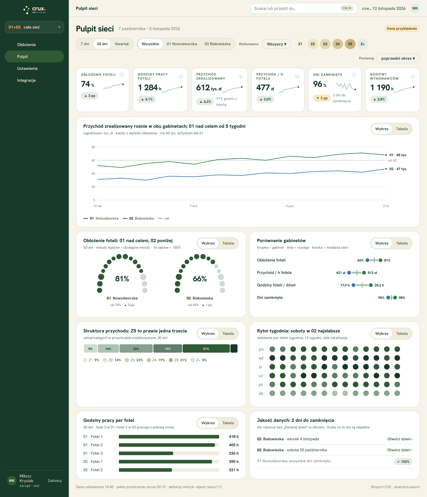

*Makieta: Pulpit sieci: obłożenie i przychód per gabinet (dane przykładowe) (`manifest/makiety/pulpit.png`).*

| Pulpit | Dla kogo | Układ |
|---|---|---|
| `/pulpit` (sieć) | zarząd (`analytics.view_network`) | rząd kafli: obłożenie, godziny, przychód, przychód/h (na ≥ 1440 px także dni zamknięte i godziny wykonawców); wykres główny: przychód tygodniowo per gabinet z linią celu; siatka 2 × N: łuki obłożenia per gabinet, wykres kropkowy porównania (obłożenie, przychód/h, godziny, dni zamknięte), pasek części wg kategorii, kalendarz kuleczek rytmu tygodnia, słupki godzin per fotel, jakość danych (dni niezamknięte z linkiem) |
| `/pulpit/gabinet` | kierownik (`analytics.view_location`), zablokowany na swój gabinet | te same karty dla jednego gabinetu + tabela wykonawców (godziny, kwota, kwota/h) |
| `/pulpit/moje` | lekarz, higienistka (`analytics.view_self`) | moje godziny, moja kwota, moja kwota/h z medianą gabinetu bez nazwisk; kalendarz kuleczek moich dni; lista moich wpisów |

Anatomia kafla (`docs/06`, 4.1): etykieta 12 px, liczba 30–32 px tabular z jednostką, sparkline z kropką po prawej, pigułka zmiany ze strzałką i słowem w kolorze według **znaczenia** (`goodDirection`). Anatomia karty (`docs/06`, 4.2): tytuł mówi, co widać („Obłożenie foteli: 01 nad celem, 02 poniżej”), podpowiedź z definicją, legenda z chipami gabinetów, przełącznik Wykres/Tabela, stopka z zakresem i `refreshed_at`.

## 7.5 Drążenie: każda liczba na ekranie ma dowód

Każdy kafel, słupek i kropka ma `href` do `/lista/oblozenie?metric=<id>&<filtry>`. Lista pokazuje dokładnie rekordy wchodzące do licznika i mianownika (zakładki „w liczniku” / „w mianowniku”; dla `chair_utilization`: wpisy i pojemność per fotel i dzień) i sumę kontrolną równą kaflowi. To jest test akceptacyjny każdej metryki (`[F0-011/AC4]`). CSV z `analytics.export` zostawia wpis w audycie.

## 7.6 Cele i porównania

`analytics.targets.<metric>` per gabinet i miesiąc w `platform.settings` (edycja w Ustawienia → System). `porownaj=cel` zmienia deltę na kaflach (różnica do celu ze strzałką i słowem) i rysuje szarą przerywaną linię „cel” na wykresie głównym (AC9). Propozycja na start: obłożenie 01 → 75%, 02 → 65%; korekta po pierwszym miesiącu pomiaru.

## 7.7 Odświeżanie i wydajność

- przyrostowo co 5 minut (ostatnie 48 h; upsert po kluczu naturalnym), pełne 02:10 dla 13 miesięcy; idempotentne (dwa uruchomienia = ten sam wynik, AC5);
- `refreshed_at` w stopce każdego pulpitu; `refresh_log` z oknem, czasem i liczbą wierszy;
- budżet: pulpit < 1,5 s p95, zapytanie metryki < 200 ms (indeksy `tenant_id, location_id, date_key`; AC6);
- cache 60 s per (tenant, rola, filtry), nigdy między użytkownikami (ADR-030).

## 7.8 Jak dodać metrykę (procedura)

1. `pnpm gen metric <id>`: szkielet `metrics/<id>.ts`, test na zestawie wzorcowym, wiersz do `docs/11`.
2. Uzupełnij definicję słowną, SQL, `goodDirection`, `forma`, `drilldown`, uprawnienie.
3. Dopisz oczekiwaną wartość do `golden/expected.json` policzoną niezależnie (`golden/verify.sql`).
4. Wiersz w `docs/11`, sekcja 4 (albo 4.7 dla 1.0). Bez wiersza `crux-doctor` (`analytics.metric-registered`) jest czerwony.
5. Kafel na pulpicie przez konfigurację w formie z rejestru; `ui.metric-form` sprawdza zgodność.


# 8 · Jak to wygląda: marka w aplikacji

Źródła: `docs/14-guideline-aplikacji.md` (zasady marki dla wszystkich aplikacji), `docs/06-design-system.md` (Crux), `crux-ksiega-znaku-1.0.pdf`, pakiet `Materialy marki/`. Makiety poniżej są wygenerowane z `manifest/zrodla/makiety/` na danych przykładowych i pokazują docelowy wygląd ekranów 1.0.

## 8.1 Dziesięć zasad, które łamie się najczęściej

1. Kolory, odstępy i zaokrąglenia wyłącznie z tokenów (`packages/ui/brand/tokens.css`, kopia 1:1 z pakietu marki). Każdy inny HEX w kodzie to błąd (`ui.no-hex`).
2. Krój Hanken Grotesk 400–800 z plików lokalnych. Liczby zawsze `tabular-nums` w polskim formacie: `1 234,50 zł`, `82%`, `14.02.2027`, `10:30`.
3. Tło jasne (kość), karty białe z obramowaniem mgły, butelkowa zieleń w pasku bocznym. Bez cieni poza panelem bocznym i tooltipem.
4. **Bursztyn to słońce.** Tylko Ginan w znaku, kropka w „crux.”, wskaźnik „teraz” i obwódka fokusu. Nigdy tło, tekst ani seria danych.
5. Gabinet **01 to Nowodworska** (baza), **02 to Białowieska**; w UI zawsze „01 Nowodworska” przez `LocationChip` (numer z cieniem), nigdy „nr 1” ani „Gabinet 1”. Kolor danych gabinetu z `locations.color_key` i nie przechodzi na inny gabinet.
6. Logo zawsze z pliku SVG (`crux-poziomy-krem.svg` w pasku bocznym, `crux-znak-krem.svg` po zwinięciu) albo z `CruxLogo` rysującego geometrię z pliku. Nigdy z fontu.
7. **Pacjent nigdy nie widzi marki Crux**: SMS, PDF, portal i rezerwacja noszą zenit.stomatologia (strażnik `ui.brand-separation`).
8. Wykres ma jedną oś, linie 2 px, legendę przy ≥ 2 seriach, tooltip, widok tabeli. Nie ma wykresów kołowych, dwuosiowych, 3D ani bursztynu w danych.
9. Model kuleczkowy: gdy coś da się pokazać kuleczkami (zębami), pokazujemy to kuleczkami (łuk obłożenia, siatka, wykres kropkowy, kalendarz).
10. Ryciny Köhlera tylko w pustych stanach, na ekranie logowania i na stronie „O Crux” (roślina wydania). Ton: krótko, bezosobowo dla personelu; bez wykrzykników, emoji i „Ups”.

## 8.2 Ekrany 1.0

### Logowanie


*Makieta: Logowanie z MFA (`manifest/makiety/logowanie.png`).*

Butelkowe tło, `crux-poziomy-krem.svg` 58 px, rycina `szalwia.svg` w kremie, karta formularza na kości. Jedyna animacja znaku: gwiazdy pojawiają się od najjaśniejszej, Ginan ostatni, ≤ 600 ms, wyłączona przy `prefers-reduced-motion`. Po haśle kod TOTP; pierwsze logowanie wymusza zmianę hasła i rejestrację MFA.

### Powłoka aplikacji

Pasek boczny 232 px (zwijany do 64) na butelce: znak Crux, przełącznik gabinetu („01 Nowodworska”, „02 Białowieska”, „01 + 02 · cała sieć” dla `network.view`), nawigacja tylko z pozycjami bieżącego wydania (Obłożenie, Pulpit, Ustawienia, Integracje), na dole użytkownik i blokada. Górny pasek: paleta poleceń `Ctrl+K` (przejdź do ekranu, zmień gabinet, skocz do dnia; od 1.1 także pacjenci), data, użytkownik.

### Obłożenie


*Makieta: Ekran Obłożenie: siatka dnia gabinetu 01 (dane przykładowe) (`manifest/makiety/oblozenie.png`).*

Siatka `HourGrid` z komórkami w kolorach kolornika, panel wpisu po prawej, pasek dnia z sumami i stanem zamknięcia. Szczegóły: rozdział 6.

### Pulpit sieci


*Makieta: Pulpit sieci: obłożenie i przychód per gabinet (dane przykładowe) (`manifest/makiety/pulpit.png`).*

Jeden wiersz filtrów, rząd kafli z anatomią z `docs/06` 4.1, wykres główny na całą szerokość, siatka 2 × N kart w formach z modelu kuleczkowego. Szczegóły: rozdział 7.

### Ustawienia → Personel

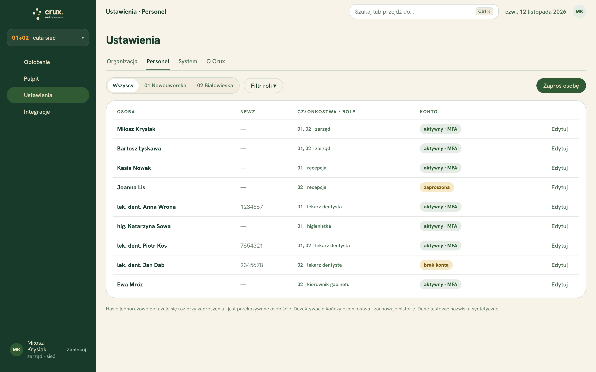

*Makieta: Ustawienia → Personel: członkostwa i role (dane przykładowe) (`manifest/makiety/personel.png`).*

Lista osób z członkostwami, rolami i stanem konta (brak konta, zaproszona, aktywny · MFA, dezaktywowany); „Zaproś osobę” pokazuje hasło jednorazowe raz. Dane testowe mają syntetyczne nazwiska.

### Ustawienia → O Crux

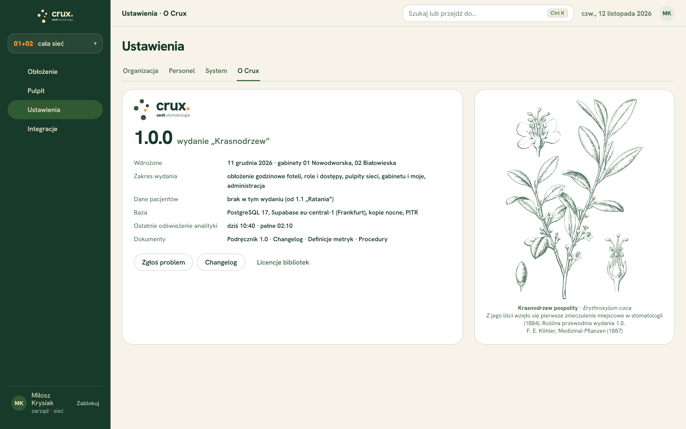

*Makieta: Strona „O Crux”: wydanie, rycina, changelog (`manifest/makiety/o-crux.png`).*

Wersja i nazwa wydania, data wdrożenia, zakres, stan analityki, linki do podręcznika i changelogu, rycina rośliny wydania (jedyne miejsce w aplikacji poza pustymi stanami i logowaniem).

## 8.3 Komponenty 1.0 (`packages/ui`)

| Grupa | Komponenty | Źródło zasad |
|---|---|---|
| Marka | `CruxLogo`, `ZenitLogo` (tylko dokumenty i portal), `LocationChip`, `LocationSwitcher` | `docs/06`, 3.1–3.3 |
| Powłoka | `AppShell`, `CommandPalette`, `SidePanel`, `Dialog`, `ConfirmDialog` (z polem powodu), `Toast`, `EmptyState` (z rycinami) | `docs/06`, 4 i 5 |
| Formularze | `Button` (primary/secondary/ghost/danger), `Input`, `Select`, `Combobox`, `DatePicker`, `TimePicker`, `PhoneInput`, `PeselInput` (od 1.1), `SegmentedControl`, `ChipToggle` | `docs/06`, 4; `docs/14`, 7 |
| Dane | `DataTable` (TanStack), `Num` (format polski, tabular, `aria-label`), `StatusPill`, `KpiTile`, `DeltaBadge`, `Card`, `CardHeader`, `ChartCard`, `FilterBar`, `HourGrid` | `docs/06`, 4.1–4.2 |
| Wykresy (`src/charts/`) | `ArchGauge`, `DotGrid`, `DotPlot`, `DotCalendar`, `Sparkline`, `PartsBar`, `LineChart`, `BarList` (z `variant="funnel"`); każdy z `TableView` i `role="img"` | `docs/06`, 6; `docs/14`, 6 |

Każdy komponent ma stronę w Storybooku (warianty, fokus, motyw ciemny, iPad 1024×768, test dostępności) i test wizualny; komponenty wykresów są porównywane ze wzorcami z `wykresy-przyklady/`.

## 8.4 Pakiet marki w repo

`pnpm brand:sync <ścieżka do Materialy marki>` kopiuje do `packages/ui/brand/`: `tokens.css`, `zenit-theme.tailwind.css`, fonty, logotypy Crux i zenit, ryciny (42 tablice zielnika, `currentColor`), do `src/brand/crux-geometry.json` i `src/charts/arch-geometry.json` geometrię znaku i łuku, do `src/charts/__reference__/` przykłady wykresów; zapisuje sumy kontrolne w `brand/manifest.json`. `crux-doctor` (`ui.brand-sync`) sprawdza, że nikt nie edytował plików marki w repo: zmiana tokena zaczyna się w `Materialy marki/`. Brakujące tokeny (np. `--dane-kulka-pusta`) żyją w `src/tokens.extra.css` z adnotacją do przeniesienia.

## 8.5 Lista kontrolna przed każdym PR z interfejsem (`docs/14`, sekcja 11)

- [ ] w diffie nie ma HEX-ów, `px` spoza skali ani `font-family` spoza tokenów
- [ ] bursztyn występuje na ekranie najwyżej w znaku, we wskaźniku „teraz” i w obwódce fokusu
- [ ] logo pochodzi z pliku SVG i ma zachowane pole ochronne
- [ ] gabinety: „01 Nowodworska”, „02 Białowieska”, kolory z `color_key`
- [ ] każdy wykres ma jedną oś, legendę (przy ≥ 2 seriach), tooltip, widok tabeli i nie zawiera bursztynu w danych
- [ ] wartość z naturalnym „100%” została rozważona jako łuk obłożenia lub siatka kuleczek
- [ ] liczby mają `tabular-nums` i polski format
- [ ] teksty przeszły przez listę słów z `docs/14`, sekcja 8; personel: forma bezosobowa
- [ ] ekran działa w trybie ciemnym, z klawiatury i przy 768 px (iPad)
- [ ] zrzut ekranu jest dołączony do PR, w obu motywach


# 9 · Stan prac na 6 listopada 2026

## 9.1 Co jest

| Element | Stan | Gdzie |
|---|---|---|
| Dokumentacja projektowa 2.1 | gotowa: wizja, architektura, 32 decyzje (ADR), model domeny, schemat bazy na poziomie DDL, prawo i bezpieczeństwo, integracje, design system, roadmapa z wydaniami, analiza rynku, konwencje kodu, praca z AI, dashboardy, obrazowanie, backlog, guideline aplikacji | `crux/docs/00–14` |
| Specyfikacje | 9 napisanych (F0-001, **F0-010, F0-011**, F1-001, F1-002, F1-003, F2-002, F3-001, F4-001); reszta w backlogu ze statusem `szkic` | `crux/docs/specs/`, `docs/13` |
| Prompty dla Cursora | 1.0: K01–K17 (ten podręcznik, rozdział 11); 1.1: F1 K01–K12; 2.0: F2 K01–K08; 2.1: F3 K01–K09; 3.0: F4 K00–K10; 4.0: F5 K01–K07 | `crux/prompts/` |
| Reguły Cursora | 9 plików `.mdc` (core, granice, baza, UI, bezpieczeństwo, kliniczne, integracje, analityka, testy) | `crux/.cursor/rules/` |
| Pakiet marki | brandbook zenit 1.0, księga znaku Crux 1.0, tokeny, fonty, logotypy, ikony, ryciny, geometria, komponenty wzorcowe, przykłady wykresów | `Materialy marki/`, `Crux - dla tworcow aplikacji/` |
| Makiety ekranów 1.0 | logowanie, obłożenie, pulpit sieci, personel, O Crux (dane przykładowe) | `crux/manifest/makiety/` |
| Manifest dla zespołu | 16 plansz PDF + źródło HTML | `crux/manifest/` |
| Plansze dla zespołu (prezentacja) | 16 slajdów w aplikacji Claude (wersja 13) | artefakt „Crux · plansze dla zespołu” |
| Prototyp pulpitu | HTML na danych przykładowych (sam układ) | `crux/design/crux-dashboard-prototyp.html` |

## 9.2 Czego nie ma (i kiedy będzie)

| Element | Kiedy | Kto |
|---|---|---|
| Repozytorium `crux` z kodem | K01 (tydzień 1) | Miłosz + Cursor |
| Organizacja Supabase „Zenit Stomatologia”, projekty `crux-staging` i `crux-prod` | K02 (staging), K17 (produkcja) | Miłosz |
| Konto Vercel i projekt, serwer workera w UE, Sentry UE | K17 | Miłosz |
| Spis foteli, godzin otwarcia i osób per gabinet | tydzień 1–2, tor C | Bartek + kierownicy |
| Opinia prawna, DPIA, umowy powierzenia | tor B, do 15.01.2027; warunek 1.1, nie 1.0 | Miłosz + prawnik |
| Odpowiedzi dostawców (Medfile, Docplanner, SMSAPI, Planmeca, biuro rachunkowe) | tor C, zapytania w tygodniu 1 | Miłosz |
| Programista do przeglądu kodu i integracji | od 1.1 | zarząd |

## 9.3 Decyzje otwarte (każda ma właściciela i termin)

| Pytanie | Propozycja | Decyduje | Do kiedy |
|---|---|---|---|
| Czy kwotę per godzinę wpisuje recepcja, czy wykonawca? | obie role mogą; kafel pokazuje odsetek godzin z kwotą | zarząd po dniu obserwacji | tydzień 3 |
| Cele obłożenia na start | 01 → 75%, 02 → 65%; korekta po miesiącu | zarząd | K17 |
| Czy sobota liczy się do dni roboczych w `days_closed_rate`? | tak, jeśli gabinet ma godziny otwarcia w sobotę | zarząd | K13 |
| Konto księgowości w 1.0? | nie, dopóki kwoty są z wpisów ręcznych | zarząd | K17 |
| Token `--dane-kulka-pusta` w pakiecie marki | dodać `#DCE4DD` / `#2A4A3A` do `tokens.css` w `Materialy marki/` | Miłosz | tydzień 4 |
| Czy gabinety 03 i 04 będą w tym samym podmiocie leczniczym? | model obsługuje oba warianty; decyzja wpływa na dane startowe tenanta | wspólnicy + prawnik | przed 1.1 |
| Która spółka jest operatorem systemu? | pytanie 1 do prawnika (`docs/04`, sekcja 8) | wspólnicy | tor B |

## 9.4 Czego potrzebuję od zespołu w pierwszych dwóch tygodniach

- od gabinetów 01 i 02: spis foteli (nazwy, kolejność, wyposażenie), godziny otwarcia per dzień tygodnia i znane wyjątki do końca roku, lista osób z rolami (kto jest recepcją, kierownikiem, wykonawcą w którym gabinecie), dzień obserwacji recepcji;
- od wspólników: zgoda na organizację Supabase i konta u dostawców (Supabase, Vercel, Sentry) na podmiot leczniczy; odpowiedź, kto podpisuje DPA; decyzja o operatorze systemu;
- od prawnika: 10 pytań z `docs/04`, sekcja 8, wysłane w tygodniu 1 (odpowiedzi warunkują 1.1).

## 9.5 Co się zmieniło 6 listopada (żeby nikt nie pracował na starej wersji)

- plan „F0 z modułem `lab` do 15 stycznia” zastąpiły **wydania**: 1.0 „Krasnodrzew” bez danych pacjentów do 11 grudnia, `lab` w 1.1 (ADR-032);
- modułem wzorcowym jest obłożenie foteli (F0-010); zlecenia laboratoryjne przeszły do 1.1;
- numeracja gabinetów: **01 Nowodworska, 02 Białowieska** (wcześniejsze dokumenty miały odwrotnie, poprawione wszędzie);
- prompty mają numery `K01`… (dawniej `P01`…); „P1” w dokumentach to wyłącznie Platforma P1;
- filtr wykonawcy w pulpitach nazywa się `wykonawca` (wcześniej `lekarz`), bo obejmuje higienistki;
- analityka, rejestr metryk, komplet wykresów i `FilterBar` powstają w 1.0 (wcześniej planowane dopiero w F3); F3 je rozszerza;
- Crux ma własny znak (księga znaku Crux 1.0) i pakiet marki jest źródłem tokenów (ADR-031).


# 10 · Plan wydania 1.0 krok po kroku

## 10.1 Siedemnaście kroków

Jeden prompt dziennie w dni robocze. Każdy krok ma w rozdziale 11 pełny tekst do wklejenia. Kolumna „Sprawdzenie” to komenda lub stan, który musi być zielony, zanim przejdziesz dalej.

| Krok | Co powstaje | Dni | Sprawdzenie | Zależy od |
|---|---|---|---|---|
| K01 | monorepo (pnpm + Turborepo), `apps/web` (Next.js 16), `apps/worker`, puste pakiety, CI, `docs/zaleznosci.md` | 1 | `pnpm install && pnpm typecheck && pnpm lint && pnpm test && pnpm e2e`; `docker build` obu aplikacji | — |
| K02 | Supabase lokalnie i staging, migracja bazowa (rozszerzenia, schematy, funkcje `auth.*`, role `crux_app`/`crux_worker`), pgTAP, lista kontrolna konfiguracji | 1 | `pnpm db:start && pnpm db:reset && pnpm db:test` | K01 |
| K03 | `@crux/shared`: `Result`, `Money`, `Id`, czas (`hourRange`), kryptografia za portem, `containsPii`, błędy | 1 | `pnpm test --filter @crux/shared`, pokrycie ≥ 90% | K01 |
| K04 | `@crux/db`: Drizzle, `withActor`, `withWorker`, helpery RLS, harness testów | 1 | `pnpm test --filter @crux/db`; `pnpm db:generate` bez różnic | K02, K03 |
| K05 | `@crux/platform`: audyt, log dostępu, outbox, `command_log`, flagi, ustawienia z rejestrem kluczy | 1 | `pnpm test --filter @crux/platform && pnpm db:test` | K04 |
| K06 | `@crux/identity` + `@crux/org`: personel, role, uprawnienia (macierz z `docs/03`, 8), członkostwa, tenant, gabinety, fotele, godziny | 1–2 | testy obu modułów, `pnpm db:test`, `pnpm doctor` | K05 |
| K07 | logowanie z MFA, sesja, blokada ekranu, powłoka ze znakiem Crux, `CommandPalette`, strona „O Crux” | 1–2 | `pnpm e2e`; `doctor` bez `service_role` | K06, K08 (komponenty) |
| K08 | `@crux/ui`: pakiet marki w repo, tokeny, komponenty, komplet wykresów, Storybook, testy wizualne | 2 | `storybook build`, `pnpm test:visual`, `pnpm lint` | K01 |
| K09 | `apps/worker`: pg-boss, dispatcher outboxa, harmonogramy, kopie nocne, `privileged.ts`, `/healthz` | 1 | `pnpm --filter worker test`; zdarzenie w outboxie kończy się `sent` | K05 |
| K10 | CI, `crux-doctor` (18 reguł), generatory (`gen module/usecase/screen/metric`), dependency-cruiser, szablon PR | 1 | `pnpm doctor` zielone; celowe naruszenie wykryte | K01–K09 |
| K11 | **obłożenie foteli** (F0-010) w 4 częściach: migracja i RLS, domena, przypadki użycia, ekran i e2e; `docs/wzorzec-modulu.md` | 3 | pełny zestaw; `spec.traceability` dla F0-010 | K06, K08, K10 |
| K12 | fabryki, zestaw wzorcowy (13 miesięcy wpisów), `pnpm seed:demo`, atrapy portów | 1 | `pnpm seed:demo`; `golden/verify.sql` = `expected.json` | K11 |
| K13 | `@crux/analytics` 1.0: wymiary i fakty, zasilanie co 5 min i nocne, rejestr metryk z 7 metrykami, `runMetric` | 2 | testy modułu, `pnpm db:test`, `pnpm doctor`; `refresh_log` po seedzie | K09, K12 |
| K14 | pulpity sieci/gabinetu/moje, `FilterBar`, lista drążenia, CSV (F0-011) | 2 | pełny zestaw; `spec.traceability` dla F0-011; p95 `/pulpit` < 1,5 s | K13 |
| K15 | ekrany administracji: organizacja, personel (zaproszenia), system (flagi, ustawienia, cele), Integracje (szkielet) | 1–2 | `pnpm e2e`, `pnpm doctor`, lista kontrolna UI | K06, K07 |
| K16 | obserwowalność bez danych osobowych (pino, Sentry UE, OTel), procedury `docs/ops/` | 1 | test loggera; zdarzenie w Sentry bez danych osobowych | K03 |
| K17 | **wydanie 1.0**: produkcja, dane startowe, konta, instrukcje, szkolenie, changelog, tag `v1.0.0` | 1 | bramka 1.0 po 10 dniach wpisów | wszystko |

Po K17: nowy czat z promptem przeglądu adwersarialnego (`docs/10`, 3.5) na całe repo; wpis `1.0 · bramka` w ledgerze.

## 10.2 Harmonogram

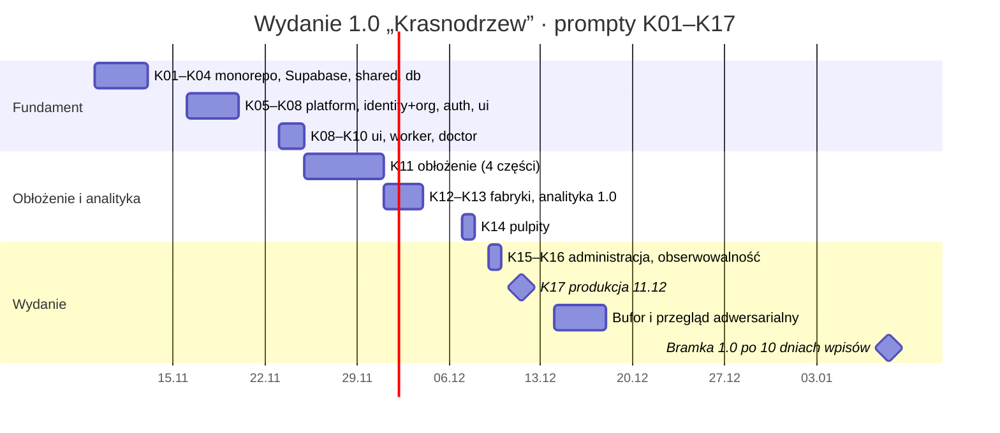

*Rysunek: Harmonogram wydania 1.0: K01–K17 w tygodniach (`podrecznik/rysunki/harmonogram.mmd`, SVG obok).*

| Tydzień | Tor A (kod) | Tor B (prawo) | Tor C (gabinety, dostawcy) |
|---|---|---|---|
| 1 (9–13.11) | K01, K02, K03, K04 | pytania do prawnika; wnioski o DPA (Supabase, Vercel, Sentry); organizacja Supabase | spis foteli i godzin 01 i 02; zapytania do Medfile, Docplanner, SMSAPI, Planmeca, biura rachunkowego |
| 2 (16–20.11) | K05, K06, K07, K08 (start) | rejestr czynności, szkic DPIA | dzień obserwacji w 01; lista osób i ról |
| 3 (23–27.11) | K08 (koniec), K09, K10, K11 (części 1–2) | szkice procedur ops | dzień obserwacji w 02; spis sprzętu |
| 4 (30.11–4.12) | K11 (części 3–4), K12, K13 | umowa między spółkami (szkic); token `--dane-kulka-pusta` | próbny eksport ze starego programu |
| 5 (7–11.12) | K14, K15, K16, K17 → **produkcja 11.12** | DPIA v1 | szkolenie recepcji; pierwszy dzień wpisów |
| 6 (14–18.12) | bufor, przegląd adwersarialny, poprawki | odpowiedzi prawnika → ADR | pomiar bazowy metryk ze starego programu |
| 7–10 (do 15.01) | specyfikacje 1.1, spike terminarza, F1 K01–K02 na gałęzi | DPIA podpisana, umowy powierzenia | plan importu; bramka 1.0 → retrospektywa |

Jeśli któryś krok trwa dłużej, przesuwa się wszystko za nim; nie skracamy kroku kosztem testów ani strażników. Bufor to tydzień 6.

## 10.3 Jak wykonać jeden krok (rytuał, zawsze ten sam)

1. **Nowy czat w Cursorze** dla każdego promptu. W pierwszej linii: `@AGENTS.md @prompts/ledger.md` plus pliki z sekcji „Przeczytaj” promptu. Reguły z `.cursor/rules/` ładują się same.
2. **Tryb Plan.** Wklej prompt. Cursor pokazuje plan plików. Czytasz 2 minuty: czy nie wychodzi poza „Zakres”, czy nie wymyśla tabel spoza `03a`, czy nie dodaje zależności spoza listy. Jeśli tak: odrzucasz i doprecyzowujesz w tym samym czacie.
3. **Tryb Agent** z tym samym promptem i dopiskiem „Realizuj plan”. Prompt z częściami (K11: 4 części) realizujesz część po części: każda część to osobny commit.
4. **Przegląd diffu.** Zasada z `docs/10`: nie akceptuj zmiany, której nie rozumiesz w 2 minuty; jeśli diff jest za duży, krok był za duży.
5. **Sprawdzenie.** Komendy z sekcji „Sprawdzenie” promptu muszą być zielone lokalnie, potem CI na PR.
6. **Przegląd adwersarialny** (drugi model, prompt 3.5 z `docs/10`) po każdym prompcie z etykietą `security`, `money`, `clinical` i po ostatniej części każdego modułu.
7. **Ledger.** Wpis w `prompts/ledger.md` (format w 10.4). To jest pamięć projektu między czatami.
8. **Commit** z Conventional Commits, PR z szablonem (definicja ukończenia, prompt, zrzuty ekranu przy UI), merge po zielonym CI.

Gdy Cursor zatrzyma się z pytaniem (prompty mówią mu, kiedy ma się zatrzymać: sekcja „Zatrzymaj się, gdy”): odpowiadasz w tym samym czacie i zapisujesz odpowiedź jako decyzję: ADR, jeśli dotyczy zasady; komentarz w specyfikacji, jeśli dotyczy funkcji.

## 10.4 Wpis w ledgerze

```
## 2026-11-26 · F0-010 · część 2 (domena)
Prompt: prompts/F0-fundament.md#K11 część 2
Commit: a1b2c3d · Gałąź: feat/F0-010-oblozenie
Wynik: zielone CI; doctor: 1 ostrzeżenie (brak README modułu) → poprawione w a1b2c3e
Uwagi: model chciał dodać pole `patient_initials` do chair_occupancy; odrzucone (ADR-032, nie ma w 03a).
```

Nowy czat czyta 10 ostatnich wpisów, zanim zaproponuje plan.

## 10.5 Definicja ukończenia (każda część i PR)

- [ ] `pnpm typecheck`, `pnpm lint`, `pnpm lint:deps`, `pnpm test`, `pnpm test:db`, `pnpm doctor` przechodzą
- [ ] nowe tabele mają wpis w `03a`, RLS, komentarz, trigger audytu i test pgTAP
- [ ] kryteria akceptacji ze specyfikacji mają testy `[ID/ACn]` (doctor: `spec.traceability`)
- [ ] zdarzenia domenowe mają schemat i wersję; payload bez danych osobowych
- [ ] teksty interfejsu w `packages/i18n/pl`, ton zgodny z `docs/06`; lista kontrolna `docs/14`, sekcja 11, i zrzut ekranu w PR
- [ ] zależności wpisane w `docs/zaleznosci.md`
- [ ] wpis w `prompts/ledger.md`; ADR, jeśli zmieniła się zasada

## 10.6 Sygnały, że AI zaczyna rozwalać system (zatrzymaj się)

- nowa nazwa na istniejące pojęcie (`visit` obok `appointment`, `slot` jako tabela) → odrzuć, wskaż słownik;
- server action z logiką > 25 linii → przenieś do przypadku użycia;
- nowa tabela bez wpisu w `03a` i bez pgTAP → CI zawodzi;
- `service_role`, `security definer`, wyłączenie RLS, `using (true)` „żeby zadziałało” → stop;
- test zmieniony razem z kodem bez wyjaśnienia → odrzuć zmianę testu;
- zależność npm „przy okazji” → usuń lub uzasadnij w `docs/zaleznosci.md`;
- komponent z HEX albo wartością arbitralną Tailwinda → token;
- metryka na ekranie bez wpisu w rejestrze → rejestr najpierw;
- model „poprawia” dokumentację, żeby pasowała do kodu, bez ADR → cofnij.

Każdy taki przypadek kończy się dopisaniem zasady do `AGENTS.md`, reguły Cursora albo reguły `doctor`.


# 11 · Prompty K01–K17 (pełny tekst)

Poniższe prompty są wklejone automatycznie z `prompts/F0-fundament.md` przy budowaniu podręcznika (`build.py`). Źródłem jest plik w `prompts/`; jeśli chcesz coś zmienić, zmień tam i zbuduj podręcznik ponownie. Każdy prompt wklejasz do **nowego czatu** w Cursorze, najpierw w trybie Plan, potem Agent („Realizuj plan”); rytuał w rozdziale 10.3.

Odwołania `@docs/…`, `@AGENTS.md`, `@.cursor/rules/…` w promptach to odwołania do plików w repo (folder `crux` skopiowany do repo w K01). Cursor dołącza je do kontekstu po wpisaniu `@`.

## K01 · Monorepo i narzędzia  [chore]

**Cel.** Puste, ale kompletne monorepo, w którym każdy kolejny prompt ma gdzie wylądować i co uruchomić.

**Przeczytaj.** `@AGENTS.md`, `@docs/01-architektura.md` (sekcje 1, 4, 5), `@docs/09-konwencje-kodu.md` (sekcje 1, 2, 6, 9), `@docs/02-decyzje-architektoniczne.md` (ADR-001, 002, 029, 030, 032).

**Zakres.** Katalog główny, `apps/web`, `apps/worker`, `packages/{shared,db,ui,i18n,testing,config}`, `packages/modules/{platform,identity,org,scheduling,analytics,integrations}` (puste szkielety z `package.json` i `index.ts`), `tools/{doctor,gen}` (puste), `.github/workflows/ci.yml` (szkielet), `.cursor/rules/` (skopiuj z folderu projektu bez zmian), `docs/` (skopiuj), `prompts/` (skopiuj), `podrecznik/` (skopiuj).

**Kroki.**
1. `pnpm` workspaces (`pnpm-workspace.yaml`: `apps/*`, `packages/*`, `packages/modules/*`, `tools/*`), Turborepo (`turbo.json` z zadaniami `build`, `typecheck`, `lint`, `test`, `test:db`, `e2e`, `doctor`), `.nvmrc` = `22`, `.npmrc` z `save-exact=true`, `.editorconfig`, `.gitignore`, `.gitattributes`.
2. `packages/config`: `tsconfig.base.json` (`strict`, `noUncheckedIndexedAccess`, `exactOptionalPropertyTypes`, `verbatimModuleSyntax`, `moduleResolution: bundler`, `target: ES2022`), `eslint.config.base.js` (flat config: `typescript-eslint` strict-type-checked, `eslint-plugin-boundaries` z elementami `app`, `module-domain`, `module-application`, `module-infrastructure`, `module-public`, `package`, reguły z `docs/09`, sekcja 6; `no-restricted-syntax` dla `new Date()` poza `packages/shared/time`; `no-restricted-imports` dla ścieżek `packages/modules/*/src/**`), `prettier.config.js`, `dependency-cruiser.cjs` z grafem z `docs/01`, sekcja 4 (na razie `platform`, `identity`, `org`, `scheduling`, `analytics`, `integrations`).
3. `apps/web`: `create-next-app`-równoważny szkielet Next.js 16 (App Router, TypeScript, Tailwind v4, Turbopack), `next.config.ts` z `output: 'standalone'`, `cacheComponents: false`, `reactCompiler: false` (włączymy po pomiarze), `images.remotePatterns: []`; `proxy.ts` pusty z komentarzem; strona `/` z tekstem „crux”; Dockerfile (multi-stage, standalone).
4. `apps/worker`: `src/main.ts` z „hello”, `tsup` lub `tsx` do uruchomienia, Dockerfile.
5. Każdy pakiet: `package.json` (`name: @crux/<nazwa>`, `type: module`, `exports` tylko `./src/index.ts`), `tsconfig.json` rozszerzający bazę, `src/index.ts`.
6. Skrypty główne: `pnpm typecheck`, `pnpm lint`, `pnpm test` (Vitest workspace), `pnpm test:db` (na razie `echo "no db tests yet" && exit 0`), `pnpm doctor` (na razie `echo skip`), `pnpm e2e` (Playwright, pusty test dymny na `/`).
7. `.github/workflows/ci.yml`: Node 22, pnpm cache, `pnpm install --frozen-lockfile`, `typecheck`, `lint`, `test`, `test:db`, `doctor`, `e2e` (w CI z `playwright install --with-deps chromium`).
8. `README.md` repo: 10 linii (co to, jak uruchomić, link do `docs/` i `podrecznik/`).

**Ograniczenia.** Nie instaluj niczego poza: `next`, `react`, `react-dom`, `typescript`, `@types/*`, `eslint` + `typescript-eslint` + `eslint-plugin-boundaries` + `eslint-plugin-import-x`, `prettier`, `turbo`, `vitest`, `@vitest/coverage-v8`, `playwright`, `@playwright/test`, `tsx`, `tsup`, `dependency-cruiser`, `tailwindcss`, `@tailwindcss/postcss`. Każda inna zależność: zatrzymaj się. Wersje: najnowsze stabilne, przypięte dokładnie. Utwórz `docs/zaleznosci.md` z tabelą (pakiet, po co, licencja, dane pacjentów: nie).

**Sprawdzenie.** `pnpm install && pnpm typecheck && pnpm lint && pnpm test && pnpm e2e` zielone lokalnie; `pnpm build` dla `apps/web` i `apps/worker` przechodzi; `docker build` obu aplikacji przechodzi.

**Zatrzymaj się, gdy.** Next.js 16 wymaga wersji Node innej niż 22; `eslint-plugin-boundaries` nie wspiera flat config w zainstalowanej wersji (wtedy zaproponuj alternatywę i czekaj na decyzję).

---

## K02 · Supabase lokalnie i staging, migracja bazowa  [security]

**Cel.** Lokalna baza z rozszerzeniami, schematami, rolami i funkcjami claims; staging w osobnej organizacji; pierwszy test pgTAP.

**Przeczytaj.** `@docs/03a-schemat-bazy.md` (sekcja 0), `@docs/02-decyzje-architektoniczne.md` (ADR-004, 005, 007, 020), `@docs/09-konwencje-kodu.md` (sekcja 4), `@.cursor/rules/20-database.mdc`.

**Zakres.** `supabase/` (`config.toml`, `migrations/`, `tests/`, `seed.sql`), `packages/db/package.json` (skrypty), `.env.example`.

**Kroki.**
1. `supabase init`; w `config.toml`: `[api] enabled = false` dla lokalnego (produkcyjne wyłączenie Data API zrobimy w panelu i zapiszemy w `docs/ops/supabase-konfiguracja.md`), `[realtime] enabled = false`, `[storage] enabled = true` (bucket `assets` tylko), `[auth]` z `enable_signup = false`, MFA TOTP włączone, `jwt_expiry = 43200` (12 h), `[db] major_version = 17`.
2. Migracja `0001_foundation.sql` (ręczna): rozszerzenia (`btree_gist`, `pg_trgm`, `pgcrypto`, `unaccent`), schematy (`ref`, `audit`, `platform`, `analytics`, `pgboss`), funkcja `extensions.uuid_generate_v7()` (implementacja oparta na `gen_random_uuid` + znacznik czasu ms zgodnie z RFC 9562), funkcje `auth.tenant_id()`, `auth.staff_id()`, `auth.location_ids()`, `auth.role()`, `auth.has_permission(text)` czytające `request.jwt.claims` (bezpieczne przy braku claims: zwracają `null`/`false`), role `crux_app` (LOGIN, `in role authenticated`, bez `bypassrls`) i `crux_worker` (LOGIN, osobna rola, `nobypassrls`; polityki dla workera dodamy per tabela), `grant usage` na schematach, `alter default privileges` tak, by `authenticated` dostawał `select, insert, update` na nowych tabelach w `public` (a `delete` nie), `revoke all on schema audit from authenticated` poza `insert` przez trigger `security definer` (dodany w K05).
3. Migracja `0002_pgtap.sql`: `create extension pgtap`; `supabase/tests/helpers.sql`: schemat `tests` z funkcjami `tests.create_tenant(name)`, `tests.create_location(tenant, number)`, `tests.create_staff(tenant, role, locations[])`, `tests.authenticate_as(staff_id)` (ustawia `role authenticated` i `request.jwt.claims` tak samo jak `withActor`), `tests.tenant_a()`, `tests.tenant_b()`, `tests.location(number)`; test `supabase/tests/000_foundation.sql` sprawdzający, że funkcje `auth.*` zwracają wartości z claims i `null` bez nich.
4. Skrypty w `packages/db/package.json`: `db:start` (`supabase start`), `db:reset`, `db:test` (`supabase test db`), `db:diff`, `db:push:staging` (z `--linked`, tylko ręcznie), `db:types` (generowanie typów do `packages/db/src/generated/`).
5. `.env.example`: `DATABASE_URL` (crux_app, port 6543 transakcyjny), `DATABASE_URL_WORKER` (port 5432 sesyjny), `SUPABASE_URL`, `SUPABASE_PUBLISHABLE_KEY` (do Auth w przeglądarce), `KMS_*` (puste do K03), `FAKE_INTEGRATIONS=1`.
6. Dokument `docs/ops/supabase-konfiguracja.md`: lista kontrolna dla projektu stagingowego i produkcyjnego: organizacja „Zenit Stomatologia”, region `eu-central-1`, plan Pro + PITR, Data API off, Realtime off, parametry logów, MFA do panelu, role per projekt, `pgaudit`, `pg_cron` włączone, kopie.

**Ograniczenia.** Żadnej tabeli domenowej w tej migracji. Żadnego `service_role` w kodzie. Nie używaj `supabase-js` po stronie serwera.

**Sprawdzenie.** `pnpm db:start && pnpm db:reset && pnpm db:test` zielone; `psql` jako `crux_app` nie może `set role postgres`; `select auth.tenant_id()` bez claims zwraca `null`.

**Zatrzymaj się, gdy.** Supabase CLI nie pozwala wyłączyć Data API lokalnie w zainstalowanej wersji (wtedy zostaw włączone lokalnie, ale dodaj do listy kontrolnej produkcyjnej i do `doctor` regułę: żaden schemat nie jest eksponowany w `config.toml` `[api].schemas`).

---

## K03 · `packages/shared`: Result, Money, Id, czas, kryptografia, błędy  [security]

**Cel.** Wspólne typy wartości, z których korzysta każda domena; deterministyczny czas; szyfrowanie kopertowe za portem.

**Przeczytaj.** `@docs/09-konwencje-kodu.md` (sekcja 3), `@docs/02-decyzje-architektoniczne.md` (ADR-007, 022, 025), `@AGENTS.md`.

**Zakres.** `packages/shared/src/**`.

**Kroki.**
1. `result.ts`: `Result<T, E>` (`ok`, `err`, `isOk`, `map`, `andThen`, `unwrapOr`), `DomainError` jako unia dyskryminowana z polem `type` i opcjonalnym `details` bez danych osobowych; `TechnicalError` dla awarii.
2. `money.ts`: `Money` (grosze `bigint`, waluta `PLN`): `fromGrosze`, `fromPln('120.50')`, `add`, `subtract`, `multiply(percent)` z zaokrągleniem bankowym udokumentowanym w teście, `allocate(ratios)` (podział bez gubienia grosza), `format()` → `1 234,50 zł`, `formatShort()` → `412 tys. zł` / `1,2 mln zł` (do kafli), serializacja do string w JSON; żadnych `number` w API publicznym poza `toGroszeNumber()` z komentarzem „tylko do prezentacji”.
3. `id.ts`: `Id` (branded string), `newId()` (UUIDv7, pakiet `uuidv7`), schemat Zod `Id`.
4. `time.ts`: `Clock` (`now(): Date`), `SystemClock`, `FixedClock` do testów; `TZ = 'Europe/Warsaw'`; funkcje `toLocalDay(date)`, `startOfDayIn(tz, day)`, `hourRange(day, hour)` (zwraca `tstzrange` pełnej godziny lokalnej z poprawnym czasem letnim), `formatDateTimePl`, `formatDatePl` (`14.02.2027`), `formatTimePl`, `formatPercent` (`82%`), `PlainDate` (string `YYYY-MM-DD` z walidacją); na `date-fns` v4 + `@date-fns/tz`; eksportuj tylko te funkcje; żadnego `new Date()` poza tym plikiem (reguła ESLint z K01 ma wyjątek dla `packages/shared/src/time.ts`).
5. `crypto.ts`: port `KeyProvider` (`getDek(tenantId, keyId)`, `currentKeyId(tenantId)`), implementacja `LocalKeyProvider` dla środowiska lokalnego (klucze z `.env`, oznaczone jako NIE-produkcyjne), `encryptField(plaintext, tenantId)` → `enc:v1:<keyId>:<ivB64>:<ctB64>` (AES-256-GCM, `node:crypto`), `decryptField`, `hmacField(value, tenantId)` (HMAC-SHA256 z pepperem z `KeyProvider`); `normalizePesel`, `validatePesel` (suma kontrolna, data urodzenia, płeć) w `pesel.ts` (używane od 1.1, ale testowane już teraz).
6. `errors.ts`: mapowanie błędów Postgresa (`23505` unique, `23P01` exclusion, `42501` RLS) na `DomainError` typy `conflict`, `forbidden`.
7. `pii.ts`: `containsPii(text)` wykrywający wzorce PESEL (11 cyfr z poprawną sumą), numeru telefonu (`+48` lub 9 cyfr) i adresu e-mail; używane przez walidatory notatek, których nie wolno zasilać danymi pacjenta (K11, AC7) i przez logger (K16).
8. Testy jednostkowe dla wszystkiego, w tym: `Money.allocate([1,1,1])` dla 100 groszy daje 34/33/33; `validatePesel` na znanych poprawnych i błędnych numerach (syntetycznych, z generatora w teście); czas letni: `startOfDayIn` dla 2027-03-28 i `hourRange` dla godziny 2:00 w dniu zmiany czasu; `containsPii` na 20 przykładach.

**Ograniczenia.** Zależności: `zod`, `uuidv7`, `date-fns`, `@date-fns/tz`. Nic więcej. Wpisz je do `docs/zaleznosci.md`.

**Sprawdzenie.** `pnpm test --filter @crux/shared` zielone, pokrycie ≥ 90% dla `money`, `pesel`, `crypto`, `pii`.

**Zatrzymaj się, gdy.** Chcesz użyć `number` dla pieniędzy gdziekolwiek; chcesz dodać bibliotekę kryptograficzną poza `node:crypto`.

---

## K04 · `packages/db`: Drizzle, `withActor`, RLS, harness testów  [security]

**Cel.** Jedyny sposób dostępu do bazy z kodu: transakcja z ustawionymi claims.

**Przeczytaj.** `@docs/02-decyzje-architektoniczne.md` (ADR-005, 020), `@docs/03a-schemat-bazy.md` (sekcja 0), `@docs/01-architektura.md` (sekcja 9), `@docs/09-konwencje-kodu.md` (sekcja 4).

**Zakres.** `packages/db/src/**`, `drizzle.config.ts`.

**Kroki.**
1. Klient: `postgres` (postgres.js) + `drizzle-orm`; `createDb(url, { role: 'app' | 'worker' })`; pula z `max` 10 (web) / 5 (worker); `prepare: false` dla trybu transakcyjnego Supavisor.
2. `Actor` typ: `{ staffId, tenantId, locationIds, activeLocationId, role, permissions }`. `withActor(db, actor, fn)`: `BEGIN`; `set local role authenticated`; `select set_config('request.jwt.claims', $1, true)` z JSON claims; `set local statement_timeout = '15s'`; wykonuje `fn(tx)`; `COMMIT`/`ROLLBACK`; mapuje błędy Postgresa przez `@crux/shared/errors`.
3. `withWorker(db, fn)`: jak wyżej, rola `crux_worker`, claims `{ worker: true, operation: '<nazwa>' }`; każde wywołanie wymaga nazwy operacji z listy `privileged.ts` (lista przekazywana przy tworzeniu klienta).
4. Schemat Drizzle: `src/schema/index.ts` eksportujący schematy modułów; helpery `tenantColumns()` (`id`, `tenantId`, `createdAt`, `createdBy`), `mutableColumns()` (`updatedAt`, `updatedBy`), `rls.tenantAll(table)`, `rls.tenantLocation(table)`, `rls.appendOnly(table)`, `rls.selfOrManager(table, col)` generujące `pgPolicy` zgodnie z wzorcami z `03a`, sekcja 0; `tableComment(table, { rls, appendOnly, retention })`.
5. Migracje: `drizzle.config.ts` z `out: supabase/migrations`, `schema: packages/db/src/schema`, `migrations.prefix: 'timestamp'`; skrypt `pnpm db:generate`; dokument `packages/db/README.md` opisujący, jak dołożyć migrację ręczną (`manual_`) i jak nie edytować starych.
6. Harness testów integracyjnych: `packages/db/src/testing/`: `createTestDb()` łączący się z lokalnym Supabase, `withTestTenant()` tworzący tenant A i B, gabinety 01/02, personel każdej roli (przez `tests.*` z K02), `actorFor(staff)`; `resetBetweenTests()` (truncate tabel z listy, `restart identity`).
7. Test: `withActor` ustawia claims (odczyt `auth.tenant_id()` w transakcji zwraca tenant aktora) i czyści je po transakcji; `withWorker` z nieznaną operacją rzuca.

**Ograniczenia.** Zero `service_role`. Zero `supabase-js` po stronie serwera. Drizzle `pgPolicy` dla każdej polityki (SQL ręczny tylko dla funkcji/triggerów).

**Sprawdzenie.** `pnpm test --filter @crux/db` (integracyjne, wymaga `pnpm db:start`), `pnpm db:generate` nie generuje różnic na pustym schemacie.

**Zatrzymaj się, gdy.** Drizzle w zainstalowanej wersji nie wspiera `pgPolicy` lub `EXCLUDE` (wtedy: polityki i więzy w migracjach ręcznych `manual_`, a w schemacie tylko komentarz; zapisz jako dług).

---

## K05 · `@crux/platform`: audyt, log dostępu, outbox, zdarzenia, flagi, ustawienia  [security]

**Cel.** Mechanizmy przekrojowe, od których zależą wszystkie moduły.

**Przeczytaj.** `@docs/03a-schemat-bazy.md` (sekcja 1), `@docs/01-architektura.md` (sekcje 6, 9–11), `@docs/04-prawo-i-bezpieczenstwo.md` (sekcja 6), `@docs/02-decyzje-architektoniczne.md` (ADR-008, 009).

**Zakres.** `packages/modules/platform/**`, migracje tabel z sekcji 1 `03a`, testy pgTAP.

**Kroki.**
1. Migracja: `platform.outbox`, `platform.command_log`, `platform.feature_flags`, `platform.settings`, `audit.events`, `audit.access_log`, `audit.integrity_checks` dokładnie jak w `03a` (klucze złożone z `coalesce` zrealizuj przez kolumny generowane lub unikalne indeksy częściowe). Funkcja `audit.track()` (`security definer`, właściciel `postgres`, `search_path` pusty) zapisująca `before`/`after` jako `jsonb` z **usunięciem kolumn wrażliwych** (lista: `pesel_enc`, `pesel_hmac`, `id_document_enc`, `*_enc`) i `reason` z `current_setting('crux.reason', true)`; funkcja `platform.set_reason(text)`. RLS: `audit.events` select tylko dla `auth.has_permission('audit.read')`; `audit.access_log` insert przez funkcję `audit.log_access(...)` (`security definer`), select dla `audit.read`; `outbox`/`command_log` select/insert dla tenanta; `feature_flags`/`settings` select dla tenanta, update dla `settings.manage`.
2. Domena/aplikacja: `publishEvent(tx, topic, payload, { dedupeKey })` z walidacją payloadu schematem zdarzenia z rejestru `events/registry.ts` (każde zdarzenie: nazwa z wersją, schemat Zod zawierający tylko identyfikatory); `recordCommand`/`findCommand`; `logAccess(tx, actor, { patientId, resource, resourceId, action, justification })`; `isEnabled(flag, { tenantId, locationId })`; `getSetting`/`setSetting` z walidacją per klucz (rejestr kluczy w `settings/keys.ts`; pierwsze klucze: `scheduling.occupancy_mode` per gabinet, wartości `manual` | `appointments`, domyślnie `manual`; `ui.default_location`; `analytics.targets.chair_utilization` per gabinet).
3. `domain/events.ts`: typy bazowe `DomainEvent<TName, TPayload>`; `apps/worker` będzie konsumował (K09).
4. Testy pgTAP: trigger audytu zapisuje `before`/`after` bez pól `*_enc`; `authenticated` nie może `update`/`delete` w `audit.*`; izolacja tenantów w `outbox`.
5. Testy integracyjne: `publishEvent` z nieznanym tematem rzuca; `dedupeKey` powtórzony nie tworzy drugiego wiersza; `logAccess` zapisuje `ip_hash` (tylko HMAC adresu); `setSetting` odrzuca wartość spoza schematu klucza.

**Ograniczenia.** Payload outboxa: tylko identyfikatory (test sprawdza, że schematy zdarzeń nie mają pól o nazwach `name`, `phone`, `pesel`, `email`, `content`).

**Sprawdzenie.** `pnpm test --filter @crux/platform && pnpm db:test`.

**Zatrzymaj się, gdy.** Potrzebujesz `security definer` w miejscu innym niż `audit.track()` i `audit.log_access()`.

---

## K06 · `@crux/identity` i `@crux/org`: personel, role, uprawnienia, tenanci, gabinety, fotele  [security]

**Cel.** Model organizacji i uprawnień; `authorize()`; claims budowane z członkostw.

**Przeczytaj.** `@docs/03a-schemat-bazy.md` (sekcje 2–3), `@docs/03-model-domeny.md` (sekcje 1, 3), `@docs/01-architektura.md` (sekcje 7–9), `@docs/04-prawo-i-bezpieczenstwo.md` (sekcja 6 „Dostęp”), `@docs/specs/F0-010-oblozenie-godzinowe.md` (sekcja „Uprawnienia”).

**Zakres.** `packages/modules/identity/**`, `packages/modules/org/**`, migracje, pgTAP, seed uprawnień.

**Kroki.**
1. Migracja `org`: `tenants`, `locations`, `chairs`, `opening_hours`, `opening_exceptions` (z `03a`). RLS: `tenants` select własnego; reszta `tenant_all` (konfiguracja widoczna dla całego tenanta), update tylko `org.manage`.
2. Migracja `identity`: `staff_role` enum, `staff_members`, `memberships`, `permissions`, `role_permissions`, `provider_capabilities`, `break_glass_requests`. RLS: `staff_members` select dla tenanta, update własnego rekordu (ograniczone kolumny przez widok) lub `staff.manage`; `memberships` select dla tenanta, insert/update `staff.manage`; `break_glass_requests` insert dla `dentist`/`location_manager`, select `audit.read`.
3. Seed uprawnień: `identity/src/permissions.ts` (lista startowa: `org.manage`, `staff.manage`, `settings.manage`, `audit.read`, `patient.read`, `patient.write`, `patient.merge`, `appointment.read`, `appointment.create`, `appointment.move`, `appointment.cancel`, `appointment.override_hours`, `occupancy.read`, `occupancy.write`, `occupancy.write_own`, `occupancy.void`, `occupancy.close_day`, `occupancy.write_closed`, `occupancy.override_hours`, `lab_order.read`, `lab_order.write`, `lab_order.cost`, `network.view`, `analytics.view_self`, `analytics.view_location`, `analytics.view_network`, `analytics.export`, `integrations.manage`) i macierz `role_permissions` jako migracja danych (`manual_`) zgodnie z macierzą w `docs/03`, sekcja 8; `authorize(actor, permission, scope?)` sprawdza uprawnienie w claims i, gdy `scope.locationId`, członkostwo w gabinecie (chyba że `network.view`); zwraca `err({ type: 'forbidden' })` i zapisuje nieudaną próbę do `audit.events` (akcja `forbidden`).
4. `buildClaims(tx, authUserId, activeLocationId)`: pobiera `staff_member`, aktywne `memberships` (`ends_on` null lub ≥ dziś), rolę w aktywnym gabinecie, sumę uprawnień ról (`role_permissions`) → `Actor`.
5. Przypadki użycia: `createStaffMember`, `inviteStaffMember` (tworzy konto w Supabase Auth przez `AuthAdminPort` z hasłem jednorazowym do zmiany przy pierwszym logowaniu; w 1.0 bez e-maila zapraszającego, link przekazuje administrator), `deactivateStaffMember`, `assignMembership`, `endMembership`, `setProviderCapabilities`, `requestBreakGlass`; `org`: `createTenant` (tworzy też DEK przez `KeyProvider`), `createLocation` (walidacja numeru `^\d{2}$`, unikalność, `color_key` z puli), `updateLocation`, `createChair`, `updateChair` (nazwa, kolejność, wyposażenie, `active`), `setOpeningHours`, `setOpeningException`; zapytania `listLocations`, `listChairs(locationId)`, `getOpeningHours(locationId, day)` (uwzględnia wyjątki), `listStaff(filters)`.
6. Testy pgTAP: pracownik 01 bez członkostwa w 02 nie widzi `memberships` z 02 (dla tabel operacyjnych; konfiguracja gabinetów jest widoczna); tenant B nic nie widzi. Testy integracyjne: `authorize` odrzuca brak uprawnienia i zapisuje audyt; `buildClaims` nie uwzględnia członkostwa zakończonego; `createLocation('1')` odrzucone.

**Ograniczenia.** Uprawnienia to dane; nie twórz `if (role === 'dentist')` poza `buildClaims`. Konta imienne: `staff_members.email` unikalny w tenancie.

**Sprawdzenie.** `pnpm test --filter @crux/identity --filter @crux/org && pnpm db:test && pnpm doctor`.

**Zatrzymaj się, gdy.** Chcesz dodać rolę spoza enumu lub uprawnienie spoza listy bez wpisu w `docs/03`.

---

## K07 · Logowanie, MFA, sesja, blokada ekranu, powłoka  [security]

**Cel.** Personel loguje się bezpiecznie, wybiera gabinet i widzi powłokę aplikacji ze znakiem Crux.

**Przeczytaj.** `@docs/02-decyzje-architektoniczne.md` (ADR-010, 030), `@docs/06-design-system.md` (sekcje 3–5), `@docs/14-guideline-aplikacji.md` (sekcje 1, 3), `@docs/04` (sekcja 6 „Dostęp”), `@.cursor/rules/30-ui.mdc`.

**Zakres.** `apps/web/app/(auth)/**`, `apps/web/server/{auth.ts,with-actor.ts,action-result.ts}`, `apps/web/proxy.ts`, `apps/web/app/(app)/layout.tsx`, `packages/ui` (tylko użycie; komponenty powstają w K08, więc **wykonaj K08 przed krokami 5–6** albo użyj tymczasowych komponentów oznaczonych `// TODO(K08)` i zamień je w K08).

**Kroki.**
1. `AuthPort` w `@crux/identity/ports` (`signInWithPassword`, `verifyTotp`, `enrollTotp`, `getSession`, `signOut`, `changePassword`); adapter Supabase Auth (`@supabase/ssr` tylko w przeglądarce i w cienkiej warstwie serwera do odczytu sesji; dostęp do danych nadal przez Drizzle).
2. `requireActor()`: odczyt sesji Supabase (cookie), weryfikacja JWT, `buildClaims` dla `auth_user_id` i aktywnego gabinetu z cookie `crux.location`; brak sesji → przekierowanie do `/logowanie`; brak MFA zweryfikowanego w sesji (`aal2`) → `/logowanie/mfa`; pierwsze logowanie → wymuszona zmiana hasła i rejestracja TOTP.
3. Ekrany: `/logowanie` (e-mail + hasło; butelkowe tło, `crux-poziomy-krem.svg` 58 px, rycina `szalwia.svg` w kolorze kremu obok, jedyna animacja znaku: gwiazdy od najjaśniejszej, Ginan ostatni, ≤ 600 ms, wyłączona przy `prefers-reduced-motion`), `/logowanie/mfa` (kod TOTP, pierwsza rejestracja TOTP z QR), `/zablokowany` (blokada ekranu: hasło lub TOTP odblokowuje bez utraty stanu strony; włączana po 5 min bezczynności z `proxy.ts` + licznik po stronie klienta), wylogowanie.
4. `proxy.ts`: nagłówki bezpieczeństwa (CSP bez `unsafe-inline` poza `nonce`, HSTS, `X-Frame-Options`), przekierowania sesji, `request_id` do logów.
5. `(app)/layout.tsx` z `AppShell`: pasek boczny 232 px (zwijany do 64) ze znakiem Crux (`crux-poziomy-krem.svg` 28 px, po zwinięciu `crux-znak-krem.svg`), `LocationSwitcher` (zmiana gabinetu = cookie + `refresh()`; „01 Nowodworska”, „02 Białowieska”, „cała sieć” dla `network.view`), nawigacja wg uprawnień i flag (w 1.0: Obłożenie, Pulpit, Ustawienia; pozycje Dziś, Terminarz, Pacjenci, Plany leczenia, Finanse, Laboratorium, Recall pojawiają się po włączeniu flag w kolejnych wydaniach, nie są renderowane jako „wkrótce”), górny pasek z `CommandPalette` (`Ctrl+K`: przejdź do ekranu, zmień gabinet, skocz do dnia; od 1.1 także wyszukiwanie pacjenta), użytkownik, przycisk blokady; `<head>`: favicon i manifest z `crux/ikony/`, `<title>` „crux · zenit.stomatologia”.
6. `toActionResult(result)` mapujący `DomainError.type` na teksty z `packages/i18n/pl/errors.ts`.
7. Strona „O Crux” (`/ustawienia/o-crux`): wersja z `package.json`, nazwa wydania („1.0 Krasnodrzew”) i jego rycina `brand/ryciny/krasnodrzew.svg` w kolorze mchu, data wdrożenia, link do podręcznika; jedyne miejsce poza pustymi stanami i logowaniem, gdzie pojawia się rycina (`docs/06`, 3.3).
8. e2e Playwright: logowanie → MFA → powłoka; blokada po bezczynności (z nadpisanym czasem przez zmienną testową); użytkownik bez członkostwa w 02 nie widzi 02 w przełączniku; pierwsze logowanie wymusza zmianę hasła.

**Ograniczenia.** Żadnych danych pacjenta na ekranach tego wydania. Hasła nigdy w logach (test: logger ma listę dozwolonych pól). Zależności: `@supabase/supabase-js`, `@supabase/ssr`, `qrcode` (do TOTP) — wpis do `docs/zaleznosci.md`.

**Sprawdzenie.** `pnpm e2e` zielone; `pnpm doctor` bez `service_role` w `apps/web`.

**Zatrzymaj się, gdy.** Supabase Auth MFA wymaga Data API/`supabase-js` w sposób, którego nie da się ograniczyć do Auth (opisz dokładnie, czego wymaga).

---

## K08 · `packages/ui`: pakiet marki, komponenty, model kuleczkowy, Storybook  [ui]

**Cel.** Design system w kodzie, zanim powstanie pierwszy ekran domenowy; wykresy marki gotowe na pulpity 1.0.

**Przeczytaj.** `@docs/06-design-system.md` (całość), `@docs/14-guideline-aplikacji.md` (całość), `@design/crux-dashboard-prototyp.html`, `@.cursor/rules/30-ui.mdc`, `@docs/02` (ADR-014, 031). Pakiet marki: folder `Materialy marki/` i `Crux - dla tworcow aplikacji/` (dysk „Zenit Stomatologia”); jeśli nie ma go w repo, zatrzymaj się i poproś o skopiowanie do `packages/ui/brand/`.

**Zakres.** `packages/ui/**`, `packages/config/tailwind-preset.ts`.

**Kroki.**
1. `brand/`: skopiuj 1:1 z `Materialy marki/`: `tokeny/tokens.css` → `brand/tokens.css`, `tokeny/zenit-theme.tailwind.css` → `brand/zenit-theme.tailwind.css`, `font/*.ttf` + `LICENCJA.txt` → `brand/fonts/`, `crux/logo/**` i `zenit/logo/**` → `brand/logo/{crux,zenit}/`, `ryciny-kohler/svg/*` i `svg-48px/*` → `brand/ryciny/` i `brand/ryciny-48/` (42 tablice, `currentColor`; kolor nadaje CSS); z `Crux - dla tworcow aplikacji/geometria/`: `crux-geometria.json` → `src/brand/crux-geometry.json`, `luk-geometria.json` → `src/charts/arch-geometry.json`; `wykresy-przyklady/*.svg` → `src/charts/__reference__/`. Nie edytuj tych plików (tokeny mają już `--zenit-*`, `--surface-*`, `--text-*`, `--status-*`, `--dane-gabinet-*`, `--dane-skala-*`, `--kolornik-*`, `--radius-*`, `--space-*` i `[data-theme="dark"]`); brakujące tokeny (np. `--dane-kulka-pusta`, `06` sekcja 8) dopisz w osobnym pliku `src/tokens.extra.css` z komentarzem „do przeniesienia do Materialy marki”. `brand/README.md`: skąd pochodzą pliki i jak je odświeżyć (`pnpm brand:sync <ścieżka>` kopiuje i liczy sumy kontrolne do `brand/manifest.json`; `crux-doctor ui.brand-sync` porównuje). Licencja fontu (SIL OFL) w `docs/zaleznosci.md`.
2. `tailwind-preset.ts` (Tailwind v4 `@theme` przez CSS, preset mapujący kolory na zmienne; **bez** wartości HEX w klasach); reguła ESLint w `apps/web` zabraniająca `bg-[#…]` i `text-[#…]` (`crux-doctor` też to sprawdza).
3. Komponenty z inwentarza `06`, sekcja 4, w zakresie 1.0: `CruxLogo` (z `crux-geometry.json`, `currentColor`, Ginan w bursztynie; wzorzec `Crux - dla tworcow aplikacji/komponenty/CruxLogo.tsx`), `ZenitLogo` (wrapper na pliki SVG, tylko do dokumentów i portalu), `Num` (format polski, `tabular-nums`, `aria-label`), `AppShell`, `CommandPalette`, `LocationChip`, `LocationSwitcher`, `Button`, `Input`, `Select`, `Combobox`, `DatePicker`, `TimePicker`, `PhoneInput`, `PeselInput`, `SegmentedControl`, `ChipToggle`, `DataTable`, `KpiTile` (anatomia z `06`, 4.1), `DeltaBadge`, `Card`, `CardHeader`, `ChartCard` (anatomia z `06`, 4.2: tytuł mówiący, co widać, podpowiedź z definicją, legenda z `LocationChip`, przełącznik Wykres/Tabela z `TableView`, stopka z zakresem i `refreshed_at`, ładowanie przez przyciemnienie), `FilterBar` (kontrakt URL z `docs/11`, sekcja 3), `StatusPill`, `SidePanel`, `Dialog`, `ConfirmDialog` (z polem powodu), `Toast`, `EmptyState` (z rycinami z `brand/ryciny/` jako komponenty SVG), `HourGrid` (siatka godzin × kolumn z nawigacją klawiaturą i polem fokusu; bez logiki domenowej; używana przez obłożenie w K11 i w 1.1 przez widok tygodnia). Prymitywy Radix skopiowane i przestylowane (bez domyślnego wyglądu shadcn).
4. `src/charts/`: komplet modelu kuleczkowego i wykresów z `06`, sekcja 6: `ArchGauge` (łuk z `arch-geometry.json`, prop `width` domyślnie 220, `value` 0–1, `filled = Math.round(value * 16)`, liczba w łuku; wzorzec `komponenty/ArchGauge.tsx`), `DotGrid`, `DotPlot`, `DotCalendar`, `Sparkline`, `PartsBar`, `LineChart` (Recharts z motywem: siatka `--grid` 1 px, linie 2 px z zaokrąglonymi końcami, etykiety końców linii z rozsuwaniem kolizji, linia celu przerywana `3 3` podpisana „cel”, linia odniesienia patyna 1 px, tooltip przy najechaniu i fokusie z wartością pogrubioną przed nazwą serii, celownik, strzałki ←/→ po punktach), `BarList` (poziome słupki ze skali zieleni, zaokrąglenie 4 px tylko na końcu z danymi, próbka kolornika przy etykiecie; `variant="funnel"`). Każdy: `role="img"` z opisem, `TableView`, porównanie wizualne ze wzorcem z `__reference__/`.
5. Storybook (najnowszy stabilny, Vite builder) z historią dla każdego komponentu: warianty, stan fokusu, motyw ciemny, iPad (viewport 1024×768) i test dostępności (`@storybook/addon-a11y`).
6. Testy wizualne: `@storybook/test-runner` + zrzuty Playwright w CI (`pnpm test:visual`), baseline w repo.
7. `packages/ui/README.md`: jak dodać komponent (historia → test → eksport z `index.ts`).

**Ograniczenia.** Bursztyn tylko w `LocationChip` (cień), fokusie, Ginan w `CruxLogo` i kropce nazwy. Żadnych cieni poza `SidePanel`/tooltip. Logo nigdy z fontu. Liczby `tabular-nums` wszędzie (`KpiTile`, `DataTable`, `ArchGauge`). Żadnego pliku `crux-*` w komponentach używanych w dokumentach dla pacjenta. Zależności: `@radix-ui/*` (tylko użyte prymitywy), `lucide-react`, `@tanstack/react-table`, `react-hook-form`, `@hookform/resolvers`, `recharts`, `storybook` i addony, `class-variance-authority`, `clsx`, `tailwind-merge`; wpis do `docs/zaleznosci.md`.

**Sprawdzenie.** `pnpm --filter @crux/ui storybook build`, `pnpm test:visual`, `pnpm lint` (brak HEX w `apps/web`); zrzuty `ArchGauge`, `DotGrid`, `DotPlot`, `PartsBar` obok wzorców z `__reference__/` w `docs/generated/charts-vs-reference.png`.

**Zatrzymaj się, gdy.** Potrzebny komponent spoza inwentarza; chcesz dodać bibliotekę komponentów gotowych.

---

## K09 · `apps/worker`: pg-boss, dispatcher outboxa, harmonogramy, operacje uprzywilejowane  [security]

**Cel.** Proces, który wysyła zdarzenia, wykonuje zadania cykliczne i jako jedyny ma dostęp uprzywilejowany.

**Przeczytaj.** `@docs/01-architektura.md` (sekcja 11), `@docs/02` (ADR-009), `@docs/03a` (sekcja 1), `@docs/05-integracje.md` (sekcja 7).

**Zakres.** `apps/worker/src/**`, `apps/worker/Dockerfile`, `docker-compose.worker.yml`.

**Kroki.**
1. `src/privileged.ts`: lista operacji workera z opisem (`outbox.dispatch`, `backup.nightly`, `analytics.refresh`, `integrity.verify`, `messages.update_status`, `reminders.schedule`), każda z nazwą tabel, których dotyka. `withWorker` (K04) odrzuca operacje spoza listy.
2. pg-boss na `DATABASE_URL_WORKER`, schemat `pgboss`; kolejki: `outbox-dispatch` (co 5 s pobiera `pending` z `next_attempt_at <= now()`, blokada `for update skip locked`, partie po 50), `scheduled-*` (cron przez pg-boss: `analytics.refresh` co 5 min i pełne 02:10 (handler w K13), `backup.nightly` 02:00, `integrity.verify` 03:00, `reminders.schedule` co 10 min (od 1.1)).
3. Dispatcher: rejestr handlerów `topics/<topic>.ts` (w 1.0: `occupancy.entry_recorded.v1`, `occupancy.entry_voided.v1`, `occupancy.day_closed.v1`, `occupancy.day_reopened.v1` → log i zlecenie `analytics.refresh` dla gabinetu i dnia z payloadu; prawdziwe adaptery zewnętrzne od 1.1); handler dostaje `withWorker` i payload zwalidowany schematem zdarzenia; sukces → `status = sent`; błąd → `attempts + 1`, `next_attempt_at = now() + 2^attempts min`, po 8 → `dead` + zdarzenie `platform.outbox.dead.v1` (dla ekranu Integracje).
4. Kopia nocna: `pg_dump` (schematy `public`, `audit`, `platform`, `ref`, `analytics`, bez `pgboss`) → szyfrowanie `age` lub AES-256-GCM kluczem z `KeyProvider` → wysyłka przez `FileStoragePort` (na razie adapter „lokalny folder” + interfejs S3 w 2.0) → wpis w `audit.events` (`backup.completed`) → test odtworzenia na pustym kontenerze (skrypt `tools/restore-test.sh`, uruchamiany ręcznie co kwartał, udokumentowany).
5. Zdrowie: HTTP `/healthz` (`200` gdy pg-boss działa i ostatni dispatch < 60 s temu), logi pino, graceful shutdown na `SIGTERM`.
6. Dockerfile i `docker-compose.worker.yml` do uruchomienia na serwerze w UE; sekrety z env.
7. Testy: dispatcher ponawia z wykładniczym odstępem i oznacza `dead` po 8 próbach (z `FixedClock`); `withWorker('nieznana')` rzuca; zadanie cykliczne nie uruchamia się dwa razy równolegle (pg-boss singleton key).

**Ograniczenia.** Worker nie importuje `apps/web`. Handlery nie wołają API zewnętrznych bezpośrednio: tylko przez porty z `@crux/integrations` (w 1.0 atrapy). Zależności: `pg-boss`, `pino`, `pino-pretty` (dev). Wpis do `docs/zaleznosci.md`.

**Sprawdzenie.** `pnpm --filter worker test`, `docker build`, uruchomienie lokalne z `pnpm db:start` i jednym zdarzeniem w outboxie kończy się `status = sent`.

**Zatrzymaj się, gdy.** pg-boss w zainstalowanej wersji zmienił API cron/singleton (opisz różnice).

---

## K10 · CI, `crux-doctor`, generatory, dependency-cruiser  [chore]

**Cel.** Strażnicy architektury działają automatycznie (ADR-029).

**Przeczytaj.** `@docs/02` (ADR-029), `@docs/09` (sekcje 6–9), `@docs/10` (sekcja 6), `@docs/03` (sekcja 1: zakazane synonimy).

**Zakres.** `tools/doctor/**`, `tools/gen/**`, `.github/workflows/ci.yml`, `packages/config/dependency-cruiser.cjs`.

**Kroki.**
1. `tools/doctor`: program Node (`tsx`) z regułami w `rules/*.ts`, każda: `id`, `level`, `description`, `check(ctx)` → lista naruszeń (plik, linia, komunikat). Reguły 1.0:
   - `db.rls-required`: każda tabela w `public` i `analytics` (z lokalnej bazy przez `information_schema`) ma `relrowsecurity = true` i ≥ 1 politykę; wyjątki w `tools/doctor/allowlist.json` z uzasadnieniem.
   - `db.pgtap-required`: każda tabela ma plik `supabase/tests/<tabela>.sql`.
   - `db.table-comment`: komentarz tabeli zawiera `rls:` i `append_only:`.
   - `db.append-only-grants`: tabele oznaczone `append_only: yes` nie mają polityk `update`/`delete` dla `authenticated`.
   - `code.no-any`, `code.no-as-unknown`, `code.no-new-date` (poza `shared/time`), `code.no-service-role`, `code.no-security-definer` (poza allowlist).
   - `code.usecase-authorize`: każdy plik w `application/` eksportujący funkcję z `Actor` w sygnaturze zawiera wywołanie `authorize(`.
   - `code.thin-server-action`: pliki z `'use server'`: żadna funkcja > 25 linii.
   - `code.module-imports`: brak importów `packages/modules/*/src/`.
   - `code.vocabulary`: brak identyfikatorów `visit`, `clinic`, `branch`, `customer`, `client`, `doctor` (jako rola), `bill`, `slot` (jako encja; słownik: wpis obłożenia) w `packages/modules` i `apps` (lista w `tools/doctor/vocabulary.json`, z wyjątkami dla tekstów i18n).
   - `ui.no-hex`: brak `#[0-9a-f]{3,8}` i `-[#` w `apps/web/**/*.tsx` i `packages/ui/src/**` poza `brand/` i `tokens.extra.css`.
   - `ui.brand-sync`: sumy kontrolne plików w `packages/ui/brand/` zgodne z `brand/manifest.json`.
   - `ui.brand-separation`: żadnego pliku `crux-*` ani `CruxLogo` w `packages/ui/src/documents/`, `packages/modules/messaging/` i `apps/web/app/(public)/`.
   - `ui.metric-form`: każde użycie `runMetric('<id>')` w `apps/web` renderuje formę zgodną z polem `forma` w rejestrze (sprawdzenie po nazwie komponentu w tym samym pliku).
   - `analytics.metric-registered`: każde `runMetric('…')` w `apps/web` ma wpis w `metricRegistry` i wiersz w `docs/11`, sekcja 4.
   - `analytics.no-pii`: zabronione nazwy kolumn w schemacie `analytics` (`first_name`, `last_name`, `pesel*`, `phone`, `email`, `address`).
   - `deps.documented`: każda zależność z `package.json` ma wiersz w `docs/zaleznosci.md`.
   - `spec.traceability`: dla specyfikacji ze statusem `w realizacji`/`wdrożona` każde `ACn` ma test z `[ID/ACn]` (grep po `*.test.ts`, `*.spec.ts`, `supabase/tests`).
   - `docs.rules-checksum`: `AGENTS.md` i `.cursor/rules/*` mają sumy w `docs/.rules-lock.json`; zmiana bez aktualizacji locka = ostrzeżenie (lock aktualizuje `pnpm doctor --update-lock`, co wymusza świadomą zmianę).
   Wyjście: tabela w konsoli + adnotacje GitHub (`::error file=…`).
2. `tools/gen` (plop lub własny skrypt): `pnpm gen module <name>` (szkielet z `01`, sekcja 5, `README.md`, `permissions.ts`, `events.ts`, test RLS szablon, wpis w dependency-cruiser, reguła `.cursor/rules/module.mdc` w pakiecie), `pnpm gen usecase <module> <name>`, `pnpm gen screen <route>`, `pnpm gen metric <id>` (plik metryki ze szkieletem, test na zestawie wzorcowym, wiersz do wklejenia w `docs/11`); szablony w `tools/gen/templates/` odzwierciedlają wzorce z `09`, sekcja 3.
3. `dependency-cruiser.cjs`: graf z `01`, sekcja 4, pełny (wszystkie moduły, także przyszłe); `pnpm lint:deps` i `pnpm lint:deps:graph` (SVG do `docs/generated/`).
4. CI: zadania `typecheck`, `lint`, `lint:deps`, `test`, `test:db` (z `supabase start` w CI), `doctor`, `test:visual`, `e2e`; cache pnpm i Playwright; `gitleaks`; `pnpm audit --audit-level high` jako ostrzeżenie; status wymagany do merge.
5. Szablon PR `.github/pull_request_template.md` z definicją ukończenia z `AGENTS.md`, listą kontrolną UI z `docs/14`, sekcja 11, i polem „Prompt/ledger”.

**Ograniczenia.** Doctor nie może mieć fałszywych alarmów na obecnym repo: po K10 `pnpm doctor` jest zielony. Wyjątki tylko przez `allowlist.json` z uzasadnieniem.

**Sprawdzenie.** `pnpm doctor` zielone; celowe naruszenie (np. `any` w pliku testowym) zostaje wykryte; `pnpm gen module demo` tworzy pakiet, który przechodzi `typecheck` i `doctor`; usuń `demo` po teście.

**Zatrzymaj się, gdy.** Reguła wymaga dostępu do bazy w CI, a Supabase w CI nie działa (wtedy reguła `db.*` działa lokalnie i w CI z etykietą `requires-db`).

---

## K11 · Moduł wzorcowy: obłożenie godzinowe foteli (F0-010) w 4 częściach  [security, money-adjacent]

**Cel.** Pierwsza funkcja od specyfikacji do e2e, która staje się wzorcem do kopiowania, i zarazem rdzeń wydania 1.0: recepcja wpisuje, jak pracowały fotele, bez żadnych danych pacjenta.

**Przeczytaj.** `@docs/specs/F0-010-oblozenie-godzinowe.md`, `@docs/03a-schemat-bazy.md` (sekcja 5: `chair_occupancy`, `occupancy_day_closures`, `time_blocks`), `@docs/03-model-domeny.md` (ChairOccupancy), `@docs/06` (sekcja 5: wzorce ekranów; `HourGrid` z K08), `@docs/09` (sekcja 3), `@docs/10` (sekcja 2).

**Część 1/4 · migracja i RLS.** Uruchom `pnpm gen module scheduling` (pakiet istnieje jako szkielet z K01; generator uzupełnia). Migracja: enum `occupancy_source`, tabele `chair_occupancy`, `occupancy_day_closures`, `time_blocks` dokładnie jak w `03a`, sekcja 5 (więz wykluczający nakładanie na fotelu dla wpisów nieunieważnionych, `check` na długość notatki, indeksy). Trigger audytu na wszystkich trzech. RLS `tenant_location` dla wszystkich; insert/update `chair_occupancy` tylko z `occupancy.write` (w gabinecie) lub `occupancy.write_own` (gdy `provider_id = auth.staff_id()`); `delete` nikomu. pgTAP: AC2 (nakładanie → `23P01`), AC4 (recepcja 01 nie widzi 02, tenant B nic), unieważniony wpis nie blokuje więzu, `dentist` nie zapisze wpisu z cudzym `provider_id`. Sprawdzenie: `pnpm db:test`.

**Część 2/4 · domena.** `domain/chair-occupancy.ts`: `OccupancyEntry.create(input, clock, context)` z regułami: pełne godziny lokalne w 1.0 (`hourRange`), w godzinach otwarcia gabinetu z wyjątkami (`getOpeningHours`), poza blokadą fotela, kategoria z `Z1`…`Z+`, kwota ≥ 0 w groszach, notatka ≤ 80 znaków i `containsPii === false` (AC7), `overrideReason` wymagany poza godzinami (AC3); `void(entry, reason)`; `DayClosure.close(location, day, entries, capacity)` zwracający podsumowanie (godziny, kwota, fotele bez wpisów); `isDayClosed`; reguła „po zamknięciu dnia zmiana wymaga `occupancy.write_closed` i powodu” (AC5). Testy jednostkowe z `FixedClock`, w tym dzień zmiany czasu.

**Część 3/4 · przypadki użycia.** `recordOccupancy` (tworzy lub aktualizuje wpis dla fotela i godziny; `commandId`), `recordOccupancyRange` (jedna komenda dla wielu godzin tego samego fotela, np. 9:00–13:00; transakcja), `voidOccupancy` (powód; zdarzenie `occupancy.entry_voided.v1`), `copyDayFrom(location, sourceDay, targetDay)` („dzień jak wczoraj”: kopiuje wykonawców i kategorie, bez kwot), `closeDay` (zdarzenie `occupancy.day_closed.v1`), `reopenDay` (`occupancy.write_closed`, powód), `createTimeBlock`/`endTimeBlock` (fotel: serwis, zamknięcie, szkolenie, inne), zapytania: `getDayGrid(locationIds, day)` (jedna kwerenda: fotele, godziny otwarcia, wpisy, blokady, status zamknięcia; AC10), `getWeekSummary(locationIds, isoWeek)`, `listOccupancy(filters)` dla listy drążenia. Każdy: Zod, `commandId`, `authorize`, `withActor`, outbox. Testy integracyjne: AC1, AC3, AC5, AC6, AC8; `assistant` tylko czyta; `dentist` zapisuje tylko swoje.

**Część 4/4 · UI i e2e.** `pnpm gen screen oblozenie`. Ekran `/oblozenie?gabinet=01&dzien=2026-11-12`: nagłówek z `LocationSwitcher`, datą i nawigacją `←/→`, `T` dziś; `HourGrid` (kolumny = fotele z chipem gabinetu, wiersze = godziny otwarcia); komórka: pusta (wolna), wpis (tło kolornika kategorii, pasek 4 px, inicjały wykonawcy, kwota w formacie `450 zł` jeśli jest), blokada (kreskowanie, słowo); klawiatura: strzałki po komórkach, `Enter` otwiera `SidePanel` wpisu (wykonawca `Select` z personelu gabinetu, kategoria `ChipToggle` Z1–Z+, kwota `Input` w złotych z przecinkiem, notatka, zakres godzin), `1`–`6` ustawia kategorię od razu, `Backspace` unieważnia z `ConfirmDialog` i powodem, `Shift+strzałka` zaznacza zakres godzin; pasek dnia: suma godzin, suma kwot, „Zamknij dzień” (`ConfirmDialog` z podsumowaniem i listą foteli bez wpisów), stan „Dzień zamknięty” z chipem i przyciskiem „Otwórz ponownie” dla uprawnionych; „Dzień jak wczoraj”; widok tygodnia (`/oblozenie/tydzien`): `DotCalendar` obłożenia per fotel i dzień plus tabela sum. Stany: ładowanie, pusty gabinet („Dodaj fotele w Ustawieniach”), błąd. Teksty i18n. e2e (AC9): wypełnienie 3 godzin z klawiatury, kolizja z komunikatem, zamknięcie dnia, próba edycji po zamknięciu jako recepcja odrzucona, kierownik edytuje z powodem; iPad 1024×768.

**Po części 4.** Napisz `packages/modules/scheduling/README.md` i `docs/wzorzec-modulu.md`: „jak skopiować moduł obłożenia do nowego modułu” z listą plików, kolejnością i miejscami, gdzie wzorzec celowo jest prosty (brak pacjenta, brak statusów).

**Sprawdzenie.** `pnpm typecheck && pnpm lint && pnpm test && pnpm db:test && pnpm e2e && pnpm doctor` zielone; `spec.traceability` dla F0-010 pełne; status specyfikacji → `w realizacji` → po wdrożeniu na staging `wdrożona`.

**Zatrzymaj się, gdy.** Spec wymaga pola, którego nie ma w `03a` (najpierw PR do `03a`); chcesz dodać do wpisu cokolwiek identyfikującego pacjenta.

---

## K12 · `packages/testing`: fabryki, zestaw wzorcowy, demo  [chore]

**Cel.** Dane syntetyczne do testów, stagingu i prezentacji; nigdy prawdziwe osoby.

**Przeczytaj.** `@docs/09` (sekcja 5), `@docs/04` (sekcja 6 „Dane”), `@AGENTS.md` (sekcja „Nigdy”, dane testowe), `@docs/11` (sekcja 4.7: metryki 1.0).

**Zakres.** `packages/testing/src/**`, `supabase/seed.sql` (tylko słowniki), skrypt `pnpm seed:demo`.

**Kroki.**
1. Fabryki (`fishery` lub własne): `tenantFactory`, `locationFactory` (01 Nowodworska `color_key=01`, 02 Białowieska `color_key=02` jako stałe; numeracja z `docs/14`, sekcja 4), `chairFactory`, `openingHoursFactory` (pn–pt 8–20, sb 8–14), `staffFactory` (imiona i nazwiska z generatora sylab, bez list prawdziwych osób; NPWZ syntetyczne z poprawną sumą kontrolną oznaczone prefiksem testowym), `occupancyEntryFactory`, `timeBlockFactory`, `dayClosureFactory`. Fabryki dla pacjentów i wizyt dochodzą w 1.1 (`F1`, K01–K02).
2. Zestaw wzorcowy `golden/`: generator z ziarnem (`seed = 20261105`) tworzący 2 gabinety (01: 3 fotele, 02: 2 fotele), 5 wykonawców, 13 miesięcy wpisów obłożenia (rozkład: 01 ok. 80%, 02 ok. 65%, sobota niżej, kategorie wg wag, kwoty z zakresów per kategoria), 6 blokad, dni zamknięte w 95%; zapisuje oczekiwane wartości metryk 1.0 do `golden/expected.json` policzone **niezależnie** naiwnym SQL w `golden/verify.sql` i opisane w `golden/README.md` (jak policzono każdą wartość).
3. `pnpm seed:demo`: zasiewa lokalną bazę/staging tenantem demo (`Zenit Stomatologia DEMO`) z fabryk; blokada uruchomienia, gdy `DATABASE_URL` wskazuje produkcję (sprawdzenie nazwy hosta z listy w `.env`).
4. Atrapy portów: `fakeSms`, `fakeFileStorage` (folder tymczasowy), `fakeKeyProvider`, `fakeAuthAdmin` w `packages/testing/src/fakes/` używane przez testy i tryb `FAKE_INTEGRATIONS=1`.

**Ograniczenia.** Żadnych nazwisk ani numerów przypominających prawdziwe osoby; tylko generator sylab. Zależności: `fishery` (opcjonalnie), `seedrandom`.

**Sprawdzenie.** `pnpm seed:demo` na lokalnej bazie; `pnpm test` korzysta z fabryk w ≥ 1 teście integracyjnym każdego modułu; `golden/verify.sql` uruchomiony na zasianym zestawie daje wartości z `expected.json`.

---

## K13 · `@crux/analytics` 1.0: schemat, zasilanie, rejestr metryk  [security]

**Cel.** Pulpity liczą z osobnego schematu od pierwszego dnia; każda metryka to kod z testem i wpisem w rejestrze.

**Przeczytaj.** `@docs/specs/F0-011-pulpit-1-0.md`, `@docs/02` (ADR-027), `@docs/03a` (sekcja 12), `@docs/11` (sekcje 1, 3, 4.6, 4.7, 8), `@docs/01` (sekcja 12), `@.cursor/rules/70-analytics.mdc`.

**Część 1/2 · wymiary, fakty, zasilanie.** `pnpm gen module analytics` (szkielet z K01). Migracja w schemacie `analytics`: `dim_date` (wypełniona 2020–2040, święta PL z funkcji, `is_working_day`), `dim_location`, `dim_chair`, `dim_provider` (klucz, nazwa wyświetlana, tytuł; dane pracownicze), `dim_category` (Z1–Z+), `fact_chair_capacity` (fotel × dzień: minuty otwarcia minus wyjątki minus blokady), `fact_chair_occupancy` (fotel × dzień × wykonawca × kategoria: minuty, kwota w groszach, liczba wpisów; źródło wg `scheduling.occupancy_mode` gabinetu: w 1.0 `chair_occupancy`, od 1.1 także `appointments`), `fact_day_closures`, `refresh_log`. Indeksy `(tenant_id, location_id, date_key)`. RLS `tenant_location` + widoki per rola: `v_self_*` (`provider_key = auth.staff_id()`), `v_location_*`, `v_network_*`; uprawnienia `analytics.view_self/location/network`. Reguła `doctor` `analytics.no-pii` (z K10) przechodzi. Worker `analytics.refresh` (K09): przyrostowo co 5 min (gabinet i dzień z payloadu zdarzeń oraz ostatnie 48 h; upsert po kluczu naturalnym), pełne 02:10 dla 13 miesięcy; `refresh_log` z oknem, czasem i liczbą wierszy; idempotentne (dwukrotne uruchomienie = ten sam wynik; test). pgTAP: lekarz nie widzi wierszy innego lekarza w `v_self_*`; kierownik nie widzi innego gabinetu.

**Część 2/2 · rejestr metryk.** `packages/modules/analytics/src/metrics/registry.ts` i `metrics/<id>.ts` dla metryk 1.0 z `docs/11`, sekcja 4.7: `chair_utilization`, `chair_hours_worked`, `revenue_realized` (1.0: suma kwot z wpisów obłożenia; definicja w rejestrze ma pole `since` i zmieni źródło w 2.0 bez zmiany `id`), `revenue_per_chair_hour`, `revenue_by_category`, `provider_hours_worked`, `days_closed_rate`. Każda: `{ id, name, definition, since, direction, goodDirection, forma, grain[], permission, sql (parametryzowany: tenant, locations, providers, categories, from, to), drilldown: { entity: 'oblozenie', filters } }`; `runMetric(id, filters, actor)` z cache 60 s per (tenant, rola, filtry) i walidacją filtrów wg roli po stronie serwera (lekarz nie ustawi `wykonawca=inny`; kierownik zablokowany na swój gabinet); `metricRegistry` eksportowany. Test per metryka na zestawie wzorcowym (`expected.json`) i test drążenia (`[F0-011/AC4]`: suma rekordów z `drilldown` = wartość metryki dla `revenue_realized` i `chair_hours_worked`).

**Ograniczenia.** Dashboardy nie liczą nic z tabel operacyjnych (wyjątek: siatka dnia w `/oblozenie`, która jest ekranem operacyjnym). Żadnej kolumny identyfikującej pacjenta w `analytics` (w 1.0 nie ma pacjentów; reguła chroni przyszłość).

**Sprawdzenie.** `pnpm test --filter @crux/analytics && pnpm db:test && pnpm doctor`; `refresh_log` po `pnpm seed:demo` i jednym cyklu workera pokazuje 13 miesięcy.

**Zatrzymaj się, gdy.** Metryka wymaga danych, których nie ma w `03a` (najpierw PR do `03a` i `11`).

---

## K14 · Pulpity 1.0: sieć, gabinet, moje; lista drążenia (F0-011)  [ui]

**Cel.** Zarząd, kierownik i lekarz widzą obłożenie i przychód na jednych definicjach, w formach z modelu kuleczkowego, z drążeniem do wpisów.

**Przeczytaj.** `@docs/specs/F0-011-pulpit-1-0.md`, `@docs/11` (sekcje 3, 4.6, 4.7, 5.7, 6, 9), `@docs/06` (sekcje 4.1, 4.2, 6), `@docs/14-guideline-aplikacji.md` (sekcja 6: procedura przy każdym wykresie), `@design/crux-dashboard-prototyp.html`, wzorce `packages/ui/src/charts/__reference__/*.svg`.

**Część 1/2 · pulpity.** `FilterBar` z kontraktem URL z `docs/11`, sekcja 3 (`okres`, `porownaj`, `gabinet`, `wykonawca`, `kategoria`; `widok` per karta), zapamiętywanie w `localStorage`. `/pulpit` (sieć, `analytics.view_network`): układ z `docs/11`, 5.7: rząd kafli (`chair_utilization`, `chair_hours_worked`, `revenue_realized`, `revenue_per_chair_hour`; na ≥ 1440 px także `days_closed_rate` i `provider_hours_worked`), wykres główny: przychód tygodniowo per gabinet (`LineChart`, kolory z `color_key`, etykiety końców linii, linia celu z `analytics.targets.*`, gdy ustawiona), siatka 2 × N: łuki obłożenia per gabinet (`ArchGauge`), porównanie gabinetów (`DotPlot`: obłożenie, przychód/h, godziny, dni zamknięte), struktura przychodu wg kategorii (`PartsBar`), rytm tygodnia (`DotCalendar`), fotele (`BarList` godzin per fotel), jakość danych (lista dni niezamkniętych z linkiem do `/oblozenie`). `/pulpit/gabinet` (kierownik, zablokowany na swój gabinet; te same karty dla jednego gabinetu plus tabela wykonawców: godziny, kwota, kwota/h). `/pulpit/moje` (lekarz, higienistka: `v_self_*`; kafle moje godziny, moja kwota, moja kwota/h; druga liczba „mediana gabinetu” bez nazwisk; `DotCalendar` moich dni). Dane przez `runMetric` w Server Components z `Suspense` per karta; cache 60 s; stopka z `refreshed_at` z `refresh_log`.

**Część 2/2 · drążenie i eksport.** `/lista/oblozenie` z `metric` i filtrami: zakładki „w liczniku” / „w mianowniku” (dla `chair_utilization`: wpisy i pojemność foteli per dzień), `DataTable`, suma kontrolna równa kaflowi (`[F0-011/AC4]`), CSV (`analytics.export`, wpis w `audit.events`). e2e: zmiana filtra przeładowuje karty bez migotania; link z filtrami odtwarza widok; lekarz na `/pulpit` dostaje przekierowanie do `/pulpit/moje`; kierownik z `gabinet=02` spoza członkostwa dostaje swój gabinet; klawiatura na wykresie (fokus na punktach, strzałki, tooltip); widok tabeli każdej karty.

**Ograniczenia.** Bursztyn nie występuje na pulpicie (poza fokusem). Kolory gabinetów z `locations.color_key`. Żadnych wykresów kołowych ani pierścieniowych. Forma każdej karty z pola `forma` w rejestrze (`ui.metric-form`). Przy każdej karcie zrzut ekranu w PR (procedura `14`, 6.1, pkt 9), w obu motywach.

**Sprawdzenie.** pełny zestaw + `spec.traceability` dla F0-011; p95 renderu `/pulpit` na zestawie wzorcowym < 1,5 s (pomiar w e2e z `performance.now()`).

**Zatrzymaj się, gdy.** Potrzebna metryka spoza rejestru (najpierw `pnpm gen metric` + `docs/11`).

---

## K15 · Ekrany administracji: organizacja, personel, ustawienia, integracje  [security]

**Cel.** Miłosz i Bartek zarządzają siecią z aplikacji, bez SQL: gabinety, fotele, godziny, personel, role, flagi.

**Przeczytaj.** `@docs/03a` (sekcje 2–3), `@docs/06` (sekcja 5: formularze, tabele), `@docs/04` (sekcja 6 „Dostęp”), `@docs/01` (sekcja 15: nowy gabinet bez kodu).

**Zakres.** `apps/web/app/(app)/ustawienia/**`, `apps/web/app/(app)/integracje/**`, `apps/web/features/{org,identity,platform}/**`.

**Kroki.**
1. `/ustawienia/organizacja` (`org.manage`): lista gabinetów z chipami i kolorami danych; formularz gabinetu (numer, nazwa, adres, kod resortowy, kolor z puli, `active`, `opened_on`); fotele gabinetu (nazwa, kolejność przeciąganiem, wyposażenie jako `ChipToggle`, `active`); godziny otwarcia tygodniowe z zakresami obowiązywania; wyjątki (kalendarz: święto, dzień skrócony, powód). Każda zmiana przez przypadki użycia z K06; audyt widoczny w zakładce „Historia zmian” (`audit.read`).
2. `/ustawienia/personel` (`staff.manage`): lista personelu z rolami per gabinet i statusem konta (brak konta, zaproszony, aktywny, MFA zarejestrowane, dezaktywowany); formularz osoby (dane, tytuł, NPWZ, kolor w grafiku, kompetencje Z1–Z+); członkostwa (gabinet, rola, od, do); „Zaproś” (tworzy konto, pokazuje hasło jednorazowe raz, do przekazania osobiście), „Resetuj MFA” (z powodem), „Dezaktywuj” (kończy członkostwa, wylogowuje); własny profil `/ustawienia/profil` (zmiana hasła, MFA, motyw jasny/ciemny).
3. `/ustawienia/system` (`settings.manage`): flagi funkcji per tenant/gabinet z opisem i datą zmiany; ustawienia z rejestru kluczy (`scheduling.occupancy_mode` per gabinet z ostrzeżeniem, `analytics.targets.*` per gabinet i miesiąc); `/ustawienia/o-crux` (z K07).
4. `/integracje` (`integrations.manage`): szkielet ekranu z `docs/11`/F1-010: lista portów z atrapami w 1.0 („SMS: niepodłączone”, „Platforma P1: od wydania 3.0”), kolejka outboxa (`pending`, `dead` z przyciskiem „ponów”), ostatnie 100 wpisów `integration_log` bez danych osobowych, stan workera (`/healthz` i ostatni `refresh_log`).
5. e2e: dodanie fotela i godzin w 02 przez `network_admin`; kierownik 01 nie widzi edycji organizacji; zaproszenie osoby i pierwsze logowanie z wymuszoną zmianą hasła; włączenie flagi zmienia nawigację po odświeżeniu.

**Ograniczenia.** Hasło jednorazowe pokazywane raz, nigdy w logach ani e-mailu. Dezaktywacja nie usuwa danych (członkostwa dostają `ends_on`). Każdy formularz: etykieta nad polem, błąd przy polu, zapis `Ctrl+Enter`, nieudany zapis nie czyści pól.

**Sprawdzenie.** `pnpm e2e` zielone; `pnpm doctor` zielone; lista kontrolna UI z `docs/14`, sekcja 11, w PR.

**Zatrzymaj się, gdy.** Supabase Auth nie pozwala tworzyć kont z serwera bez `service_role` (wtedy `AuthAdminPort` realizowany w workerze jako operacja uprzywilejowana `auth.invite` z własnym audytem; opisz).

---

## K16 · Obserwowalność bez danych osobowych, procedury operacyjne  [security]

**Cel.** Logi, błędy i ślady bez danych osobowych; dokumenty operacyjne wymagane przez rozporządzenie (§ 1 ust. 5) gotowe, zanim w 1.1 pojawią się dane pacjentów.

**Przeczytaj.** `@docs/02` (ADR-016), `@docs/04` (sekcje 2 wiersz „§ 1 ust. 5”, 6), `@AGENTS.md`.

**Zakres.** `packages/shared/src/logger.ts`, `apps/web/instrumentation.ts`, `apps/worker/src/telemetry.ts`, `docs/ops/**`.

**Kroki.**
1. Logger pino z **listą dozwolonych pól** (`requestId`, `actorId`, `tenantId`, `locationId`, `module`, `usecase`, `durationMs`, `errorType`, identyfikatory `*Id`); każde inne pole jest usuwane przez serializer; dodatkowo `containsPii` (K03) na wartościach tekstowych; test: próba zalogowania obiektu z `pesel`, `lastName`, `phone`, `content` kończy się usunięciem tych pól i ostrzeżeniem `logger.redacted`.
2. Sentry (region UE, DSN z env) z `sendDefaultPii: false`, `beforeSend` usuwającym `request.data`, `user` poza `id`, nagłówki, ciasteczka; brak replay; test jednostkowy `beforeSend`.
3. OpenTelemetry: trace dla server actions i handlerów workera (`@opentelemetry/sdk-node`, eksporter OTLP do adresu z env; domyślnie wyłączony lokalnie), atrybuty tylko identyfikatory; `requestId` z `proxy.ts` propagowany do bazy jako `set_config('crux.request_id')` w `withActor`, zapisywany w `audit.events.request_id`.
4. `docs/ops/`: `incydent-bezpieczenstwa.md` (72 h, role, szablon zgłoszenia do UODO), `korekta-wpisu.md` (procedura udokumentowana, § 1 ust. 6 pkt 1; w 1.0 dotyczy wpisów obłożenia i konfiguracji), `kopie-i-odtwarzanie.md` (PITR, `pg_dump`, test kwartalny, RPO/RTO), `nowy-pracownik.md` i `odejscie-pracownika.md` (konta, członkostwa, MFA, tokeny; z ekranami z K15), `wdrozenie-produkcyjne.md` (okno po 20:00, lista kontrolna), `supabase-konfiguracja.md` (z K02), `zaleznosci-przeglad.md` (co kwartał). Każdy dokument: właściciel, data przeglądu.

**Ograniczenia.** Zależności: `pino`, `@sentry/nextjs`, `@sentry/node`, `@opentelemetry/*` (minimalny zestaw). Wpis do `docs/zaleznosci.md` z uwagą o DPA Sentry.

**Sprawdzenie.** `pnpm test --filter @crux/shared` (logger), ręczne wywołanie błędu na stagingu pokazuje w Sentry zdarzenie bez danych osobowych (zrzut do `docs/ops/`).

**Zatrzymaj się, gdy.** Jakikolwiek pakiet telemetryczny wymaga wysyłki do regionu poza UE bez możliwości zmiany.

---

## K17 · Wydanie 1.0 „Krasnodrzew”: produkcja, konta, instrukcja, bramka  [security, chore]

**Cel.** Crux 1.0 działa w obu gabinetach: recepcja wpisuje obłożenie, zarząd patrzy na pulpit, wszystko udokumentowane.

**Przeczytaj.** `@docs/07` (sekcja 2: bramka 1.0), `@docs/ops/wdrozenie-produkcyjne.md`, `@docs/ops/supabase-konfiguracja.md`, `@docs/04` (sekcja 5: warunki Supabase), `@podrecznik/PODRECZNIK-CRUX-1.0.md` (rozdział 12).

**Zakres.** Konfiguracja produkcji (poza repo: Supabase `crux-prod`, Vercel, serwer workera), `docs/ops/`, `docs/instrukcje/`, `CHANGELOG.md`, tag.

**Kroki.**
1. Produkcja: projekt Supabase `crux-prod` (organizacja „Zenit Stomatologia”, `eu-central-1`, Pro + PITR) wg listy kontrolnej; Data API i Realtime wyłączone; role `crux_app`/`crux_worker` z osobnymi hasłami; migracje przez CI (`db:push` z taga); Vercel projekt `crux` (region `fra1`, zmienne środowiskowe, domena `crux.zenitstomatologia.pl`; staging `crux-staging.zenitstomatologia.pl` z ochroną hasłem; Supabase Auth `Site URL` i `Redirect URLs` tylko z tych adresów; ciasteczka host-only; ADR-033), worker na serwerze w UE (`docker-compose.worker.yml`, sekrety z menedżera sekretów, `/healthz` monitorowany); Sentry UE; kopie nocne włączone i jedna odtworzona testowo na pustym kontenerze (wynik w `docs/ops/kopie-i-odtwarzanie.md`).
2. Dane startowe produkcji (skrypt jednorazowy `tools/bootstrap-prod.ts`, uruchamiany ręcznie z audytem): tenant (podmiot leczniczy, dane z KRS/RPWDL), gabinety 01 Nowodworska i 02 Białowieska (adres, kod resortowy, kolory), fotele i godziny otwarcia wg spisu z dnia obserwacji, konta: `network_admin` (Miłosz, Bartek), `location_manager` i `receptionist` per gabinet, `dentist`/`hygienist` dla wykonawców z grafiku; hasła jednorazowe przekazane osobiście; MFA zarejestrowane przy pierwszym logowaniu.
3. `docs/instrukcje/recepcja-oblozenie.md` (1 strona, ze zrzutami): jak wpisać dzień w 2 minuty, klawisze, „dzień jak wczoraj”, zamknięcie dnia, co robić przy pomyłce; `docs/instrukcje/zarzad-pulpit.md` (1 strona): filtry, co znaczy każda liczba (link do definicji), drążenie, eksport. Szkolenie 15 minut per gabinet; lista obecności w `docs/ops/`.
4. `CHANGELOG.md` z wpisem `1.0.0 · Krasnodrzew · <data>` (zakres, znane ograniczenia: brak pacjentów i wizyt, dane finansowe z wpisów ręcznych), tag `v1.0.0`, wpis `1.0 · wydanie` w `ledger.md`.
5. Pierwsze 2 tygodnie: codzienny przegląd `days_closed_rate` i `dead` w outboxie; po 2 tygodniach retrospektywa z recepcją (co trwa za długo), wnioski do backlogu 1.1.

**Ograniczenia.** Żadnych danych pacjentów na produkcji przed wydaniem 1.1 (reguła w `AGENTS.md`; `doctor` sprawdza, że migracje tabel `patients*` nie istnieją w 1.0). Hasła nigdy w kanałach pisemnych.

**Sprawdzenie.** Bramka 1.0 z `docs/07`, sekcja 2: oba gabinety wpisują obłożenie przez 10 kolejnych dni roboczych z `days_closed_rate ≥ 90%`; pulpit sieci pokazuje wartości zgodne z sumą wpisów (drążenie); `pnpm doctor` zielony na tagu; test odtworzenia kopii wykonany; zero zdarzeń `dead`.

**Zatrzymaj się, gdy.** Supabase lub Vercel wymagają zgody na transfer danych poza UE w konfiguracji, której nie da się wyłączyć (opisz, co dokładnie; `docs/04`, sekcja 5).

---


# 12 · Wdrożenie 1.0 i co po nim

## 12.1 Środowiska i co w nich żyje

| Środowisko | Gdzie | Dane | Jak trafia tam kod |
|---|---|---|---|
| lokalne | laptop: Supabase CLI w Dockerze, `pnpm dev`, worker lokalnie | fabryki, `pnpm seed:demo` | praca w Cursorze |
| podgląd PR | Vercel preview + gałąź Supabase | fabryki | automatycznie z PR |
| staging | Vercel `crux-staging`, Supabase `crux-staging` (Frankfurt), worker w kontenerze | syntetyczne o wolumenie produkcji | merge do `main` |
| produkcja | Vercel `crux` (`fra1`), Supabase `crux-prod` (Frankfurt, Pro + PITR), worker na serwerze w UE, Sentry UE | prawdziwe (personel, wpisy) | tag `v1.x.y` → CI → migracje → deploy, po 20:00 |

Adresy (ADR-033): produkcja `https://crux.zenitstomatologia.pl`, staging `https://crux-staging.zenitstomatologia.pl` (hasło Vercel), podglądy PR `*.vercel.app`. Domena główna `zenitstomatologia.pl` zostaje stroną dla pacjentów; Crux nie żyje pod ścieżką `/crux`, bo osobny host to osobne ciasteczka, osobna polityka CSP i osobny deploy. DNS: rekord CNAME `crux` → cel podany przez Vercel w zakładce Domains (dziś `cname.vercel-dns.com`), to samo dla `crux-staging`; `.com` → 301 na `.pl`.

Lista kontrolna projektu Supabase (`docs/ops/supabase-konfiguracja.md`, z K02): organizacja „Zenit Stomatologia”, region `eu-central-1`, Data API i Realtime wyłączone, MFA do panelu, osobne hasła ról `crux_app` i `crux_worker`, `pgaudit`, parametry logów bez treści zapytań, PITR, kopie.

## 12.2 Dane startowe produkcji (K17, skrypt `tools/bootstrap-prod.ts`)

1. Tenant: podmiot leczniczy z danych KRS/RPWDL (nazwa, NIP, REGON, numer księgi), DEK w KMS.
2. Gabinety: `01 Nowodworska` (baza), `02 Białowieska`: adres, kod resortowy, `color_key` (01, 02), `opened_on`.
3. Fotele i godziny otwarcia wg spisu z tygodnia 1 (tor C); wyjątki do końca roku (święta, dni skrócone).
4. Konta: `network_admin` (Miłosz, Bartek), `location_manager` i `receptionist` per gabinet, `dentist`/`hygienist` dla wykonawców z grafiku; hasła jednorazowe przekazane osobiście; MFA przy pierwszym logowaniu.
5. Ustawienia: `scheduling.occupancy_mode = manual` dla obu gabinetów; cele obłożenia (`analytics.targets.chair_utilization`): 01 → 0,75, 02 → 0,65 (do korekty po miesiącu).
6. Flagi: `oblozenie`, `pulpit`, `ustawienia`, `integracje` włączone; wszystko inne wyłączone.

Skrypt jest uruchamiany ręcznie, raz, z audytem; blokada, gdy `DATABASE_URL` nie wskazuje produkcji (i odwrotnie dla `seed:demo`).

## 12.3 Szkolenie i instrukcje

- `docs/instrukcje/recepcja-oblozenie.md` (1 strona ze zrzutami): logowanie i MFA, siatka dnia, klawisze, „dzień jak wczoraj”, kwoty, blokady, „zamknij dzień”, co robić przy pomyłce (unieważnij z powodem; po zamknięciu poproś kierownika).
- `docs/instrukcje/zarzad-pulpit.md` (1 strona): filtry, co znaczy każda liczba (link do definicji), drążenie, eksport, cele.
- Szkolenie 15 minut per gabinet w dniu wdrożenia; lista obecności w `docs/ops/`.
- Pierwsze 2 tygodnie: codzienny rzut oka na `days_closed_rate` i `dead` w outboxie; po 2 tygodniach retrospektywa z recepcją (co trwa za długo, czego brakuje) → backlog 1.1.

## 12.4 Lista kontrolna wdrożenia produkcyjnego (`docs/ops/wdrozenie-produkcyjne.md`)

- [ ] tag `v1.0.0` z zielonym CI; `pnpm doctor` zielony; `spec.traceability` pełne
- [ ] migracje przetestowane na stagingu z danymi o wolumenie produkcji; okno po 20:00
- [ ] kopia nocna działa; jedno odtworzenie wykonane na pustym kontenerze i opisane
- [ ] Sentry: testowy błąd na stagingu bez danych osobowych (zrzut w `docs/ops/`)
- [ ] `/healthz` workera monitorowany; `analytics.refresh` co 5 min widoczny w `refresh_log`
- [ ] dane startowe wgrane; konta utworzone; hasła jednorazowe przekazane osobiście
- [ ] instrukcje wydrukowane; szkolenie odbyte; lista obecności
- [ ] `CHANGELOG.md`: `1.0.0 · Krasnodrzew · 2026-12-11` (zakres, znane ograniczenia: brak pacjentów i wizyt, kwoty z wpisów ręcznych)
- [ ] wpis `1.0 · wydanie` w ledgerze

## 12.5 Bramka 1.0 i co ją może zatrzymać

Bramka (rozdział 2, `docs/07`, sekcja 2) jest mierzona po 10 dniach roboczych wpisów. Najczęstsze powody niespełnienia i odpowiedź:

| Objaw | Przyczyna | Odpowiedź |
|---|---|---|
| `days_closed_rate` < 90% | recepcja zapomina zamknąć dzień albo wpis trwa za długo | przypomnienie w pasku dnia o 19:00, skrót `Z`, retrospektywa; jeśli nie pomaga: zamknięcie dnia przez kierownika z listy dni |
| kafel przychodu niewiarygodny | kwoty wpisane w połowie godzin | pokazujemy odsetek godzin z kwotą; decyzja, kto wpisuje kwoty; od 2.0 źródłem są należności |
| `dead` w outboxie | handler analityki rzuca na danych brzegowych (zmiana czasu, blokada przez północ) | poprawka + test; zadanie w Integracjach do ponowienia |
| pulpit > 1,5 s | brak indeksu albo pełne przeliczenie w godzinach pracy | indeksy z `03a`, harmonogram nocny, cache 60 s |

## 12.6 Co po 1.0: warunki startu 1.1 „Ratania”

1. Bramka 1.0 spełniona (wpis w ledgerze `1.0 · bramka`).
2. Tor B zamknięty: opinia prawna (Supabase, dokumentacja), DPIA podpisana, umowy powierzenia (Supabase, Vercel, Hetzner, SMS, Sentry), rejestr czynności z czynnościami na danych pacjentów, procedury `docs/ops/` z właścicielami.
3. Specyfikacje F1-004…F1-011 napisane z szablonu (czaty w projekcie); spike terminarza (ADR-019) rozstrzygnięty.
4. Programista do przeglądu kodu dostępny.
5. Pierwsza migracja z danymi pacjentów (`patients`) ma etykietę `patient-data` i w PR potwierdzenie punktu 2.

Prompty 1.1: `prompts/F1-pacjenci-terminarz.md` (K01–K12). Obłożenie przechodzi na tryb `appointments` gabinet po gabinecie (rozdział 6.7), a pulpity dostają metryki wizyt bez zmiany układu.


# 13 · Procedury: jak dokładać, zmieniać i wracać

Każda procedura ma ten sam kształt: od czego zacząć, co jest niezmienne, czym się kończy. Źródło cyklu: `docs/10-praca-z-ai.md`, sekcja 2 i 3.

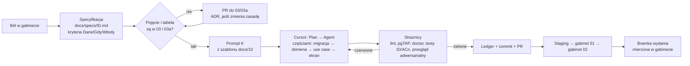

*Rysunek: Cykl funkcji: od bólu w gabinecie do wydania (`podrecznik/rysunki/cykl-funkcji.mmd`, SVG obok).*

## 13.1 Jak dodać funkcję (od bólu w gabinecie do wydania)

1. **Ból → specyfikacja.** Czat w projekcie Claude z szablonem z `docs/10`, 3.1: problem, rozwiązanie w skrócie, historie, kryteria akceptacji w formie „Dane / Gdy / Wtedy”, dane (tabele z `03a`), uprawnienia (`docs/03`, 8), zdarzenia, prawo, UI, poza zakresem, otwarte pytania. Plik `docs/specs/<ID>.md`, wiersz w `docs/13`, pole „Wydanie”.
2. **Słownik i schemat najpierw.** Jeśli funkcja potrzebuje pojęcia, którego nie ma w `docs/03`, albo tabeli spoza `03a`: najpierw PR do dokumentacji (w tym samym dniu), potem kod. Model nie ma prawa wymyślać tabel.
3. **Prompt.** Czat w projekcie generuje prompt z szablonu `docs/10`, 3.2 na podstawie specyfikacji; prompt trafia do pliku fazy w `prompts/` (żeby ledger miał do czego się odwołać) jako kolejny `K`.
4. **Realizacja** częściami: migracja + RLS + pgTAP → domena + testy → przypadki użycia + testy integracyjne → ekran + e2e. Rytuał z rozdziału 10.3.
5. **Metryka?** Jeśli funkcja ma liczbę na pulpicie: 7.8.
6. **Wydanie.** Funkcja wchodzi do gabinetu z wydaniem, po bramce poprzedniego; `CHANGELOG.md`, instrukcja 1 strona, szkolenie.

## 13.2 Jak dodać tabelę lub kolumnę

1. Wpis w `docs/03a` (sekcja modułu) z komentarzem `rls:/append_only:/retention:` i w `docs/03` (słownik, niezmienniki).
2. Schemat Drizzle w `packages/db/src/schema/<moduł>.ts` z helperami `tenantColumns()`, `rls.*()`, `tableComment()`; `pnpm db:generate` → migracja; migracje na `main` nie są edytowane.
3. Zmiany niszczące tylko expand → migrate → contract z etykietą `destructive-migration`.
4. Test pgTAP izolacji tenantów i gabinetów (`supabase/tests/<tabela>.sql`); trigger audytu.
5. `pnpm db:test && pnpm doctor` (reguły `db.*`).

## 13.3 Jak dodać ekran

1. `pnpm gen screen <route>`: strona w `(app)`, komponent w `features/`, test e2e szkieletowy, teksty i18n.
2. Wyłącznie komponenty z `packages/ui` i tokeny; nowy komponent najpierw w `packages/ui` ze stroną w Storybooku.
3. Stany: ładowanie bez migania, pusto (krótki tekst + jedno działanie, rycina tylko w pustych stanach), błąd (co zrobić), brak uprawnień.
4. Klawiatura, 44 px na iPadzie, tryb ciemny, 768 px.
5. Lista kontrolna z `docs/14`, sekcja 11, i zrzuty w PR.

## 13.4 Jak dodać metrykę

Rozdział 7.8: `pnpm gen metric <id>` → definicja, SQL, `forma`, `goodDirection`, drążenie → `golden/expected.json` policzone niezależnie → wiersz w `docs/11` → kafel przez konfigurację.

## 13.5 Jak dodać gabinet, fotel, osobę (bez kodu)

- **Gabinet:** Ustawienia → Organizacja → nowy gabinet (numer `03`, nazwa, adres, kod resortowy, kolor z puli), fotele, godziny otwarcia; `scheduling.occupancy_mode = manual`; konta i członkostwa. Od tej chwili obłożenie i pulpity działają dla 03. Zero kodu (`docs/01`, sekcja 15).
- **Fotel:** Ustawienia → Organizacja → gabinet → fotele (nazwa, kolejność, wyposażenie). Pojemność liczy się od następnego odświeżenia.
- **Osoba:** Ustawienia → Personel → Zaproś (dane, tytuł, NPWZ, członkostwa z rolami); hasło jednorazowe przekazane osobiście; MFA przy pierwszym logowaniu.
- **Odejście:** Dezaktywuj (kończy członkostwa, wylogowuje, zostawia historię). Procedura `docs/ops/odejscie-pracownika.md`.

## 13.6 Jak zmienić zasadę (ADR)

1. Nowa decyzja na końcu `docs/02` według szablonu: status, kontekst, decyzja, konsekwencje, alternatywy, „wracamy, gdy”.
2. Stara decyzja nie jest kasowana: status „zastąpiona przez ADR-0XX” albo „uzupełniona przez”.
3. W tym samym PR: `AGENTS.md` i `.cursor/rules/*`, `pnpm doctor --update-lock` (reguły mają sumy kontrolne; zmiana bez locka jest ostrzeżeniem).
4. Jeśli decyzja zmienia schemat lub słownik: `03`, `03a` w tym samym PR; jeśli zmienia plan: `07` i podręcznik (`build.py`).

## 13.7 Jak wrócić (gdy coś poszło nie tak)

| Sytuacja | Procedura |
|---|---|
| wdrożenie zepsuło produkcję | Vercel: rollback do poprzedniego deploya (sekundy); worker: poprzedni obraz; baza: jeśli migracja była expand-only, nic nie robić; jeśli nie: PITR do minuty sprzed wdrożenia (`docs/ops/kopie-i-odtwarzanie.md`) i protokół w audycie |
| zły wpis w danych | nie kasujemy: unieważnienie z powodem (wpis), ponowne otwarcie dnia z powodem, korekta konfiguracji z audytem |
| prompt poszedł w złą stronę | odrzuć plan albo diff w czacie; nie poprawiaj ręcznie „po cichu”; zapisz w ledgerze, co odrzucono i dlaczego; jeśli to błąd dokumentacji, najpierw ADR |
| test czerwony „bez powodu” | nie osłabiaj testu; jeśli test jest zły, opisz dlaczego i poproś o decyzję (AGENTS, „Nigdy”) |
| `doctor` czerwony | poprawiasz kod, reguła zostaje; wyjątek tylko przez `tools/doctor/allowlist.json` z uzasadnieniem |
| utrata zaufania do liczby na pulpicie | drążenie: lista rekordów z sumą kontrolną; porównanie z `golden/verify.sql` na stagingu; jeśli definicja jest zła: zmiana w rejestrze + `docs/11` + nowy `since` |

## 13.8 Procedury operacyjne (`docs/ops/`, powstają w K16)

| Dokument | Kiedy | Właściciel |
|---|---|---|
| `incydent-bezpieczenstwa.md` | podejrzenie wycieku, utrata urządzenia, nietypowy dostęp; 72 h na ocenę zgłoszenia do UODO | zarząd |
| `korekta-wpisu.md` | każda korekta po zamknięciu dnia (1.0), wpisu klinicznego (3.0) | kierownik |
| `kopie-i-odtwarzanie.md` | kopie nocne, PITR, test odtworzenia co kwartał, RPO ≤ 5 min, RTO ≤ 4 h | Miłosz |
| `nowy-pracownik.md`, `odejscie-pracownika.md` | konta, członkostwa, MFA, tokeny, dostęp do dokumentów | kierownik + zarząd |
| `wdrozenie-produkcyjne.md` | okno po 20:00, lista kontrolna z 12.4 | Miłosz |
| `supabase-konfiguracja.md` | lista kontrolna projektu stagingowego i produkcyjnego | Miłosz |
| `zaleznosci-przeglad.md` | przegląd zależności i licencji co kwartał | Miłosz |

## 13.9 Rytm, który utrzymuje system w zdrowiu

- codziennie w pierwszych 2 tygodniach wydania: `days_closed_rate`, `dead` w outboxie, Sentry;
- co tydzień: przegląd ledgera, otwarte pytania z `docs/09`-stanu prac, backlog 1.1;
- co miesiąc: cele per gabinet, przegląd uprawnień (kto ma `network.view`), `pnpm audit`;
- co kwartał: test odtworzenia kopii, przegląd prawny (`docs/04` ma datę i właściciela), przegląd zależności, „bus factor”;
- przy każdym wydaniu: retrospektywa z recepcją, aktualizacja podręcznika (`build.py`), changelog.


# 14 · Słownik, skróty i mapa plików

## 14.1 Pojęcia 1.0 (PL ↔ EN)

| Po polsku | W kodzie | Znaczenie |
|---|---|---|
| podmiot leczniczy | `tenant` | administrator danych; właściciel bazy pacjentów (od 1.1) |
| gabinet | `location` | `01 Nowodworska`, `02 Białowieska`; numer i kolor danych są stałe |
| fotel | `chair` | zasób, na którym odbywa się praca; ma wyposażenie i kolejność |
| godziny otwarcia, wyjątek | `opening_hours`, `opening_exceptions` | tygodniowy wzorzec i dni szczególne |
| personel, członkostwo | `staff_member`, `membership` | osoba z kontem; przypisanie do gabinetu z rolą i okresem |
| wykonawca | `provider` | lekarz dentysta albo higienistka wykonujący świadczenie; filtr `wykonawca` |
| uprawnienie | `permission` | czynność jako dana, np. `occupancy.write` |
| wpis obłożenia | `chair_occupancy` / `OccupancyEntry` | godzina pracy fotela: wykonawca, kategoria, kwota; bez pacjenta |
| blokada czasu | `time_block` | fotel niedostępny (serwis, zamknięcie, szkolenie); od 1.1 także wykonawca |
| zamknięcie dnia | `occupancy_day_closure` | potwierdzenie kompletności wpisów dnia w gabinecie |
| tryb obłożenia | `occupancy_mode` | `manual` (1.0) albo `appointments` (po przejściu na terminarz) |
| kategoria usługi, kolornik | `service_category` Z1…Z+ | Z1 przegląd i plan, Z2 higienizacja, Z3 wypełnienia, Z4 leczenie kanałowe, Z5 korony i licówki, Z+ ortodoncja nakładkowa |
| pojemność fotela | `fact_chair_capacity` | minuty otwarcia minus blokady, per fotel i dzień |
| obłożenie | `chair_utilization` | minuty wpisów ÷ dostępne minuty |
| rejestr metryk | `metricRegistry` | definicje metryk jako kod z testem i drążeniem |
| drążenie | `drilldown` | lista rekordów, z których powstała liczba |
| zestaw wzorcowy | `golden` | deterministyczne dane testowe z oczekiwanymi wartościami metryk |
| outbox | `platform.outbox` | zdarzenia do wysłania zapisane w transakcji komendy |
| aktor, claims | `Actor`, `request.jwt.claims` | kto wykonuje operację: osoba, tenant, gabinety, rola, uprawnienia |
| wydanie | `release` | numerowana wersja wdrożona w gabinetach, z nazwą rośliny |
| bramka | — | mierzalny warunek zamknięcia wydania, sprawdzany w gabinecie |
| strażnik | — | automat, który łamie się głośno: lint, pgTAP, `crux-doctor`, dependency-cruiser |

Zakazane synonimy (strażnik `code.vocabulary`): `visit`, `clinic`, `branch`, `customer`, `client`, `doctor` (jako rola), `bill`, `slot` (jako encja).

## 14.2 Skróty

| Skrót | Znaczenie |
|---|---|
| `1.0`, `1.1`, `2.0`… | wydania Crux: Krasnodrzew, Ratania, Pięciornik, Cynamonowiec, potem 3.0, 4.0, 5.0 |
| „P1” w rozmowie | pierwsza wersja Crux = wydanie 1.0; w dokumentach „P1” = Platforma P1 (e-zdrowie, CeZ) |
| `F0`…`F6` | fazy: zakres funkcjonalny, porządek specyfikacji i promptów |
| `F0-010` | specyfikacja; `AC5` jej kryterium; `[F0-010/AC5]` w teście |
| `K01`…`K17` | prompty dla Cursora w obrębie fazy; części = commity |
| `E0.7`, `M0`…`M6` | epik w roadmapie, kamienie milowe |
| ADR-0XX | decyzja architektoniczna w `docs/02` |
| RLS | row level security: polityki w bazie per wiersz |
| MFA, TOTP | drugi składnik logowania: kod z aplikacji |
| PITR | odtworzenie bazy do dowolnej minuty |
| DPIA, DPA | ocena skutków dla ochrony danych; umowa powierzenia |
| EDM, CeZ | elektroniczna dokumentacja medyczna; Centrum e-Zdrowia |
| pgTAP | testy w bazie (izolacja tenantów i gabinetów) |
| `doctor` | `crux-doctor`, zestaw reguł sprawdzanych w CI |

## 14.3 Mapa plików folderu `crux`

| Plik | Po co | Kiedy czytać |
|---|---|---|
| `README.md` | mapa folderu, słownik skrótów, start dla nowego czatu | na początku |
| `AGENTS.md` | twarde zasady dla każdego agenta AI | zawsze; Cursor czyta automatycznie |
| `docs/00-wizja-i-zasady.md` | po co, zasady, czego nie robimy, miary sukcesu, miary 1.0 | start każdego dużego tematu |
| `docs/01-architektura.md` | stos, moduły, przepływy, sieć jako jeden organizm, środowiska, koszty, NFR | przed każdą nową funkcją |
| `docs/02-decyzje-architektoniczne.md` | ADR-001…033 | gdy chcesz coś zmienić w stosie lub wzorcu |
| `docs/03-model-domeny.md` | słownik, agregaty (w tym ChairOccupancy), niezmienniki, kolornik, FHIR, macierz ról (sekcja 8) | przed zmianą w bazie i uprawnieniach |
| `docs/03a-schemat-bazy.md` | tabele na poziomie DDL (5.1 obłożenie, 12.1 analityka 1.0), wzorce RLS, retencja | przy każdej migracji |
| `docs/04-prawo-i-bezpieczenstwo.md` | RODO, dokumentacja, EDM, Platforma P1, KSeF, MDR, EHDS, Supabase; 5a: co zmienia 1.0 | przed wszystkim, co dotyka danych |
| `docs/05-integracje.md` | Platforma P1 (bramka Medfile), SMS, ZnanyLekarz, Optima, fiskalna, import | od 1.1 |
| `docs/06-design-system.md` | tokeny z pakietu marki, znak Crux, komponenty, anatomia kafla i karty, model kuleczkowy, ton, rozbieżności z `14` | przed każdym ekranem |
| `docs/07-roadmapa.md` | tory, wydania z bramkami, fazy, epiki, 1.0 tydzień po tygodniu, ryzyka | planowanie |
| `docs/08-analiza-rynku.md` | IQ Dental, Prodentis, Estomed, FELG, Medfile; Dentrix/Jarvis, CareStack, Curve, Open Dental; Romexis, 3Shape | decyzje produktowe |
| `docs/09-konwencje-kodu.md` | struktura repo, nazewnictwo, wzorce, testy, strażnicy, zależności | przy każdym PR |
| `docs/10-praca-z-ai.md` | cykl funkcji, szablony promptów, Cursor, sygnały ostrzegawcze, ledger | przy każdym prompcie |
| `docs/11-dashboardy-i-raporty.md` | pulpity, filtry, rejestr metryk, formy, metryki i pulpity 1.0 (4.7, 5.7), drążenie | przed każdą metryką |
| `docs/12-obrazowanie-dicom.md` | Romexis, Orthanc, DICOMweb, worklist, agent, MDR | 4.0 |
| `docs/13-backlog-specyfikacji.md` | lista specyfikacji ze statusem i wydaniem | planowanie, śledzenie |
| `docs/14-guideline-aplikacji.md` | zasady marki dla wszystkich aplikacji sieci, lista kontrolna PR | przed każdym ekranem, razem z `06` |
| `docs/specs/` | specyfikacje; 1.0: F0-010, F0-011 | przed implementacją |
| `prompts/F0-fundament.md` | prompty 1.0 (K01–K17) | przy implementacji 1.0 |
| `prompts/F1…F5` | prompty kolejnych wydań | później |
| `prompts/ledger.md` | pamięć projektu: co zastosowano, co odrzucono, dług | zawsze na starcie czatu |
| `.cursor/rules/` | reguły Cursora | Cursor sam |
| `design/crux-dashboard-prototyp.html` | prototyp układu pulpitu | referencja |
| `manifest/` | manifest dla zespołu (PDF, plansze, makiety, źródła) | do pokazania innym |
| `podrecznik/` | ten podręcznik: rozdziały, rysunki, `build.py`, wyniki | na start i przy każdym kroku |
| `../Materialy marki/`, `../Crux - dla tworcow aplikacji/` | pakiet marki (poza repo) | K08, każda zmiana tokenów |

## 14.4 Jak zbudować ten podręcznik ponownie

```
cd crux
python3 podrecznik/build.py            # PODRECZNIK-CRUX-1.0.md + .html (zawsze), .pdf (gdy jest Chromium/Playwright)
python3 manifest/zrodla/makiety/generuj.py && node manifest/zrodla/render.js all   # makiety, manifest PDF i plansze
```

Rysunki w `podrecznik/rysunki/*.mmd` są renderowane do SVG, jeśli w systemie jest `mmdc` (`npm i -g @mermaid-js/mermaid-cli`); bez niego podręcznik `.md` ma bloki ```mermaid, które Cursor i GitHub renderują same.
